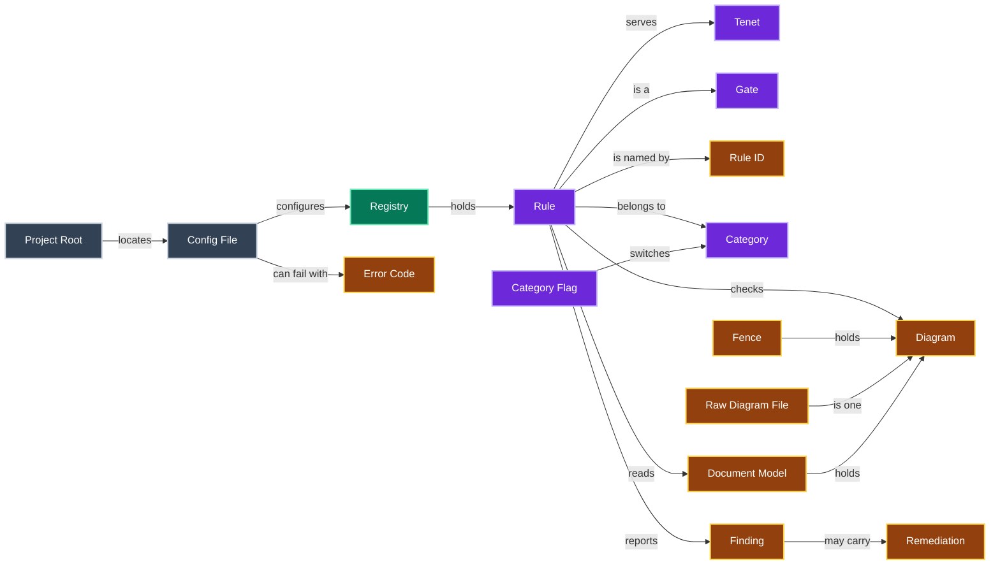
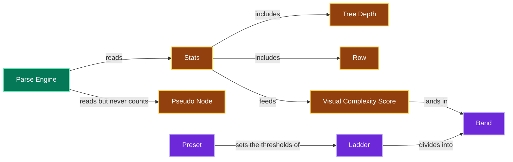
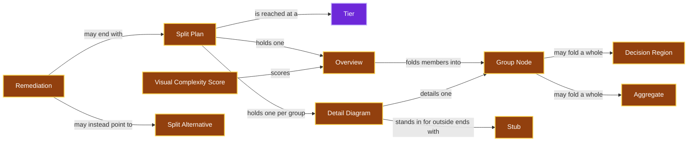
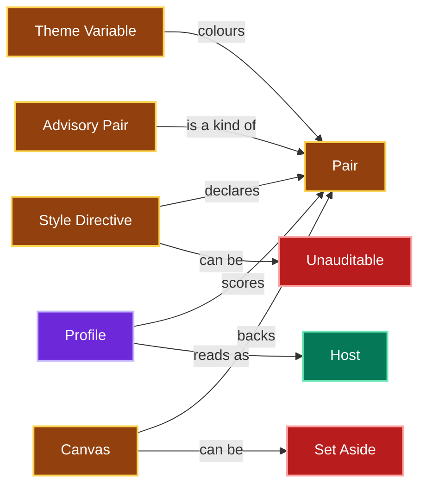
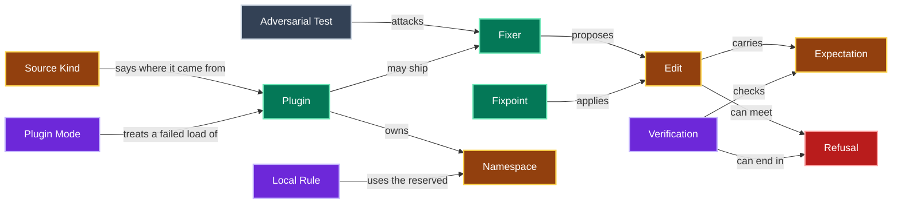
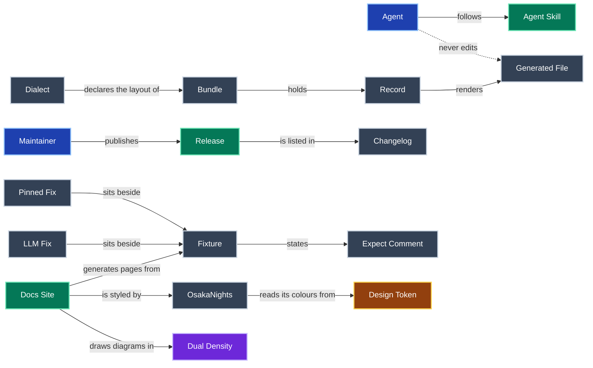

# Glossary

The ubiquitous language for `jpai-mermaidjs-lint`.
Each term is written in Title Case wherever it is used, to mark it as this glossary's meaning rather than the plain-language one.
When a new domain term enters the code or the conversation, add it here in the same change.
Give it its own H2 and a place in the diagram.

One diagram of every term would fail this tool's own complexity gates, so the diagram is split into six, one per area.

Running the gates over a Diagram.

Scoring visual complexity.

Splitting an oversized Diagram.

Scoring contrast.

Fixing, and extending with plugins.

The project around the tool.

## Adversarial Test

A hostile input written to break a Fixer.
It asserts a Refusal or an exact safe output.

## Aggregate

An `erDiagram` entity with every entity it owns, directly or through a chain of owners, named after that root entity.
An entity is owned by its single identifying parent or, as a leaf, by the one entity it depends on.
A Split Plan's `T4` folds the largest Aggregate whose Detail Diagram fits into one Group Node.
An Aggregate whose root is a Lookup Root is named after the member with the most edges crossing its boundary instead.
A Junction is owned by no entity.

## Advisory Pair

A border Pair that never produces a Finding, because a saturated border on a faint fill cannot pass in both themes.
It is any border Pair scored under `mkdocs-material` or in an `erDiagram`.
Under `mkdocs-material` that includes a sequence diagram's lifeline, arrowhead or activation bar.

## Agent

An AI coding assistant working in this repo, such as Claude Code or Codex.
Every Agent is bound by the instructions in [AGENTS.md](AGENTS.md).

## Agent Skill

`skills/mermaidjs-lint/`, the instructions an Agent follows to lint and fix diagrams with this tool, with its eval suite.

## Band

The range between two thresholds of a Ladder, such as above `nodeAcceptable` up to `nodeComplex`.
Each Band has one Rule.

## Bundle

The `adrs/` directory as a whole, including the Records and every Generated File rendered from them.

## Canvas

The page colour in each theme behind everything a Diagram does not box.
Translucent fills, edge label boxes and page-backed sequence pairs are scored on it.
It is GitHub's `#ffffff` and `#0d1117` unless `--canvas-light`, `--canvas-dark` or the `canvas` option sets a side.
It applies under the github Profile only.

## Category

The group a Rule belongs to: parse, complexity or contrast, or a one-word Category a Plugin declares.

## Category Flag

`--category` or `--disable-category`, which switches every Rule in a Category on or off for one run, over the Config File.
In the library it is a `selection`.

## Chain Entry

The member of a chain-like Group Node that no other member leads into, where a reader enters it.
A group is chain-like when, in a flowchart or `stateDiagram`, its members form one directed path, or several disjoint ones for twin chains.
It is named after its Chain Entry, or for twin chains after the entry the flow reaches first, per [MJL-0030](adrs/0030-a-group-is-named-where-a-reader-enters-it.md).
Twin chains whose stages a Lane Label names take it first.

## Changelog

`CHANGELOG.md`, the curated list of user-visible changes per Release.
Its Unreleased section holds what is on main but not yet released.

## Config File

The optional `mermaidjs-lint.config.json` or `.mjs` that switches Rules off and sets their options.

## Decision

A node in a flowchart or `stateDiagram` whose outgoing edges carry two labels or more.
A Split Plan's `T5` and `T6` never fold two targets of its differently labelled branches into one Group Node, unless the branches rejoin inside it.
A decision shape folds only with a whole Decision Region or author region around it.

## Decision Region

The single-entry single-exit region from a branching node to the node where its branches rejoin, its immediate post-dominator.
The branching node is a Decision, a decision shape, a choice, a fork, or any node with a labelled branch.
Every edge into it enters the branching node, and every edge out of it reaches the rejoin node.
A branch that ends the flow is folded inside it.
A Split Plan's `T2` folds it whole, innermost first, into a Group Node named after the branching node.
One hiding a single node is undone when the Overview and every Detail Diagram still meet the target without it.

## Dense Mesh

A graph that joins at least half of all its node pairs, and more pairs than twice its nodes.
Folding it leaves a Dense Mesh, so a Split Plan is refused for one, per [MJL-0030](adrs/0030-a-group-is-named-where-a-reader-enters-it.md).
The reason given is "dense mesh: a matrix or table reads better than a diagram".
The check runs on the Diagram and on each plan's Overview.
The refusal prints the Diagram as a Split Alternative.

## Design Token

One named brand colour in `docs-site/theme/osakanights/design-tokens.json`.
`make theme` writes the theme's CSS colour block from these tokens.

## Detail Diagram

The half of a Split Plan that shows one Group Node's members, with every edge between them.
A Stub stands in for each node outside the group that an edge reaches.
A Detail Diagram still over the target is split once more.

## Diagram

One Mermaid source: a mermaid Fence in a markdown file, or a whole `.mmd` or `.mermaid` file.

## Dialect

This repo's declared documentation conventions, in [docs/CONVENTIONS.md](docs/CONVENTIONS.md).

## Docs Site

The MkDocs Material site under `docs-site/`.
Its reference pages are generated from the Fixtures, `RULES.md` and `examples/`.

## Document Model

What a Rule reads for one file: the source, its kind, the markdown tree and its Diagrams.
`buildDocModel` in `src/model.ts` builds it once per file.

## Dual Density

A diagram drawn twice: a simplified one inline with a one-sentence summary, and a detailed one in a collapsible block beneath it.
The docs and the Docs Site draw their diagrams this way.

## Echoing Region

Author regions drawn from one template.
They are siblings of one shape that hold regions of their own, or the children of echoing regions with one label and shape.
A region's shape is how many nodes it holds of its own, and each child region's label and shape.
A Split Plan's `T3` folds a region and its Echoing Regions in one step, so they read alike, per [MJL-0033](adrs/0033-a-plan-folds-what-the-author-grouped-and-refuses-buckets.md).

## Edit

A proposed change: a start offset, an end offset, replacement text and an Expectation.

## Error Code

The stable kebab-case name of a failure, shown as error[code] and carried on the error class.

## Expect Comment

The line in a Fixture naming the Rule IDs it must report, or none for a clean file.

## Expectation

What an Edit claims about the reparsed document: same-diagrams or same-tree.

## Family Label

A Group Node label naming a whole dotted Prefix Family, as `gold.* (+5)`, counting every member.
The group holds three members or more, each label leading with one namespace and a dot.
No node outside it leads with that namespace, per [MJL-0036](adrs/0036-a-group-is-named-by-its-family-or-lanes-and-a-stub-by-its-group.md).

## Fan Label

A Group Node label naming a group that holds every leaf one overview node leads to, as `Checkout domain → … (+4)`.
It reads `… → ` and the node's name for leaves leading into it, and counts every member.
The name is a kept node's label or the base label a group shows, per [MJL-0038](adrs/0038-twin-chains-fold-whole-and-a-pair-names-both-members.md).

## Fence

The code block that holds a Diagram in markdown.
It is unterminated when it never closes.
Its closing fence is the line that would close it: the opening fence after the quote markers and indentation before it, as micromark reads them.

## Finding

One reported violation, with a file, a line range, a Rule ID, a message and optionally a Remediation.

## Fixer

The optional fix function of a Rule.
It proposes Edits and never writes files itself.

## Fixpoint

The engine's loop of applying verified Edits in a fixed Rule order until nothing changes.

## Folded Parallel

An Overview edge beside another between the same two overview nodes, at least one a Group Node, that stands for edges between other ends.
The original draws one relationship there, so a reader would count two.
An Aggregate folds only where it adds no Folded Parallel, per [MJL-0034](adrs/0034-a-refusal-prints-its-list-or-table-and-folds-stay-tight.md).
Edges the original itself draws side by side between two nodes are not one.

## Fixture

One `.md`, `.mmd` or `.mermaid` file under `tests/fixtures` or `examples/` that the test suite runs as a case.

## Gate

A check that fails the run, with exit 1, while any Finding remains.
Every Rule is a Gate, and `make docs-ci` runs the Gates over this repo's markdown.

## Generated File

A file rendered from a source by a regenerate command, and never edited by hand.
In `adrs/` that is everything rendered from the Records, as [AGENTS.md](AGENTS.md) lists.

## Group Node

One node of an Overview that stands for a set of the original nodes, folded together.
Its label is an author label or a member's, with the count of the rest, such as `ingest (+5)`.
A chain-like group takes its Chain Entry's label.
Another group from `T5` or `T6` takes the label of the member with the most edges crossing its boundary.
Any other group takes its best-connected member's label.
A long label is shown cut in the middle with an ellipsis, and no Group Node shows a label another node shows.
It is drawn apart from an original node.
A flowchart draws it as a subroutine, a `stateDiagram` or `erDiagram` with a thick dashed border, and a `classDiagram` with a `<<group>>` annotation.

## Host

Where a Diagram is drawn for a reader, such as GitHub or a MkDocs Material site.
The Host may choose the label colour.

## Hub

A node of degree at least four and at least the 90th percentile degree of its Diagram.
A Split Plan's `T5` and `T6` keep it as its own node in the Overview, unless the target cannot be met otherwise.

## Id Family

The Prefix Family of a diagram whose every label leads with an id naming one, as a ticket graph's `PLAT-1201` and `DATA-0381`.
A Split Plan's `T6` folds each Id Family whole, hubs included, before any pair.
One whose detail does not fit folds in even contiguous runs, per [MJL-0033](adrs/0033-a-plan-folds-what-the-author-grouped-and-refuses-buckets.md).
A family's group is never undone, and once one family folds only families fold.

## Junction

An `erDiagram` entity identified by entities in two Aggregates or more, such as a table joining two others.
A Split Plan folds it into neither side: it stays in the Overview or folds with neither.

## Keyword

The word a Diagram's type is declared with, such as `flowchart` or `erDiagram`, for the type mermaid's own detection gives it.
A type declared two ways has one keyword, so `graph` is `flowchart`.

## Ladder

The ordered thresholds of one measure.
A Diagram lands in one Band, so one Rule of the Ladder fires.

## Lane Label

A Group Node label naming twin chains by their stages, as `Extract → bronze (+8)`, counting every member.
Each place along the chains is named by the namespace every label there leads with.
Failing that, it is the first word they all lead with, and failing that an ellipsis.
At least one place is named, per [MJL-0036](adrs/0036-a-group-is-named-by-its-family-or-lanes-and-a-stub-by-its-group.md).
Two first words, as `Extract` and `Ingest`, name a place joined by a slash, per [MJL-0038](adrs/0038-twin-chains-fold-whole-and-a-pair-names-both-members.md).

## LLM Fix

A `<name>.llm.<ext>` sibling of a Fixture, or an `llm` block in `RULES.md`.
It holds the judgement fix an LLM proposed for Findings that `--fix` leaves.
It states its reason in an `llm:` comment and must lint clean.

## Local Rule

A Plugin Rule that is one file in `.mermaidjs-lint/rules`, under the reserved Namespace local.

## Lookup Root

An Aggregate's root every edge of which joins one other member, as a `LANGUAGE` table hangs from `FILM`.
Its name says nothing of the Aggregate, so the Aggregate is named after the member with the most edges crossing its boundary.

## Maintainer

The owner of this repo, and the audience of the runbooks in `docs/`.
The Maintainer cuts each Release by the steps in [docs/PUBLISHING.md](docs/PUBLISHING.md).

## Namespace

The word before the slash in a Plugin Rule ID, such as acme in acme/parse-no-todo.
A core Rule ID has none.

## OsakaNights

The Docs Site's theme, in `docs-site/theme/osakanights/`, which another MkDocs Material site can adopt.
Its colours come from Design Tokens.

## Overview

The half of a Split Plan that keeps the whole Diagram's shape, with each group of nodes folded into one Group Node.
It is scored against the target like any Diagram.

## Pair

A foreground and a background scored together.
Text is `fill` and `color`, a border is `fill` and `stroke`, and an edge label is a `linkStyle` `color` and the label box.
Host text is the Host's forced label colour and `fill`.
A sequence Pair is a Theme Variable and the box or page it is drawn on.

## Pair Label

A Group Node label naming both members of a group of two, as `ROOM (+BUILDING)`, the other member's label in place of the count.
A stub for either member shows its own label alone, per [MJL-0038](adrs/0038-twin-chains-fold-whole-and-a-pair-names-both-members.md).
It is not a Pair, which is a colour pairing.

## Parse Engine

The code that reads a Diagram's structure from mermaid's own parsers.

## Pipeline Stage

The stage of a data pipeline a node names.
It is a Prefix Family read from a dotted prefix such as `bronze.` or an id prefix such as `br_`.
Its nodes may fold into one suggested group though no edge joins them, when they share a neighbour.

## Prefix Family

The family of names a node's label or id belongs to.
It is a dotted prefix leading the node's label, such as `bronze.`.
Failing that, it is the letters leading a label that leads with an id, such as `PLAT-` in `PLAT-1201`.
Failing that, it is letters and an underscore leading its id, such as `br_`.
Failing that, it is the node's Status Family.
Under the strict rules, no `T5` or `T6` group holds two Prefix Families, per [MJL-0031](adrs/0031-a-plan-keeps-groups-even-and-names-each-stub-once.md).
In `T6`, a pair within one family goes before any other, joined by an edge or by a neighbour they share, per [MJL-0032](adrs/0032-a-stage-folds-across-lanes-and-a-stub-draws-each-edge-once.md).
With hubs folded, families stay apart before they are mixed, and a chain stage keeps to one family.
A pair sharing more overview neighbours goes first, per [MJL-0034](adrs/0034-a-refusal-prints-its-list-or-table-and-folds-stay-tight.md).

## Pinned Fix

A `<name>.fixed.<ext>` sibling of a Fixture holding the exact output of `--fix`.

## Pinned State

A state that a start or end marker inside a composite state reaches.
A Split Plan folds it only with that whole composite, so the transition is drawn inside the box it belongs to.

## Plugin

A module that adds Rules to a run, with a name, a Namespace, a contract version and optional Categories.

## Plugin Mode

How a Plugin that fails to load is treated: off, strict, lenient or collect.
Strict is the default.

## Preset

A named set of density thresholds: low-density, medium-density or high-density.

## Profile

How contrast is read.
The github Profile scores declared Pairs, mkdocs-material scores the Host's forced text, and auto picks one from the file's folder.

## Project Root

The nearest ancestor of the working directory with a `package.json`, a Config File or a `.mermaidjs-lint` directory.
It is the working directory when none has one.

## Pseudo Node

An element the Parse Engine's graph keeps but the Stats never count: a `stateDiagram` start or end marker, or a `classDiagram` lollipop interface.
It is drawn, so the graph keeps it, apart from the nodes, under `pseudo`.

## Qualified Label

A region's label followed by the label of the region around it in brackets, as `Public subnets (us-east-1)`.
A Group Node takes it when another group is named after a region of the same label.
It sits in that region in the Overview and counts every member, per [MJL-0033](adrs/0033-a-plan-folds-what-the-author-grouped-and-refuses-buckets.md).

## Range Label

A Group Node label made of its first and last member labels in natural order, joined by a spaced ellipsis.
A count of the rest follows, such as `DATA-0381 … DATA-0383 (+1)`.
A Split Plan offers it for twins, sibling leaves and members whose labels all lead with an id.
It is refused when a member of another group has a label from the first to the last, per [MJL-0029](adrs/0029-runs-meshes-and-terminals-read-as-they-are.md).

## Raw Diagram File

A `.mmd` or `.mermaid` file, read as one Diagram with no markdown around it.
Its document kind is `diagram`, and its markdown tree is empty.

## Record

One decision, authored as YAML in `adrs/`.
Its markdown is a Generated File and never edited.

## Refusal

A Fixer or the verifier declining an Edit.
The source is untouched and the Finding stays.

## Registry

The Rules a run uses: the built-ins plus loaded Plugins, with the Config File applied.

## Release

One version published to npm by the Publish workflow, with a matching tag and GitHub release.

## Remediation

The optional next step a Rule attaches to a Finding, shown in `--json` output.

## Row

A line of text inside a node: an `erDiagram` entity's attribute, or a `classDiagram` class's attribute or method.
It weighs on the Visual Complexity Score, but it is not a node.

## Row Diagram

A diagram of a Split Plan that draws the Rows of nodes its Overview keeps, since an Overview draws no Rows.
A Detail Diagram draws its members' Rows itself, when it still meets the target with them.

## Rule

One deterministic check with a Rule ID, and optionally a Fixer.

## Rule ID

The name of a Rule, written category-short-name, such as contrast-text-below-aa.

## Set Aside

What happens to a config Canvas on a file that `auto` scores under mkdocs-material.
The file is scored without it, one stderr line names the file, and the `--json` object lists it under `canvasSetAside`.
A canvas flag on such a file is refused instead, per [MJL-0019](adrs/0019-a-material-file-sets-a-config-canvas-aside.md).

## Shared Terminal

A flowchart or `stateDiagram` node that at least three other nodes lead into and that ends the flow.
It leads nowhere, or everything it leads to leads nowhere.
A `Notify on-call` step every failure ends at is one, and so is a `Cancelled` state that leads only to the final `Refunded` and `Voided`.
A Split Plan's `T5` and `T6` keep it as its own node in the Overview, unless only the loose rules meet the target.

## Source Kind

Where a Plugin came from, shown in `--list-rules` and `--json`.
It is local for a file in `.mermaidjs-lint/rules`, and package for a declared `mermaidjs-lint-plugin-*` dependency.
It is config for an entry in the Config File's `plugins` list.

## Split Alternative

What a refused Split Plan prints in its place when its reason says a list or table reads better, per [MJL-0034](adrs/0034-a-refusal-prints-its-list-or-table-and-folds-stay-tight.md).
A Star prints as a markdown list of its hub and every leaf, by way, label and connector.
A Dense Mesh prints as a markdown adjacency matrix, with a line naming the pairs no edge joins.
Both are built from the parsed graph alone and draw every node and edge.
`--split-plan` prints it after the reason, and the Remediation points to it.

## Split Plan

A recommendation for a Diagram over a node count or score threshold: one Overview and one Detail Diagram per Group Node.
It is offered only when a contract parses the emitted text and finds every node and edge kept.
It ends the Remediation, and `--split-plan` prints it, but nothing applies it, per [MJL-0025](adrs/0025-a-fold-is-offered-as-a-split.md).

## Star

A Split Plan whose every group is a run of one hub's sibling leaves of one twin class, named only by a Range Label.
Its groups hold more than half the Diagram.
Nothing the author drew sorts the leaves, so the plan is refused, per [MJL-0033](adrs/0033-a-plan-folds-what-the-author-grouped-and-refuses-buckets.md).
The reason given is "a star of leaves around one node, which no label, shape or neighbour sorts: a list reads better".
The refusal prints the Diagram as a Split Alternative.

## Stats

The nodes, edges, Rows, subgraphs, subgraph nesting depth and Tree Depth the Parse Engine reads from a Diagram.

## Stub

A node in a Detail Diagram that stands for a node, subgraph or interface outside its group.
An edge in from another group starts at one Stub for that whole group.
Edges of one kind one way between that Stub and one member are drawn once, with only the label they share, per [MJL-0033](adrs/0033-a-plan-folds-what-the-author-grouped-and-refuses-buckets.md).
When edges join two groups both ways, one detail draws the other group as one Stub, and the other draws Stubs for its members.
The detail split again draws the members when the other's detail fits, per [MJL-0035](adrs/0035-a-region-folds-whole-and-a-nested-detail-names-members.md).
Edges running one way from a single member into several members of another group come in from one Stub for that member, per [MJL-0036](adrs/0036-a-group-is-named-by-its-family-or-lanes-and-a-stub-by-its-group.md).
It is drawn dashed, so the reader sees where an edge leaves the group.
Its label is the node's label.
For a node inside a group, it adds the label the Overview shows for that group in brackets after "in".
An example is `PAYMENT_METHOD (in CUSTOMER (+2))`, per [MJL-0036](adrs/0036-a-group-is-named-by-its-family-or-lanes-and-a-stub-by-its-group.md).
Its text must have exactly one reading.
When the text could name anything else, it adds the node's id in brackets, as often as it takes.
The target of edges joining two groups one way may draw Stubs for the source's members.
It does so when it needs fewer, or as many and meets fewer outside nodes, per [MJL-0037](adrs/0037-stubs-for-one-group-share-a-box-and-the-lighter-detail-draws-exactly.md).

## Stub Box

A subgraph in a flowchart Detail Diagram holding its Stubs for two or more members of one other group.
It shows the label the Overview shows for that group, and each Stub inside it shows its member's own label, per [MJL-0037](adrs/0037-stubs-for-one-group-share-a-box-and-the-lighter-detail-draws-exactly.md).
For a group folding one author region whole, it stands for that region, so an edge to the region meets it.
For any other group, it stands for the group and draws no edge.
A detail draws one only while it still meets the target.

## Status Family

The workflow stage a label leading with a bare id names, such as `10008 Ready for Release`.
It is the one stem a word after the id shares with another such label, as `releas` with `10009 Released`.
A label sharing no stem, or two, names none, per [MJL-0032](adrs/0032-a-stage-folds-across-lanes-and-a-stub-draws-each-edge-once.md).

## Style Directive

One styled class, node or edge, read from mermaid's parsed DB.
It is a `classDef`, a node a `style` statement styles, or an edge a `linkStyle` styles.
A node's directive includes what it inherits from its classes.

## Tangled Overview

An `erDiagram` Overview whose independent cycles, edges less nodes plus one, number at least a quarter of its nodes.
Once the target is met, even by dropping rows alone, it folds Aggregates evenly, down to 60% of `nodeTarget`, per [MJL-0033](adrs/0033-a-plan-folds-what-the-author-grouped-and-refuses-buckets.md).
Each fold takes away an overview edge per entity it hides and adds no new reachable pair, per [MJL-0034](adrs/0034-a-refusal-prints-its-list-or-table-and-folds-stay-tight.md).

## Tenet

One of the four things the tool exists for, worded once in `docs-site/includes/tenets.md`.
Three are guarantees about every Diagram: always readable in light mode or dark mode, it actually renders a valid diagram, and Visual Complexity stays readable.
The fourth is a commitment about the tool: make your own rules.
See [MJL-0015](adrs/0015-four-tenets-define-the-tool.md).

## Theme Variable

A colour Mermaid's theme supplies, such as `signalTextColor`.
It is set in frontmatter or an `%%{init}%%` directive, or derived by the theme.
A `sequenceDiagram` is coloured by Theme Variables alone.

## Tier

One step of how a Split Plan groups nodes, from `T1`, which only drops Rows and duplicate edges, to `T6`.
The Tiers run least lossy first, and a plan names the last Tier that changed it.

## Tight Clique

A set of nodes that all share an edge with each other, found as a maximal clique.
When the Overview joins at least half of all node pairs during a walk, a Split Plan's `T6` folds Tight Cliques into Group Nodes.
A Diagram that is a Dense Mesh from the start is refused instead.

## Trimmed Aggregate

An Aggregate without each owned part sharing an outside neighbour with the rest, as an address chain without the `STORE` it locates.
`T4` offers it when the whole Aggregate would add a Folded Parallel, and only where it adds no new reachable pair, per [MJL-0034](adrs/0034-a-refusal-prints-its-list-or-table-and-folds-stay-tight.md).

## Twin Chains

Disjoint paths of one length, two members or more, each joining the same nodes before and after.
Extracts each feeding the bronze table it lands in are twin chains.
They fold whole, never cut into runs, their detail split again into one group per lane when it does not fit, per [MJL-0038](adrs/0038-twin-chains-fold-whole-and-a-pair-names-both-members.md).

## Tree Depth

How far a tree-shaped Diagram (`mindmap`, `treemap`, `treeView` or `ishikawa`) reaches below its root.
It weighs on the Visual Complexity Score, but it is not subgraph nesting.

## Unauditable

A directive the Profile requires to be scoreable but cannot be, such as a `fill` with no `color`.
A sequence diagram config the tool does not model, such as `themeCSS`, is Unauditable too.

## Verification

The reparse after an Edit that decides whether the Edit is kept.
It checks only what the Edit's Expectation lists, in `src/fix/verify.ts`, and anything it cannot prove ends in a Refusal.

## Visual Complexity Score

Nodes plus half a point per edge, a quarter per Row and three per subgraph.
It is scaled by one tenth per level of subgraph nesting or Tree Depth, whichever is deeper.
Written VCS in Finding messages.
