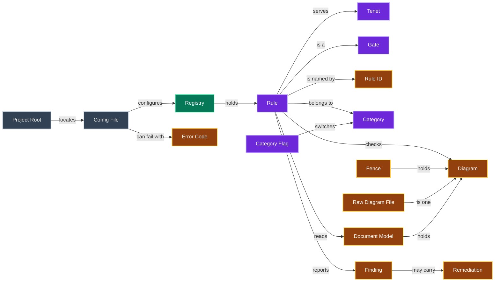
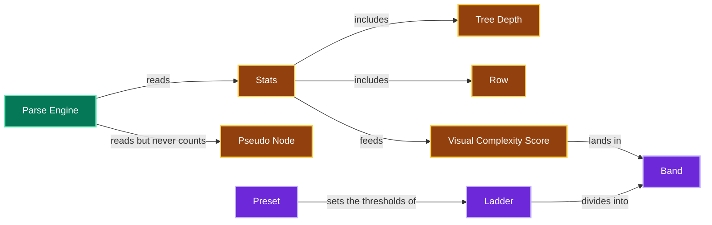
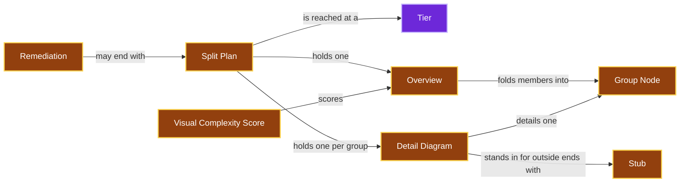
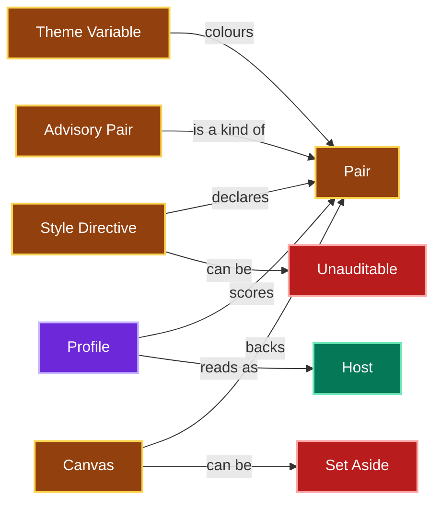
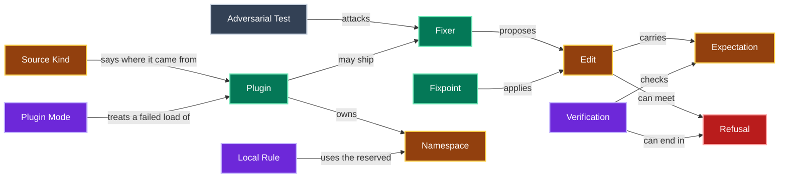
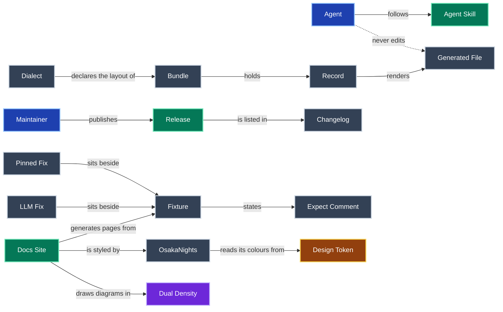

# Glossary

The ubiquitous language for `jpai-mermaidjs-lint`.
Each term is written in Title Case wherever it is used, to mark it as this glossary's meaning rather than the plain-language one.
When a new domain term enters the code or the conversation, add it here in the same change.
Give it its own H2 and a place in the diagram.

One diagram of every term would fail this tool's own complexity gates, so the diagram is split into six, one per area.

Running the gates over a Diagram.

Scoring visual complexity.

Splitting an oversized Diagram.

Scoring contrast.

Fixing, and extending with plugins.

The project around the tool.

## Adversarial Test

A hostile input written to break a Fixer.
It asserts a Refusal or an exact safe output.

## Advisory Pair

A border Pair that never produces a Finding, because a saturated border on a faint fill cannot pass in both themes.
It is any border Pair scored under `mkdocs-material` or in an `erDiagram`.
Under `mkdocs-material` that includes a sequence diagram's lifeline, arrowhead or activation bar.

## Agent

An AI coding assistant working in this repo, such as Claude Code or Codex.
Every Agent is bound by the instructions in [AGENTS.md](AGENTS.md).

## Agent Skill

`skills/mermaidjs-lint/`, the instructions an Agent follows to lint and fix diagrams with this tool, with its eval suite.

## Band

The range between two thresholds of a Ladder, such as above `nodeAcceptable` up to `nodeComplex`.
Each Band has one Rule.

## Bundle

The `adrs/` directory as a whole, including the Records and every Generated File rendered from them.

## Canvas

The page colour in each theme behind everything a Diagram does not box.
Translucent fills, edge label boxes and page-backed sequence pairs are scored on it.
It is GitHub's `#ffffff` and `#0d1117` unless `--canvas-light`, `--canvas-dark` or the `canvas` option sets a side.
It applies under the github Profile only.

## Category

The group a Rule belongs to: parse, complexity or contrast, or a one-word Category a Plugin declares.

## Category Flag

`--category` or `--disable-category`, which switches every Rule in a Category on or off for one run, over the Config File.
In the library it is a `selection`.

## Changelog

`CHANGELOG.md`, the curated list of user-visible changes per Release.
Its Unreleased section holds what is on main but not yet released.

## Config File

The optional `mermaidjs-lint.config.json` or `.mjs` that switches Rules off and sets their options.

## Design Token

One named brand colour in `docs-site/theme/osakanights/design-tokens.json`.
`make theme` writes the theme's CSS colour block from these tokens.

## Detail Diagram

The half of a Split Plan that shows one Group Node's members, with every edge between them.
A Stub stands in for each node outside the group that an edge reaches.
A Detail Diagram still over the target is split once more.

## Diagram

One Mermaid source: a mermaid Fence in a markdown file, or a whole `.mmd` or `.mermaid` file.

## Dialect

This repo's declared documentation conventions, in [docs/CONVENTIONS.md](docs/CONVENTIONS.md).

## Docs Site

The MkDocs Material site under `docs-site/`.
Its reference pages are generated from the Fixtures, `RULES.md` and `examples/`.

## Document Model

What a Rule reads for one file: the source, its kind, the markdown tree and its Diagrams.
`buildDocModel` in `src/model.ts` builds it once per file.

## Dual Density

A diagram drawn twice: a simplified one inline with a one-sentence summary, and a detailed one in a collapsible block beneath it.
The docs and the Docs Site draw their diagrams this way.

## Edit

A proposed change: a start offset, an end offset, replacement text and an Expectation.

## Error Code

The stable kebab-case name of a failure, shown as error[code] and carried on the error class.

## Expect Comment

The line in a Fixture naming the Rule IDs it must report, or none for a clean file.

## Expectation

What an Edit claims about the reparsed document: same-diagrams or same-tree.

## Fence

The code block that holds a Diagram in markdown.
It is unterminated when it never closes.
Its closing fence is the line that would close it: the opening fence after the quote markers and indentation before it, as micromark reads them.

## Finding

One reported violation, with a file, a line range, a Rule ID, a message and optionally a Remediation.

## Fixer

The optional fix function of a Rule.
It proposes Edits and never writes files itself.

## Fixpoint

The engine's loop of applying verified Edits in a fixed Rule order until nothing changes.

## Fixture

One `.md`, `.mmd` or `.mermaid` file under `tests/fixtures` or `examples/` that the test suite runs as a case.

## Gate

A check that fails the run, with exit 1, while any Finding remains.
Every Rule is a Gate, and `make docs-ci` runs the Gates over this repo's markdown.

## Generated File

A file rendered from a source by a regenerate command, and never edited by hand.
In `adrs/` that is everything rendered from the Records, as [AGENTS.md](AGENTS.md) lists.

## Group Node

One node of an Overview that stands for a set of the original nodes, folded together.
Its label is an author label or its best-connected member's, with the count of the rest, such as `ingest (+5)`.
A long label is shown cut in the middle with an ellipsis, and no Group Node shows a label another node shows.
It is drawn apart from an original node.
A flowchart draws it as a subroutine, a `stateDiagram` or `erDiagram` with a thick dashed border, and a `classDiagram` with a `<<group>>` annotation.

## Host

Where a Diagram is drawn for a reader, such as GitHub or a MkDocs Material site.
The Host may choose the label colour.

## Keyword

The word a Diagram's type is declared with, such as `flowchart` or `erDiagram`, for the type mermaid's own detection gives it.
A type declared two ways has one keyword, so `graph` is `flowchart`.

## Ladder

The ordered thresholds of one measure.
A Diagram lands in one Band, so one Rule of the Ladder fires.

## LLM Fix

A `<name>.llm.<ext>` sibling of a Fixture, or an `llm` block in `RULES.md`.
It holds the judgement fix an LLM proposed for Findings that `--fix` leaves.
It states its reason in an `llm:` comment and must lint clean.

## Local Rule

A Plugin Rule that is one file in `.mermaidjs-lint/rules`, under the reserved Namespace local.

## Maintainer

The owner of this repo, and the audience of the runbooks in `docs/`.
The Maintainer cuts each Release by the steps in [docs/PUBLISHING.md](docs/PUBLISHING.md).

## Namespace

The word before the slash in a Plugin Rule ID, such as acme in acme/parse-no-todo.
A core Rule ID has none.

## OsakaNights

The Docs Site's theme, in `docs-site/theme/osakanights/`, which another MkDocs Material site can adopt.
Its colours come from Design Tokens.

## Overview

The half of a Split Plan that keeps the whole Diagram's shape, with each group of nodes folded into one Group Node.
It is scored against the target like any Diagram.

## Pair

A foreground and a background scored together.
Text is `fill` and `color`, a border is `fill` and `stroke`, and an edge label is a `linkStyle` `color` and the label box.
Host text is the Host's forced label colour and `fill`.
A sequence Pair is a Theme Variable and the box or page it is drawn on.

## Parse Engine

The code that reads a Diagram's structure from mermaid's own parsers.

## Pinned Fix

A `<name>.fixed.<ext>` sibling of a Fixture holding the exact output of `--fix`.

## Pinned State

A state that a start or end marker inside a composite state reaches.
A Split Plan folds it only with that whole composite, so the transition is drawn inside the box it belongs to.

## Plugin

A module that adds Rules to a run, with a name, a Namespace, a contract version and optional Categories.

## Plugin Mode

How a Plugin that fails to load is treated: off, strict, lenient or collect.
Strict is the default.

## Preset

A named set of density thresholds: low-density, medium-density or high-density.

## Profile

How contrast is read.
The github Profile scores declared Pairs, mkdocs-material scores the Host's forced text, and auto picks one from the file's folder.

## Project Root

The nearest ancestor of the working directory with a `package.json`, a Config File or a `.mermaidjs-lint` directory.
It is the working directory when none has one.

## Pseudo Node

An element the Parse Engine's graph keeps but the Stats never count: a `stateDiagram` start or end marker, or a `classDiagram` lollipop interface.
It is drawn, so the graph keeps it, apart from the nodes, under `pseudo`.

## Raw Diagram File

A `.mmd` or `.mermaid` file, read as one Diagram with no markdown around it.
Its document kind is `diagram`, and its markdown tree is empty.

## Record

One decision, authored as YAML in `adrs/`.
Its markdown is a Generated File and never edited.

## Refusal

A Fixer or the verifier declining an Edit.
The source is untouched and the Finding stays.

## Registry

The Rules a run uses: the built-ins plus loaded Plugins, with the Config File applied.

## Release

One version published to npm by the Publish workflow, with a matching tag and GitHub release.

## Remediation

The optional next step a Rule attaches to a Finding, shown in `--json` output.

## Row

A line of text inside a node: an `erDiagram` entity's attribute, or a `classDiagram` class's attribute or method.
It weighs on the Visual Complexity Score, but it is not a node.

## Row Diagram

A diagram of a Split Plan that draws the Rows of nodes its Overview keeps, since an Overview draws no Rows.
A Detail Diagram draws its members' Rows itself, when it still meets the target with them.

## Rule

One deterministic check with a Rule ID, and optionally a Fixer.

## Rule ID

The name of a Rule, written category-short-name, such as contrast-text-below-aa.

## Set Aside

What happens to a config Canvas on a file that `auto` scores under mkdocs-material.
The file is scored without it, one stderr line names the file, and the `--json` object lists it under `canvasSetAside`.
A canvas flag on such a file is refused instead, per [MJL-0019](adrs/0019-a-material-file-sets-a-config-canvas-aside.md).

## Source Kind

Where a Plugin came from, shown in `--list-rules` and `--json`.
It is local for a file in `.mermaidjs-lint/rules`, and package for a declared `mermaidjs-lint-plugin-*` dependency.
It is config for an entry in the Config File's `plugins` list.

## Split Plan

A recommendation for a Diagram over a node count or score threshold: one Overview and one Detail Diagram per Group Node.
It is offered only when a contract parses the emitted text and finds every node and edge kept.
It ends the Remediation, and `--split-plan` prints it, but nothing applies it, per [MJL-0025](adrs/0025-a-fold-is-offered-as-a-split.md).

## Stats

The nodes, edges, Rows, subgraphs, subgraph nesting depth and Tree Depth the Parse Engine reads from a Diagram.

## Stub

A node in a Detail Diagram that stands for a node, subgraph or interface outside its group.
An edge in from another group starts at one Stub for that whole group.
It is drawn dashed, so the reader sees where an edge leaves the group.
Its label is the node's label.
It adds the node's group label when that differs.
Its text must have exactly one reading.
When the text could name anything else, it adds the node's id in brackets, as often as it takes.

## Style Directive

One styled class, node or edge, read from mermaid's parsed DB.
It is a `classDef`, a node a `style` statement styles, or an edge a `linkStyle` styles.
A node's directive includes what it inherits from its classes.

## Tenet

One of the four things the tool exists for, worded once in `docs-site/includes/tenets.md`.
Three are guarantees about every Diagram: always readable in light mode or dark mode, it actually renders a valid diagram, and Visual Complexity stays readable.
The fourth is a commitment about the tool: make your own rules.
See [MJL-0015](adrs/0015-four-tenets-define-the-tool.md).

## Theme Variable

A colour Mermaid's theme supplies, such as `signalTextColor`.
It is set in frontmatter or an `%%{init}%%` directive, or derived by the theme.
A `sequenceDiagram` is coloured by Theme Variables alone.

## Tier

One step of how a Split Plan groups nodes, from `T1`, which only drops Rows and duplicate edges, to `T6`.
The Tiers run least lossy first, and a plan names the last Tier that changed it.

## Tree Depth

How far a tree-shaped Diagram (`mindmap`, `treemap`, `treeView` or `ishikawa`) reaches below its root.
It weighs on the Visual Complexity Score, but it is not subgraph nesting.

## Unauditable

A directive the Profile requires to be scoreable but cannot be, such as a `fill` with no `color`.
A sequence diagram config the tool does not model, such as `themeCSS`, is Unauditable too.

## Verification

The reparse after an Edit that decides whether the Edit is kept.
It checks only what the Edit's Expectation lists, in `src/fix/verify.ts`, and anything it cannot prove ends in a Refusal.

## Visual Complexity Score

Nodes plus half a point per edge, a quarter per Row and three per subgraph.
It is scaled by one tenth per level of subgraph nesting or Tree Depth, whichever is deeper.
Written VCS in Finding messages.
