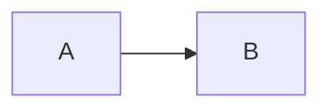
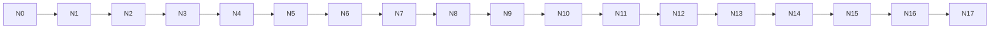
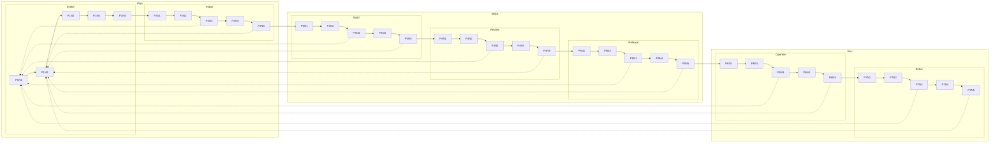
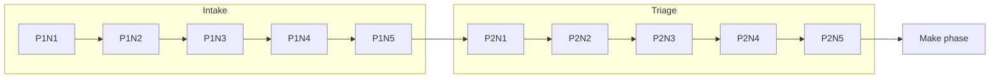
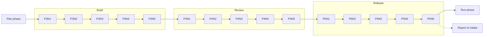
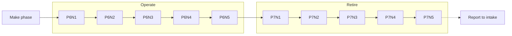
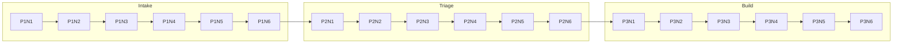
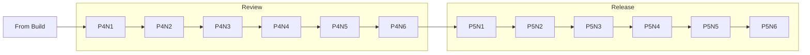

```mermaid
flowchart LR
  N17 --> N18
  N18 --> N19
  N19 --> N20
  N20 --> N21
  N21 --> N22
  N22 --> N23
  N23 --> N24
  N24 --> N25
  N25 --> N26
  N26 --> N27
  N27 --> N28
  N28 --> N29
  N29 --> N30
  N30 --> N31
  N31 --> N32
  N32 --> N33
  N33 --> N34
  N34 --> N35
```

```mermaid
flowchart LR
  subgraph P1[Intake]
    P1N1 --> P1N2 --> P1N3 --> P1N4 --> P1N5 --> P1N6
  end
  subgraph P2[Triage]
    P2N1 --> P2N2 --> P2N3 --> P2N4 --> P2N5 --> P2N6
  end
  subgraph P3[Build]
    P3N1 --> P3N2 --> P3N3 --> P3N4 --> P3N5 --> P3N6
  end
  subgraph P4[Review]
    P4N1 --> P4N2 --> P4N3 --> P4N4 --> P4N5 --> P4N6
  end
  subgraph P5[Release]
    P5N1 --> P5N2 --> P5N3 --> P5N4 --> P5N5 --> P5N6
  end
  P1N6 --> P2N1
  P2N6 --> P3N1
  P3N6 --> P4N1
  P4N6 --> P5N1
```

# The rules

Every rule, grouped by what it guards, with a failing example and what `--fix` does to it.
Each fix example is real output: `tests/rules-doc.test.ts` runs every block below through the fixer and fails when this page drifts from the code.

A block labelled before is followed by its after, which is exactly what `--fix` writes.
A block labelled reported is a case the fixer leaves alone, so the finding stays for a human.
A block labelled llm follows each reported block, and shows the judgement fix an LLM would make, with its reason in a comment.
It must lint clean.
Rules marked with a star in `--help` have a fixer.

## Categories

| Category | Rules | What it guards |
|---|---|---|
| Parse | parse-diagram-unparseable, parse-fence-unterminated | Whether mermaid can read the diagram, and whether its fence is whole |
| Complexity | complexity-node-count-hard-limit, complexity-node-count-cognitive-limit, complexity-node-count-acceptable-exceeded, complexity-visual-score-critical, complexity-visual-score-acceptable-exceeded, complexity-subgraph-nesting-too-deep | How much a reader must hold in mind at once |
| Contrast | contrast-text-below-aa, contrast-border-below-ui-minimum, contrast-directive-unauditable | Whether labels and borders can be read against their fills |

A fence is closed before its colours are rewritten.
An unparseable diagram skips every complexity rule, because thresholds mean nothing against structure the parser never read.

## Parse

### parse-diagram-unparseable

A diagram that mermaid's parser reports an error for, on one line or many, such as `graph TD; A-->; B[[[`.
The message carries the parser's own reason, whose line numbers count within the diagram, not the file.
A diagram whose type mermaid does not detect is reported too, with mermaid's reason.
A diagram the parser reads without an error passes even with no nodes.

Examples are `pie` with a `title` line, `info`, and a `sequenceDiagram` under a frontmatter title.
There is no fixer, since a syntax error needs an author.

````text reported
```mermaid
flowchart LR
  A -->
```
````

````text llm
<!-- llm: The edge had no target, so it now points at a node B, the smallest change that makes the flowchart parse. -->


````

### parse-fence-unterminated

A mermaid fence that is never closed, so every line after it is read as diagram source.
The fix adds the closing fence at the end of the file, using the opening fence's own marker and indentation.
At the top level an unclosed fence runs to the end of the file, so any prose after the diagram ends up inside the fence.
That prose stays diagram source after the fix, and `parse-diagram-unparseable` then reports it for a human to move.

A fence inside a quote or a list item ends with its container.
There the fixer closes it only when nothing follows the container, using the container's prefix.
When content follows, the fixer leaves it alone, because the closing line would be a guess.
A fence opened on the list marker's own line, such as `- ```mermaid`, is left for a human even when nothing follows it.

Only mermaid fences are checked: a diagram after an unclosed fence of another language is read as that fence's code, and is never seen.

````text before
```mermaid
flowchart LR
  A --> B
````

````text after
```mermaid
flowchart LR
  A --> B
```
````

## Complexity

Every complexity rule takes a `preset` option and any of the numeric thresholds, such as `nodeAcceptable`. `complexity-subgraph-nesting-too-deep` accepts them but reads none.
The node count rules form one ladder, and the two visual score rules form another.
A diagram lands in one band of each ladder, so only the most severe rule of a ladder fires.
A threshold such as `nodeHardLimit` is the boundary between two neighbouring bands, so set it on both rules that read it.

Set on one rule alone, it opens a gap or an overlap, and an overlap makes two rules report the same diagram.
A `--preset` flag overrides a rule's configured preset, and a numeric threshold option overrides both.
No complexity rule has a fixer, because splitting a diagram changes what it says.
The examples below are scored under the default preset, `high-density`.

### complexity-node-count-hard-limit

More nodes than the preset's hard limit.
The limit is 100 under `high-density`, and the message names existing subgraph boundaries to split along.

````text reported

````

````text llm
<!-- llm: A 101-step chain has no subgraphs to split along, so it splits into three diagrams of at most 35 nodes, each starting where the last ends. -->


````

A chain this long also scores above the complex threshold, so `complexity-visual-score-critical` fires beside it.

### complexity-node-count-cognitive-limit

More nodes than a reader can follow.
Under `high-density` the limit is 50 nodes, following [Huang et al. 2020](https://arxiv.org/abs/2008.07944) on where a network diagram becomes hard to read.
It fires above the cognitive limit and up to the hard limit.

````text reported

````

````text llm
<!-- llm: A 60-step chain splits at node N30 into two diagrams of 31 and 30 nodes, and the second starts where the first ends. -->


````

The chain also scores above the readable threshold, so `complexity-visual-score-acceptable-exceeded` fires beside it.

### complexity-node-count-acceptable-exceeded

More nodes than the preset's readable threshold, up to the cognitive limit.
Under `high-density` that is more than 35 nodes, so this chain of 36 fires it.

````text reported

````

````text llm
<!-- llm: A 36-step chain reads as two stages, so it splits at the midpoint into two diagrams of 18 nodes, and the second starts where the first ends. -->




````

### complexity-visual-score-critical

A visual complexity score above the preset's complex threshold, `vcsComplex`, which is 100 under `high-density`.
The score is nodes plus half a point per edge plus three per subgraph.
It is scaled by one tenth per level of subgraph nesting or tree depth, whichever is deeper.
The `vcsCritical` option is accepted but no rule reads it.
This diagram has only 35 nodes, but its ten subgraphs, two levels of nesting and report-back edges score above 100.

````text reported

````

````text llm
<!-- llm: The seven stages fall into three phases, so each phase becomes its own diagram, and the twelve report-back edges become one per diagram. -->






````

### complexity-visual-score-acceptable-exceeded

A visual complexity score above the preset's readable threshold, up to `vcsComplex`.

This diagram has only 30 nodes, but its five subgraphs and their edges score above 60 under `high-density`.

````text reported

````

````text llm
<!-- llm: The five stages split after Build into two diagrams, and the second opens with a node that stands for the first. -->




````

### complexity-subgraph-nesting-too-deep

Subgraphs nested three or more levels deep.
The limit is fixed at three, and no preset, flag or option changes it.
Only real subgraphs count, such as a flowchart `subgraph` or a composite state.
The depth of a `mindmap`, `treemap`, `treeView` or `ishikawa` never fires it.
Flatten the nesting, or promote a deep group into its own diagram.

````text reported
```mermaid
flowchart LR
  subgraph L1[Level one]
    subgraph L2[Level two]
      subgraph L3[Level three]
        A --> B
      end
    end
  end
```
````

````text llm
<!-- llm: The third level held a single edge, so it merges into the second and the diagram keeps two levels of nesting. -->

```mermaid
flowchart LR
  subgraph L1[Level one]
    subgraph L2[Levels two and three]
      A --> B
    end
  end
```
````

## Contrast

Contrast is read through a profile.
Under `github` the declared pairs are scored as written, and a translucent fill is composited over both page canvases.
The canvases are GitHub's unless a run sets its own, as [A host with its own page sets a canvas](https://jpeakai.github.io/jpai-mermaidjs-lint/concepts/contrast/#a-host-with-its-own-page-sets-a-canvas) explains.
Under `mkdocs-material` the host forces the label text, so `color:` is ignored and the host text is scored in both themes. `auto` reads `mkdocs-material` when any parent folder holds `mkdocs.yml` or `mkdocs.yaml`.

A `sequenceDiagram` is scored by the theme colours Mermaid resolves for it, in both themes, as [Contrast profiles](https://jpeakai.github.io/jpai-mermaidjs-lint/concepts/contrast/#a-sequence-diagram-is-scored-by-its-theme-colours) explains.

### contrast-text-below-aa

Label text below 4.5 to 1 against its fill.
The fix swaps a declared `color:` for black or white, whichever reads better.
It does so only when that clears 4.5 to 1 on every background the directive is scored against.

````text before
```mermaid
flowchart LR
  A --> B
  classDef warn fill:#ffff00,color:#fefefe
  class A warn
```
````

````text after
```mermaid
flowchart LR
  A --> B
  classDef warn fill:#ffff00,color:#000000
  class A warn
```
````

In an `erDiagram`, a class is scored against every row background the entity draws, in both themes.
When neither black nor white clears 4.5 to 1 on all of them, the finding stays for a human.

````text reported
```mermaid
erDiagram
  CAR ||--o{ WHEEL : has
  classDef c fill:#ffffff,color:#ffffff
  class CAR c
```
````

````text llm
<!-- llm: An entity draws rows on light and dark backgrounds, and no one label colour reads on all of them, so the class marks the entity with a border and leaves the rows to the theme. -->

```mermaid
erDiagram
  CAR ||--o{ WHEEL : has
  classDef c stroke:#1d4ed8,stroke-width:2px
  class CAR c
```
````

Under `github`, a `linkStyle` `color:` is scored on Mermaid's edge label box, `#e8e8e8` in light and `#585858` in dark.
No one colour clears 4.5 to 1 on both, so the finding stays for a human.

````text reported
```mermaid
flowchart LR
  A -- label --> B
  linkStyle 0 color:#ffffff,stroke:#2563eb
```
````

````text llm
<!-- llm: An edge label sits on a light box in one theme and a grey box in the other, and no one colour reads on both, so the linkStyle keeps its stroke and leaves the label text to the theme. -->

```mermaid
flowchart LR
  A -- label --> B
  linkStyle 0 stroke:#2563eb
```
````

In a `sequenceDiagram`, message text has no box, so it sits on the page in both themes.
A fixed colour that reads on a white page fades on a dark one.
The colour is a theme variable with no fill to pair, so the finding stays for a human.

````text reported
```mermaid
%%{init: {"themeVariables": {"signalTextColor": "#475569"}}}%%
sequenceDiagram
  A->>B: Request
```
````

````text llm
<!-- llm: Message text sits on the page, so it keeps the theme's own colour, which flips with the reader, and the init directive goes. -->

```mermaid
sequenceDiagram
  A->>B: Request
```
````

A fill with no declared `color:` is reported by `contrast-directive-unauditable` instead, because choosing a colour is a design decision.

### contrast-border-below-ui-minimum

A border below 3 to 1 against its fill, the WCAG rule for a UI component.
Under the `mkdocs-material` profile, and in an `erDiagram` under any profile, the pair is scored but is not a finding.
A saturated hue cannot clear 3 to 1 in both themes, and the label and tint also carry the category.
There is no fixer.

````text reported
```mermaid
flowchart LR
  A --> B
  classDef c fill:#ffffff,color:#000000,stroke:#fefefe
  class A c
```
````

````text llm
<!-- llm: The near-white stroke vanished on the white fill, so it becomes a mid grey that clears 3 to 1 against the fill. -->

```mermaid
flowchart LR
  A --> B
  classDef c fill:#ffffff,color:#000000,stroke:#5f6368
  class A c
```
````

### contrast-directive-unauditable

A style directive whose contrast cannot be audited.
Under `github` that is a `fill:` with no `color:` beside it, or a colour that does not parse.
In a `sequenceDiagram` it is also a `themeCSS` setting, or a theme the tool does not model.
Reporting it as a skip would let a gate exit clean on a diagram it never checked.

````text reported
```mermaid
flowchart LR
  A --> B
  classDef c fill:#123456
  class A c
```
````

````text llm
<!-- llm: The dark navy fill needs light text, so the class declares white, which reads at well over 4.5 to 1. -->

```mermaid
flowchart LR
  A --> B
  classDef c fill:#123456,color:#ffffff
  class A c
```
````
