# The rules

Every rule, grouped by what it guards, with a failing example and what `--fix` does to it.
Each fix example is real output: `tests/rules-doc.test.ts` runs every block below through the fixer and fails when this page drifts from the code.

A block labelled before is followed by its after, which is exactly what `--fix` writes.
A block labelled reported is a case the fixer leaves alone, so the finding stays for a human.
A block labelled llm follows each reported block, and shows the judgment fix an LLM would make, with its reason in a comment.
It must lint clean.
Rules marked with a star in `--help` have a fixer.

## Categories

| Category | Rules | What it guards |
|---|---|---|
| Parse | parse-diagram-unparseable, parse-fence-unterminated | Whether mermaid can read the diagram, and whether its fence is whole |
| Complexity | complexity-node-count-hard-limit, complexity-node-count-cognitive-limit, complexity-node-count-acceptable-exceeded, complexity-visual-score-critical, complexity-visual-score-acceptable-exceeded, complexity-subgraph-nesting-too-deep | How much a reader must hold in mind at once |
| Contrast | contrast-text-below-aa, contrast-border-below-ui-minimum, contrast-directive-unauditable | Whether labels and borders can be read against their fills |

A fence is closed before its colours are rewritten.
An unparseable diagram skips every complexity rule, because thresholds mean nothing against structure the parser never read.

## Parse

### parse-diagram-unparseable

A multi-line diagram that mermaid's parser reads as zero nodes.
The message carries the parser's own reason.
A one-line diagram may legitimately have no nodes, such as `info` or `pie title Pets`.
So on one line it fails only when the parser itself reports an error, as for `graph TD; A-->; B[[[`.
There is no fixer, since a syntax error needs an author.

````text reported
```mermaid
flowchart LR
  A -->
```
````

````text llm
<!-- llm: The edge had no target, so it now points at a node B, the smallest change that makes the flowchart parse. -->

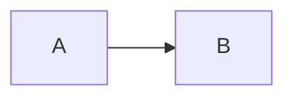
````

### parse-fence-unterminated

A mermaid fence that is never closed, so every line after it is read as diagram source.
The fix adds the closing fence, using the opening fence's own marker and indentation.
It does so only when nothing but whitespace follows the diagram.

````text before
```mermaid
flowchart LR
  A --> B
````

````text after
```mermaid
flowchart LR
  A --> B
```
````

## Complexity

Every complexity rule takes a `preset` option and any of the numeric thresholds, such as `nodeAcceptable`.
A diagram lands in one band of each ladder, so only the most severe rule of a ladder fires.
No complexity rule has a fixer, because splitting a diagram changes what it says.

### complexity-node-count-hard-limit

More nodes than the preset's hard limit.
The limit is 100 under `high-density`, and the message names existing subgraph boundaries to split along.

### complexity-node-count-cognitive-limit

More nodes than a reader can follow.
Under `high-density` the limit is 50 nodes, following [Huang et al. 2020](https://arxiv.org/abs/2008.07944) on where a network diagram becomes hard to read.
It fires above the cognitive limit and up to the hard limit.

### complexity-node-count-acceptable-exceeded

More nodes than the preset's readable threshold, up to the cognitive limit.
Under `high-density` that is more than 35 nodes, so this chain of 36 fires it.

````text reported

````

````text llm
<!-- llm: A 36-step chain reads as two stages, so it splits at the midpoint into two diagrams of 18 nodes, and the second starts where the first ends. -->

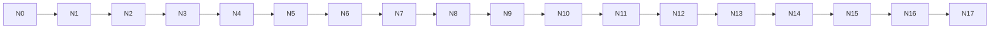

```mermaid
flowchart LR
  N17 --> N18
  N18 --> N19
  N19 --> N20
  N20 --> N21
  N21 --> N22
  N22 --> N23
  N23 --> N24
  N24 --> N25
  N25 --> N26
  N26 --> N27
  N27 --> N28
  N28 --> N29
  N29 --> N30
  N30 --> N31
  N31 --> N32
  N32 --> N33
  N33 --> N34
  N34 --> N35
```
````

### complexity-visual-score-critical

A visual complexity score above the preset's `vcsComplex` threshold, which is 100 under `high-density`.
The score is nodes plus half a point per edge plus three per subgraph, scaled by one tenth per level of nesting.
The `vcsCritical` option is accepted but not read by this rule.

### complexity-visual-score-acceptable-exceeded

A visual complexity score above the preset's readable threshold, up to `vcsComplex`.

### complexity-subgraph-nesting-too-deep

Subgraphs nested three or more levels deep.
Flatten the nesting, or promote a deep group into its own diagram.

````text reported
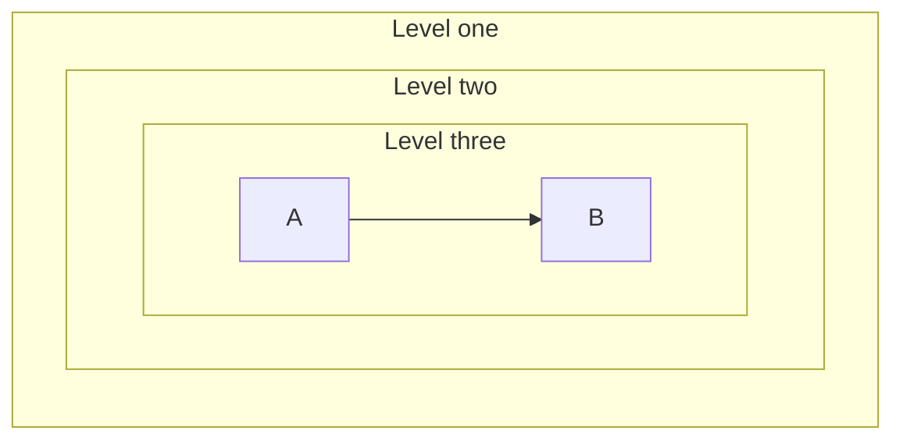
````

````text llm
<!-- llm: The third level held a single edge, so it merges into the second and the diagram keeps two levels of nesting. -->

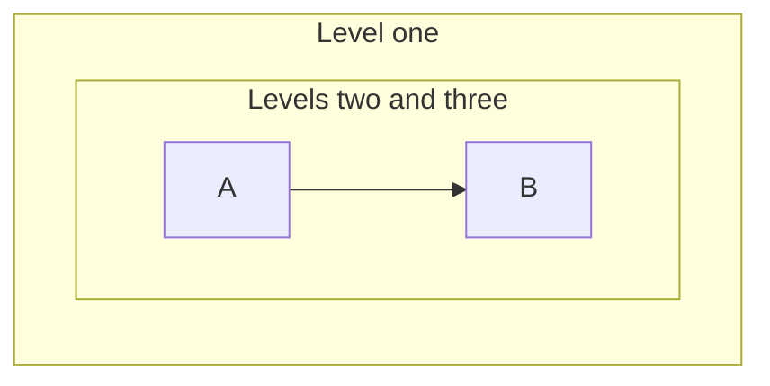
````

## Contrast

Contrast is read through a profile.
Under `github` the declared pairs are scored as written, and a translucent fill is composited over both GitHub canvases.
Under `mkdocs-material` the host forces the label text, so `color:` is ignored and the host text is scored in both themes.
`auto` reads `mkdocs-material` when any parent folder holds `mkdocs.yml` or `mkdocs.yaml`.

### contrast-text-below-aa

Label text below 4.5 to 1 against its fill.
The fix swaps a declared `color:` for black or white, whichever reads better.
It does so only when that clears 4.5 to 1 on every background the directive is scored against.

````text before
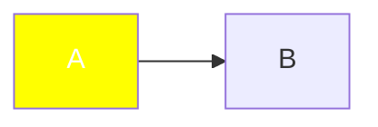
````

````text after
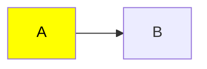
````

In an `erDiagram`, a class is scored against every row background the entity draws, in both themes.
When neither black nor white clears 4.5 to 1 on all of them, the finding stays for a human.

````text reported
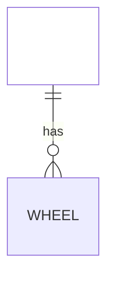
````

````text llm
<!-- llm: An entity draws rows on light and dark backgrounds, and no one label colour reads on all of them, so the class marks the entity with a border and leaves the rows to the theme. -->

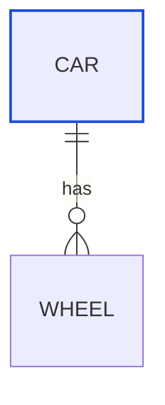
````

Under `github`, a `linkStyle` `color:` is scored on Mermaid's edge label box, `#e8e8e8` in light and `#585858` in dark.
No one colour clears 4.5 to 1 on both, so the finding stays for a human.

````text reported
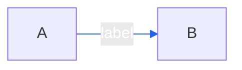
````

````text llm
<!-- llm: An edge label sits on a light box in one theme and a grey box in the other, and no one colour reads on both, so the linkStyle keeps its stroke and leaves the label text to the theme. -->

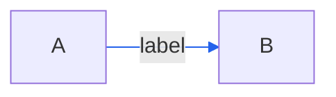
````

A fill with no declared `color:` is reported by `contrast-directive-unauditable` instead, because choosing a colour is a design decision.

### contrast-border-below-ui-minimum

A border below 3 to 1 against its fill, the WCAG rule for a UI component.
Under a host profile and in an `erDiagram` the pair is not a finding.
A saturated hue cannot clear 3 to 1 in both themes, and the label and tint also carry the category.
There is no fixer.

````text reported
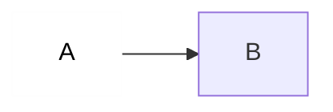
````

````text llm
<!-- llm: The near-white stroke vanished on the white fill, so it becomes a mid grey that clears 3 to 1 against the fill. -->

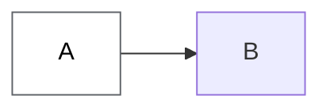
````

### contrast-directive-unauditable

A style directive whose contrast cannot be audited.
Under `github` that is a `fill:` with no `color:` beside it, or a colour that does not parse.
Reporting it as a skip would let a gate exit clean on a diagram it never checked.

````text reported

````

````text llm
<!-- llm: The dark navy fill needs light text, so the class declares white, which reads at well over 4.5 to 1. -->


````
