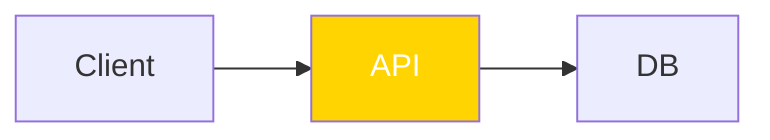
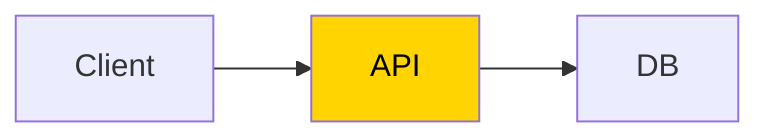
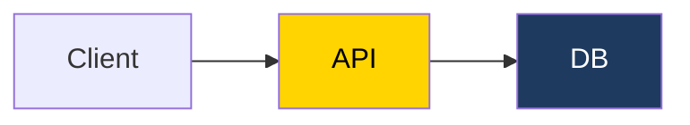

# Get started

In this tutorial you lint a diagram, fix one finding automatically, fix another by hand, and add the check to your project.
It takes about five minutes.

**Before you begin:** you need [Bun](https://bun.sh), or Node 20 or newer with npm.

## 1. Make a project

Start in a new, empty folder that is not inside another project, and give it a `package.json`:

=== "Bun"

    ```sh
    mkdir diagram-tutorial
    cd diagram-tutorial
    bun init -y
    ```

=== "npm"

    ```sh
    mkdir diagram-tutorial
    cd diagram-tutorial
    npm init -y
    ```

The new `package.json` matters.
Without one, npm walks up to the nearest parent folder holding a `package.json`, and installs into that project instead.

To add the check to a project you already have, run step 2 from that project's root and skip this step.

## 2. Install

=== "Bun"

    ```sh
    bun add --dev @jpeakai/mermaidjs-lint
    ```

=== "npm"

    ```sh
    npm install --save-dev @jpeakai/mermaidjs-lint
    ```

The install gives the project a `mermaidjs-lint` command, which `bunx` and `npx` find in `node_modules`.
Outside a project that installed it, use the full name, as in `bunx @jpeakai/mermaidjs-lint`.
The short name alone would fetch whatever package is published under it.

## 3. Lint a diagram

Create `docs/architecture.md` with a diagram whose highlighted node has white text on yellow:

````markdown
# Architecture


````

This is how GitHub draws it, and the API label all but disappears:


Run the linter over the folder:

=== "Bun"

    ```sh
    bunx mermaidjs-lint docs/
    ```

=== "npm"

    ```sh
    npx mermaidjs-lint docs/
    ```

You should see one finding, and the command exits 1:

```text
docs/architecture.md:6 contrast-text-below-aa classDef warn: text 1.43:1 < 4.5 (#ffffff on #ffd400)
1 finding(s) in 1 file(s)
```

The line gives the file and line, the rule, then what failed.
Here the label reaches 1.43 to 1 against its fill, and readable text needs 4.5 to 1.

## 4. Fix it automatically

=== "Bun"

    ```sh
    bunx mermaidjs-lint --fix docs/
    ```

=== "npm"

    ```sh
    npx mermaidjs-lint --fix docs/
    ```

```text
0 finding(s) in 1 file(s)
```

The file now declares black text, which reads on yellow:

```text
classDef warn fill:#ffd400,color:#000000
```

<div class="grid ml-compare" markdown>

<div markdown>

<p class="ml-caption ml-caption--before">Before: white on yellow, 1.43 to 1</p>


</div>

<div markdown>

<p class="ml-caption ml-caption--after">After --fix: black on yellow</p>



</div>

</div>

## 5. Fix one by hand

Give the database its own colour, with a fill but no label colour.
The file now reads:

````markdown
# Architecture


````

Mermaid's default label is dark grey, so on GitHub the new label sinks into the navy:


A host with its own theme may draw that label in another colour, so the linter cannot score it until the diagram declares one.
Run with `--fix` again:

```text
docs/architecture.md:7 contrast-directive-unauditable store: unaudited, no color: declared beside fill:, and the github profile requires one (if the host forces label text, use the mkdocs-material profile)
1 finding(s) in 1 file(s)
```

This finding stays, because choosing a label colour is a design decision.
Declare one beside the fill:

```text
  classDef store fill:#1e3a5f,color:#ffffff
```

<div class="grid ml-compare" markdown>

<div markdown>

<p class="ml-caption ml-caption--before">Before: no label colour declared</p>


</div>

<div markdown>

<p class="ml-caption ml-caption--after">After: white on navy, declared</p>



</div>

</div>

Run again, and it is clean:

```text
0 finding(s) in 1 file(s)
```

## 6. Add it to your project

Add a script to `package.json`, so everyone runs the same check:

```json
{
  "scripts": {
    "lint:diagrams": "mermaidjs-lint docs/"
  }
}
```

Run it:

=== "Bun"

    ```sh
    bun run lint:diagrams
    ```

=== "npm"

    ```sh
    npm run lint:diagrams
    ```

```text
0 finding(s) in 1 file(s)
```

In your own project, list the files and folders that hold your diagrams, such as `mermaidjs-lint README.md docs/`.
Every path you name must exist, or the run stops with `error[flag]: cannot read` and exits 2.

You now have a diagram gate that fails on any finding and fixes what it safely can.

## Next steps

- [Gate diagrams in CI](guides/ci.md), so a pull request cannot merge an unreadable diagram.
- [Check diagrams before each commit](guides/pre-commit.md), so a finding never reaches a pull request.
- [Configure the rules](guides/configure.md), to switch a rule off or change the complexity preset.
- [Lint a MkDocs Material site](guides/mkdocs.md), where the theme forces the label colour.
