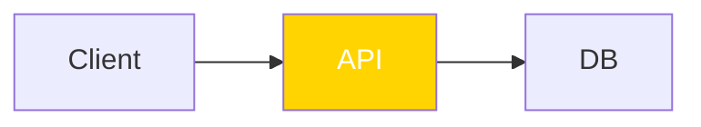

# Get started

In this tutorial you lint a diagram, fix one finding automatically, fix another by hand, and add the check to your project.
It takes about five minutes.

**Before you begin:** you need a project with a `package.json`, and [Bun](https://bun.sh) or Node 20 or newer.

## 1. Install

```sh
bun add --dev @jpeakai/mermaidjs-lint
```

## 2. Lint a diagram

Create `docs/architecture.md` with a diagram whose highlighted node has white text on yellow:

````markdown
# Architecture


````

Run the linter over the folder:

```sh
bunx mermaidjs-lint docs/
```

You should see one finding, and the command exits 1:

```text
docs/architecture.md:6 contrast-text-below-aa classDef warn: text 1.43:1 < 4.5 (#ffffff on #ffd400)
1 finding(s) in 1 file(s)
```

The line gives the file and line, the rule, then what failed.
Here the label reaches 1.43 to 1 against its fill, and readable text needs 4.5 to 1.

## 3. Fix it automatically

```sh
bunx mermaidjs-lint --fix docs/
```

```text
0 finding(s) in 1 file(s)
```

The file now declares black text, which reads on yellow:

```text
classDef warn fill:#ffd400,color:#000000
```

## 4. Fix one by hand

Give the database its own colour, with a fill but no label colour:

```text
  classDef store fill:#1e3a5f
  class DB store
```

Run with `--fix` again:

```text
docs/architecture.md:7 contrast-directive-unauditable store: unaudited, no color: declared beside fill:, and the github profile requires one (if the host forces label text, use the mkdocs-material profile)
1 finding(s) in 1 file(s)
```

This finding stays, because choosing a label colour is a design decision.
Declare one beside the fill:

```text
  classDef store fill:#1e3a5f,color:#ffffff
```

Run again, and it is clean:

```text
0 finding(s) in 1 file(s)
```

## 5. Add it to your project

Add a script to `package.json`, so everyone runs the same check:

```json
{
  "scripts": {
    "lint:diagrams": "mermaidjs-lint README.md docs/"
  }
}
```

You now have a diagram gate that fails on any finding and fixes what it safely can.

## Next steps

- [Gate diagrams in CI](guides/ci.md), so a pull request cannot merge an unreadable diagram.
- [Configure the rules](guides/configure.md), to switch a rule off or change the complexity preset.
- [Lint a MkDocs Material site](guides/mkdocs.md), where the theme forces the label colour.
