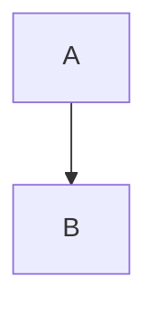

# Write a local rule

Add a rule for one project as a single file, with no package to publish.
This guide builds a rule that reports a `TODO` left in a diagram.

## Create the rule file

Create `.mermaidjs-lint/rules/parse-no-todo.mjs` at the project root:

```js
export default {
  category: "parse",
  summary: "a TODO left in a diagram",
  check: ({ doc }) =>
    doc.diagrams
      .filter((d) => d.source.includes("TODO"))
      .map((d) => ({ line: d.startLine, endLine: d.endLine, message: "TODO left in a diagram" })),
};
```

The file name is the rule key, and it must start with the rule's category, as `category-short-name`.
The rule loads on its own, with the id `local/parse-no-todo`.

## Run it

Given a diagram with a TODO comment:

````markdown

````

```sh
bunx mermaidjs-lint docs/
```

```text
mermaidjs-lint: loaded local (1 rule)
docs/flow.md:3-7 local/parse-no-todo TODO left in a diagram
1 finding(s) in 1 file(s)
```

## Test it

The `testing` entry point runs one rule over a string, with the same contract checks and fix engine as a real run:

```ts
import { expect, test } from "bun:test";
import { checkRule, localPlugin } from "@jpeakai/mermaidjs-lint/testing";
import * as mod from "../.mermaidjs-lint/rules/parse-no-todo.mjs";

const plugin = localPlugin("parse-no-todo", mod);

test("reports a TODO in a diagram", async () => {
  const src = "```mermaid\nflowchart LR\n  %% TODO\n  A --> B\n```\n";
  const findings = await checkRule(plugin, "parse-no-todo", src);
  expect(findings.map((f) => f.rule)).toEqual(["local/parse-no-todo"]);
});
```

## Go further

- **Add a fixer** by returning edits from a `fix` function. Each edit must declare what stays the same, and the engine refuses any edit that breaks it. See [Plugin API](../reference/plugin-api.md#edits).
- **Use a new category** by exporting `categories` from the file, as `export const categories = { house: "Our house style" }`, and naming the file `house-<name>.mjs`.
- **Write it in TypeScript** as `.ts` or `.mts`. That needs Bun or Node 22.18 or newer, and anything else fails with a message saying so.
- **Check every rule loads** with `bunx mermaidjs-lint --validate-plugins`.
