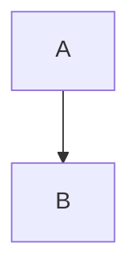

# Write a local rule

Add a rule for one project as a single file, with no package to publish.
This guide builds a rule that reports a `TODO` left in a diagram.

**Before you begin:** the package is a dev dependency, as in [Get started](../get-started.md).
The short command `mermaidjs-lint` below works only then.

## Create the rule file

Create `.mermaidjs-lint/rules/house-no-todo.mjs` at the project root:

```js
export const categories = { house: "Our house style" };

export default {
  category: "house",
  summary: "a TODO left in a diagram",
  check: ({ doc }) =>
    doc.diagrams
      .filter((d) => d.source.includes("TODO"))
      .map((d) => ({ line: d.startLine, endLine: d.endLine, message: "TODO left in a diagram" })),
};
```

The file name is the rule key, and it must start with the rule's category, as `category-short-name`.
Each key comes from exactly one file, so two files such as `house-x.js` and `house-x.mjs` fail the load with `error[plugin-contract]`, naming both.
The `categories` export declares `house` as a new category, because a TODO is a house-style choice.
Keep the built-in categories, `parse`, `complexity` and `contrast`, for what those words mean.
The rule loads on its own, with the id `local/house-no-todo`.
The `.mjs` extension makes the file an ES module in any project, as [Choose the file extension](#choose-the-file-extension) explains.

## Run it

Create `docs/flow.md` holding a diagram with a TODO comment:

````markdown

````

```sh
bunx mermaidjs-lint docs/flow.md
```

```text
mermaidjs-lint: loaded local (1 rule)
docs/flow.md:1-5 local/house-no-todo TODO left in a diagram
1 finding(s) in 1 file(s)
```

## Test it

The `testing` entry point runs one rule over a string, with the same contract checks and fix engine as a real run.
It skips three load checks: the reserved `local` namespace, conflicts between plugins, and two rule files with one name.
Run `--validate-plugins` to catch those.

=== "Bun"

    Create `tests/house-no-todo.test.ts`:

    ```ts
    import { expect, test } from "bun:test";
    import { checkRule, localPlugin } from "@jpeakai/mermaidjs-lint/testing";
    import * as mod from "../.mermaidjs-lint/rules/house-no-todo.mjs";

    const plugin = localPlugin("house-no-todo", mod);

    test("reports a TODO in a diagram", async () => {
      const src = "```mermaid\nflowchart LR\n  %% TODO\n  A --> B\n```\n";
      const findings = await checkRule(plugin, "house-no-todo", src);
      expect(findings.map((f) => f.rule)).toEqual(["local/house-no-todo"]);
    });
    ```

    Run it with `bun test`.

=== "Node"

    Create `tests/house-no-todo.test.mjs`:

    ```js
    import assert from "node:assert/strict";
    import { test } from "node:test";
    import { checkRule, localPlugin } from "@jpeakai/mermaidjs-lint/testing";
    import * as mod from "../.mermaidjs-lint/rules/house-no-todo.mjs";

    const plugin = localPlugin("house-no-todo", mod);

    test("reports a TODO in a diagram", async () => {
      const src = "```mermaid\nflowchart LR\n  %% TODO\n  A --> B\n```\n";
      const findings = await checkRule(plugin, "house-no-todo", src);
      assert.deepEqual(findings.map((f) => f.rule), ["local/house-no-todo"]);
    });
    ```

    Run it with `node --test tests/house-no-todo.test.mjs`.

Either route reports one passing test.

## Go further

- **Add a fixer** by returning edits from a `fix` function. Each edit must declare what stays the same, and the engine refuses any edit that breaks it. See [Plugin API](../reference/plugin-api.md#edits).
- **Write it in TypeScript** as `.mts`. The command starts on Node even under `bunx`, so run `bunx --bun mermaidjs-lint docs/` to use Bun. On Node, use 22.18 or newer (23.6 or newer on Node 23). Anything else fails with `error[plugin-source]`.
- **Check every rule loads** with `bunx mermaidjs-lint --validate-plugins`.

## Choose the file extension

Name a rule `.mjs`, or `.mts` for TypeScript, and it loads in any project.
Under Node, a `.js` or `.ts` rule loads only as the `"type"` field in the project's `package.json` allows:

| `"type"` in `package.json` | A `.js` or `.ts` rule under Node |
|---|---|
| `"module"` | Loads |
| No `"type"` field | On Node 20.19 or a later 20 release, or on 22.7 or newer, loads with a `MODULE_TYPELESS_PACKAGE_JSON` warning on every run. On 20.18 or older, on 21, or on 22.0 to 22.6, it fails with `error[plugin-import]`. |
| `"commonjs"` | Fails with `error[plugin-import]`, `could not be imported: Unexpected token 'export'`, and exits 1 |

A `.ts` rule also needs Node 22.18 or newer (23.6 or newer on Node 23), as `.mts` does, whatever the `"type"` field says.
On older Node it fails with `error[plugin-source]` before it is imported.

`npm init -y` writes `"type": "commonjs"` in npm 11, so the npm route in [Get started](../get-started.md) makes a project where a `.js` rule fails.
`bun init -y` writes `"type": "module"`.
To keep a `.js` or `.ts` name, set `"type": "module"` in `package.json`, or rename the file to `.mjs` or `.mts`.
Under Bun, through `bunx --bun`, each extension loads whatever the `"type"` field says.
