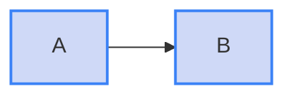

# Lint a MkDocs Material site

Score your site's diagrams the way Material renders them, where the theme sets the label colour.

**Before you begin:** the package is a dev dependency, as in [Get started](../get-started.md).
The short command `mermaidjs-lint` below works only then.

## Run it on the docs folder

```sh
bunx mermaidjs-lint docs/
```

There is nothing to configure.
The default profile, `auto`, scores a file as Material renders it when its folder, or a parent folder, holds `mkdocs.yml` or `mkdocs.yaml`.
Every other file is scored as GitHub renders it.

- **The search climbs up to 20 folders.** It stops at neither the project root nor the repository root.
- **Any MkDocs config counts.** The theme it names is never read.
- **A monorepo needs care.** A `mkdocs.yml` at the top scores every package's README as Material, so lint those with `--profile github`.

## Keep README.md scored as GitHub renders it

With `mkdocs.yml` at the repository root, every markdown file in the repository has it as a parent. `README.md` is then scored as Material, although GitHub is where it is read.

Choose one of two fixes:

- **Move the site into its own folder.** Put `mkdocs.yml` and its docs folder under a folder such as `docs-site/`, and the root files keep the `github` profile.
- **Lint the root files in a second run.** Pass the profile for them, naming the root files your project has:

```sh
bunx mermaidjs-lint --profile github README.md
bunx mermaidjs-lint docs/
```

## Write fills that work in both themes

Under Material, `color:` is ignored, and the label text is dark in the light theme and light in the dark theme.
A fill therefore has to read under both.

- **Translucent fills work best.** A fill with an alpha channel, such as `#1d4ed836`, blends with whichever page background is showing.
- **Strong opaque fills fail one theme.** A dark fill hides the dark text of the light theme, and a pale fill hides the light text of the dark theme.
- **Borders carry the category.** A border is not a contrast finding under Material, so a strong `stroke:` can mark a group while the fill stays light.

````markdown

````

## Force a profile

When a file renders through Material but its folder holds no `mkdocs.yml`, pass the profile:

```sh
bunx mermaidjs-lint --profile mkdocs-material site-content/
```

To pin it for good, set `profile` on the three contrast rules in `mermaidjs-lint.config.json`:

```json
{
  "rules": {
    "contrast-text-below-aa": ["error", { "profile": "mkdocs-material" }],
    "contrast-border-below-ui-minimum": ["error", { "profile": "mkdocs-material" }],
    "contrast-directive-unauditable": ["error", { "profile": "mkdocs-material" }]
  }
}
```

A `--profile` flag still overrides this for one run.
[Config file](../reference/configuration.md#rule-options) lists the profile option.

## Why Material differs from GitHub

[Contrast profiles](../concepts/contrast.md) explains why the same diagram can pass on GitHub and fail under Material.
