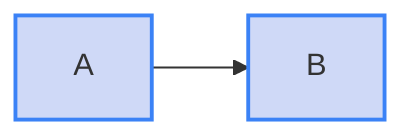

# Lint a MkDocs Material site

Score your site's diagrams the way Material renders them, where the theme sets the label colour.

**Before you begin:** read [Contrast profiles](../concepts/contrast.md) if you want to know why this differs from GitHub.

## Run it on the docs folder

```sh
bunx mermaidjs-lint docs/
```

There is nothing to configure.
The default profile, `auto`, finds `mkdocs.yml` in a parent folder of each file, and scores those files as Material renders them.
Files elsewhere in the repository are still scored as GitHub renders them.

## Write fills that work in both themes

Under Material, `color:` is ignored, and the label text is dark in the light theme and light in the dark theme.
A fill therefore has to read under both.

- **Translucent fills work best.** A fill with an alpha channel, such as `#1d4ed836`, blends with whichever page background is showing.
- **Strong opaque fills fail one theme.** A dark fill hides the dark text of the light theme, and a pale fill hides the light text of the dark theme.
- **Borders carry the category.** A border is not a contrast finding under Material, so a strong `stroke:` can mark a group while the fill stays light.

````markdown

````

## Force a profile

When a file renders through Material but its folder holds no `mkdocs.yml`, pass the profile:

```sh
bunx mermaidjs-lint --profile mkdocs-material site-content/
```

To pin it for good, set `profile` on the three contrast rules in the [configuration file](../reference/configuration.md#rule-options).
