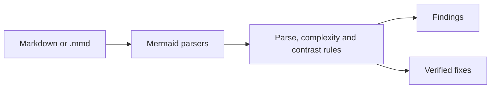

# mermaidjs-lint

Deterministic lint gates and verified fixers for Mermaid diagrams in markdown.

It reads each diagram with mermaid's own parsers.
It then gates whether the diagram parses and how complex it is.
It also gates whether labels and borders can be read against their fills.
Where a fix is safe, `--fix` applies it and re-parses the result before keeping it.



## Install

```sh
bun add --dev @jpeakai/mermaidjs-lint
```

## Use

```sh
bunx mermaidjs-lint docs/            # report findings, exit 1 on any
bunx mermaidjs-lint --fix docs/      # apply verified fixes, then report what is left
```

## This site is a test suite

Every page under Reference is generated from the files the test suite runs:

- [Rules](reference/rules.md) draws each example from `RULES.md` before and after `--fix`.
- [Fixtures](reference/fixtures.md) shows every file in `tests/fixtures` with what it reports.
- [Examples](reference/examples.md) shows the layout and icon examples, each linted clean.

The build checks every example as it writes the page, and fails when one has drifted from the tool.
This page itself renders through Material, so the linter scores its diagram under the `mkdocs-material` profile.
