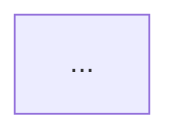

# Command line

The `mermaidjs-lint` command, as installed with the package.
To use it in a pipeline, see [Gate diagrams in CI](../guides/ci.md).

## Help

The text below is generated from `mermaidjs-lint --help` when this site is built.

```text
--8<-- "cli-help.txt"
```

## Flags

| Flag | Short | Value | Default | Effect |
|---|---|---|---|---|
| `--fix` | | | off | Apply every fix proven safe, write the file, then report what remains |
| `--split-plan` | | | off | After the report, print the split plan for each diagram a node count or score rule flags, and write no file |
| `--json` | | | off | Print one JSON object instead of text lines |
| `--preset` | `-p` | a preset name or alias | `high-density` | Set the density for every complexity rule |
| `--profile` | | `auto`, `github`, `mkdocs-material` | `auto` | Set how contrast is read |
| `--canvas-light` | | an opaque CSS colour | `#ffffff` | Set the light page colour that page-backed pairs are scored on, under `github` only |
| `--canvas-dark` | | an opaque CSS colour | `#0d1117` | Set the dark page colour that page-backed pairs are scored on, under `github` only |
| `--category` | | a category name, or a comma-separated list | | Turn on every rule in that category for this run, even one the config turns off. May be repeated. |
| `--disable-category` | | a category name, or a comma-separated list | | Turn off every rule in that category for this run. May be repeated. |
| `--config` | | a file path | the config at the project root | Read that config file instead |
| `--no-plugins` | | | off | Load no plugin, refuse a `.mjs` config, and set aside config settings for plugin rules |
| `--lenient-plugins` | | | off | Skip a plugin that fails to load, and say so |
| `--validate-plugins` | | | off | Load every plugin, report every failure, and check no file |
| `--list-rules` | | | off | Print every active rule by category, then the plugins. Takes only `--config`, `--no-plugins` or `--lenient-plugins`, and the category flags. |
| `--version` | | | | Print the version, for a bug report |
| `--help` | `-h` | | | Print the help |

Some flags cannot be combined, and the run exits 2 when they are:

- `--no-plugins` with `--lenient-plugins`.
- `--validate-plugins` with `--no-plugins`, `--fix`, `--list-rules`, a category flag or any path.
- `--split-plan` with `--fix`, `--json`, `--list-rules` or `--validate-plugins`.
- `--category` and `--disable-category` naming the same category.
- `--list-rules` with any path, `--fix`, `--json`, `--preset`, `--profile`, `--canvas-light` or `--canvas-dark`, which it would ignore.
- `--canvas-light` or `--canvas-dark` with `--profile mkdocs-material`.

A canvas colour that will not parse, or is translucent, is `error[flag]` with exit code 2.
A canvas flag beside `--profile mkdocs-material` is `error[flag]`.
A file that `auto` or the config scores under `mkdocs-material` refuses a canvas flag with `error[canvas-profile]`.
So does a config canvas run with `--profile mkdocs-material`.
A canvas from the config is set aside, not refused, for a file that `auto` scores under `mkdocs-material`.
One stderr line names those files.
[A host with its own page sets a canvas](../concepts/contrast.md#a-host-with-its-own-page-sets-a-canvas) explains what the canvas changes.
For example, a viewer with its own page colours runs:

```sh
mermaidjs-lint docs/ --canvas-light '#faf8f9' --canvas-dark '#101010'
```

A preset name or alias is matched without regard to case:

| Preset | Aliases |
|---|---|
| `low-density` | `low`, `l`, `strict` |
| `medium-density` | `medium`, `med`, `m`, `balanced` |
| `high-density` | `high`, `h`, `permissive`, `default` |

## Precedence

A complexity threshold or a contrast profile can be set in four places.
The first that applies wins:

1. A threshold option set on the rule in the config, such as `nodeHardLimit`, which beats any preset.
2. The `--preset` or `--profile` flag.
3. The `preset` or `profile` option set on the rule in the config.
4. The default, which is `high-density` or `auto`.

A flag therefore overrides a preset or profile the config sets, but not a threshold the config sets.

A canvas side follows the same order: `--canvas-light` or `--canvas-dark`, then that side of the `canvas` option in the config, then GitHub's colour.
A flag sets only its own side, so `--canvas-dark` alone keeps a light side the config sets.

## Which rules run

The rules a run uses are settled in three steps:

1. Every loaded rule starts on, built-in and plugin alike.
2. The config turns off each rule set to `"off"`.
3. The category flags have the last word for this run. `--category` turns a category's rules back on, and `--disable-category` turns them off.

A rule that `--category` turns back on runs with the options the config gives it, such as `["off", { "preset": "low" }]`.
A category is one of `parse`, `complexity` and `contrast`, or a category a loaded plugin declares.
`--list-rules` takes the same flags, so it shows which rules a run would use.

| Run | Rules used |
|---|---|
| `mermaidjs-lint docs/ --disable-category complexity` | The parse and contrast rules the config leaves on |
| `mermaidjs-lint docs/ --disable-category parse,complexity` | The contrast rules the config leaves on |
| `mermaidjs-lint docs/ --category contrast` | Every rule the config leaves on, plus every contrast rule, even one the config turns off |

Each of these is a usage error with exit code 2, as `error[flag]`:

- A category that no loaded rule source declares, such as a plugin category under `--no-plugins`.
- One category named by both flags.
- Category flags that turn off every rule, which would pass every file unchecked.

## Plugins and untrusted repositories

`--no-plugins` loads no plugin, and never imports a `.mjs` config, because a `.mjs` config is code.
When the config it would read is a `.mjs` file, the run stops with `error[config-code]` and exit code 2.
Pass `--config` with a `.json` config of your own to run anyway.
A `.json` config is read as usual, because it is data and runs no code.
So the linter itself imports none of the repository's code.
That does not make the repository safe.
Installing its dependencies may already have run their code.
A package runner started inside the checkout reads its `bunfig.toml` or `.npmrc`, which can run code before the linter starts.
Run an installed linter from a folder you control, and name the checkout's files by path.
[SECURITY.md](https://github.com/jpeakai/jpai-mermaidjs-lint/blob/main/SECURITY.md) states the full trust model.

## Paths

| Path | What is checked |
|---|---|
| A `.mmd` or `.mermaid` file | The whole file, as one diagram |
| Any other file named explicitly | Every mermaid fence in it, read as markdown whatever its extension |
| A directory | Every `.md`, `.markdown`, `.mmd` and `.mermaid` file beneath it |

A walk leaves out dot-folders and dependency or build output folders, as `--help` lists, and a file named explicitly is always checked.
When the paths match no file at all, the run stops with `error[flag]: no matching files` and exit code 2.

A directory walk never follows a symbolic link, to a file or to a folder.
It names each link it skipped on standard error, as `mermaidjs-lint: skipped symbolic link <path>; name it as a path to check it`, so a gate never passes a file in silence.
A link named as a path is followed and checked.
`--fix` refuses to write through a named link whose target is outside the project root, with `error[fix-outside-root]` and exit code 2.
It refuses before it writes any file.

Every path must exist.
A missing path is a usage error, `error[flag]: cannot read <path>`, with exit code 2.

## Exit codes

| Code | Meaning |
|---|---|
| 0 | No findings remain |
| 1 | Findings remain, a plugin failed to load in a run that is not lenient, or the run failed, such as with `package-json` or `fix-not-converging` |
| 2 | A usage error: an unknown flag, a missing path, no matching files, or a bad config file |

## Error codes

A failure prints `error[code]: reason`, and the same `code` is on the exported error class.

| Code | Exit code | Cause |
|---|---|---|
| `flag` | 2 | An unknown flag, a bad flag value, flags that contradict (such as a canvas flag beside `--profile mkdocs-material`), a category that is not loaded, category flags that leave no rule, no paths, a path that cannot be read, or no matching files |
| `config-file` | 2 | The config cannot be read or parsed, or is neither `.json` nor `.mjs` |
| `config-not-found` | 2 | The file given to `--config` does not exist |
| `config-code` | 2 | `--no-plugins` was given, and the config to read is a `.mjs` file, which is code |
| `config-ambiguous` | 2 | More than one config file at the project root |
| `config-shape` | 2 | An unknown config key, or a key of the wrong type |
| `rule-setting` | 2 | A rule setting that is not a severity, or a severity and options |
| `unknown-rule` | 2 | A rule id that is not loaded. Outside strict mode, a plugin rule id is set aside instead. |
| `rule-option` | 2 | An option the rule does not declare, a value of the wrong type, a preset or profile name that does not exist, a canvas colour that is not an opaque CSS colour, or a canvas beside `profile` `mkdocs-material` on the same rule |
| `canvas-profile` | 2 | A canvas from one source met a `mkdocs-material` profile from another: a canvas flag on a file that the config or `auto` scores under `mkdocs-material`, or a config canvas with `--profile mkdocs-material`. Material's page is its own. |
| `fix-outside-root` | 2 | `--fix` was given a symbolic link whose target is outside the project root |
| `package-json` | 1 | The project's `package.json` is not a JSON object. A run with plugins off, through `--no-plugins` or `"plugins": false` in the config, reads nothing from it, so it carries on. |
| `fix-not-converging` | 1 | A fixer kept proposing edits for 1000 passes. The message names the rules still editing, and that file is not written. |
| `plugin-import` | 1 | A plugin module could not be imported |
| `plugin-contract` | 1 | A plugin export breaks the contract, or targets another API version |
| `plugin-conflict` | 1 | Another plugin already claimed the namespace or a category word, or two local rule files declare one category with different descriptions |
| `plugin-not-installed` | 1 | A declared plugin package is not installed |
| `plugin-source` | 1 | A plugin source cannot be loaded, such as a `.cts` file, TypeScript on a runtime that cannot import it, or an installed plugin whose `package.json` is not a JSON object |
| `plugin-fixer` | 1 | A plugin fixer threw, returned something other than a list, or returned an edit with no valid expectation |

## Text output

One line per finding, then a summary:

```text
docs/architecture.md:6 contrast-text-below-aa classDef warn: text 1.43:1 < 4.5 (#ffffff on #ffd400)
1 finding(s) in 1 file(s)
```

A line reads `file:line rule message`.
A finding that spans a diagram prints its first and last line, as `file:3-7`.

## Split plans

`--split-plan` prints a section after the summary for each diagram that a node count or score rule flags.
The heading names the diagram's `file:line` and the tier of the plan.
An overview follows, where each group of nodes is folded into one group node.
Then one detail diagram per group shows its members, with a stub for each node outside the group that an edge reaches.
Each diagram is a mermaid fence, so the output can be pasted into a markdown file and checked:

````text
## docs/pipeline.md:12: split plan (T2)

### Overview



### Detail g1: ingest (+5)


````

When no plan meets the contract, the section says why, and the finding keeps its subgraph hint.
A detail that is still over the target is split once more, under a heading one level down.
The plan is a recommendation, per [MJL-0025](https://github.com/jpeakai/jpai-mermaidjs-lint/blob/main/adrs/0025-a-fold-is-offered-as-a-split.md): nothing is written, and the exit code is the check's.
The plan is not in the `--json` object, so `--split-plan` refuses `--json` rather than drop it.

Standard error carries these lines, each when it applies:

| Line | When |
|---|---|
| `mermaidjs-lint: loaded acme (1 rule)` | Plugins loaded |
| `mermaidjs-lint: plugins off; skipped mermaidjs-lint-plugin-acme` | `--no-plugins`, or `"plugins": false` in the config, found plugins and loaded none |
| `mermaidjs-lint: skipped plugin <source> [code]: reason` | A lenient run left a broken plugin out |
| `mermaidjs-lint: ignored config setting for <id>, whose plugin did not load` | A config setting named a plugin rule that is not loaded |
| `mermaidjs-lint: skipped symbolic link <path>; name it as a path to check it` | A directory walk met a symbolic link |
| `mermaidjs-lint: config canvas set aside for N files scored under mkdocs-material: <paths>` | A config canvas met files that `auto` scores under `mkdocs-material`. The `--json` object lists the same paths under `canvasSetAside`. |

## JSON output

`--json` prints one object:

```json
{
  "findings": [
    {
      "file": "docs/architecture.md",
      "line": 6,
      "endLine": 6,
      "rule": "contrast-text-below-aa",
      "message": "classDef warn: text 1.43:1 < 4.5 (#ffffff on #ffd400)",
      "remediation": "Darken or lighten the fill, or change color:, until the ratio reaches 4.5:1 in every theme."
    }
  ],
  "files": 1,
  "plugins": [],
  "skippedPlugins": [],
  "canvasSetAside": []
}
```

| Key | Holds |
|---|---|
| `findings` | Each finding: `file`, `line`, `endLine`, `rule`, `message`, and `remediation` when the rule gives one |
| `files` | How many files were checked |
| `plugins` | Each loaded plugin: `kind` (`local`, `package` or `config`), `spec`, `namespace` and its `rules` ids |
| `skippedPlugins` | Each plugin a lenient run left out: `source`, `kind`, `code` and `message` |
| `canvasSetAside` | Each file whose config canvas was set aside because `auto` scores it under `mkdocs-material`, as a path relative to the working directory, or absolute when the file is outside it |

Under `--no-plugins`, `skippedPlugins` is empty, and the skipped plugins appear only on standard error.
`--validate-plugins --json` prints `{ valid, plugins, failures }` instead, where `failures` has the shape of `skippedPlugins`.
