# Architecture

How `jpai-mermaidjs-lint` is put together, and how a run moves through it, read from `src/`.
[DATA_MODEL.md](DATA_MODEL.md) holds every shape these diagrams pass around, field by field.

Each section opens with a simplified diagram and a one-sentence summary.
The full diagram sits in a collapsible block beneath it.
The terms follow [GLOSSARY.md](../GLOSSARY.md), and the decisions behind the design live in [`adrs/`](../adrs/).

The docs site draws the run for consumers on its [how it works](https://jpeakai.github.io/jpai-mermaidjs-lint/concepts/how-it-works/) page.
It describes the latest release, and this file describes `main`.

## Contents

- [Modules](#modules)
- [Run pipeline](#run-pipeline)
- [A lint run](#a-lint-run)
- [A fix run](#a-fix-run)
- [Fix verification](#fix-verification)
- [Plugin loading](#plugin-loading)
- [Core data shapes](#core-data-shapes)

## Modules

The command sets up a registry once, then checks or fixes each file through one document model that the parse engine reads.

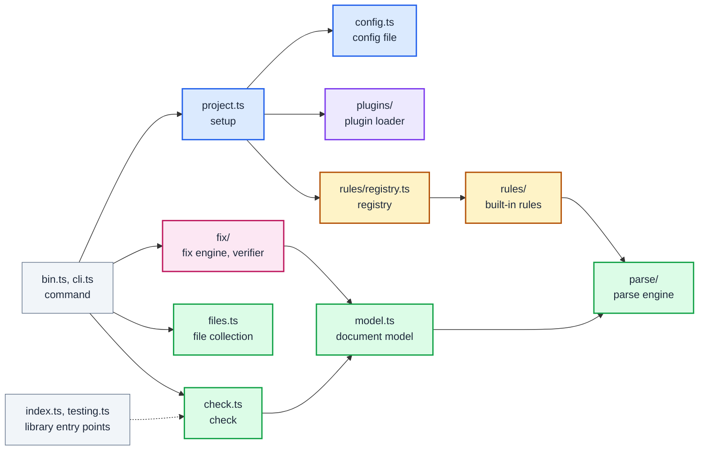

Entry points, setup and the plugin loader, by file (15 nodes)

Each arrow is an import.
`bin.ts` is the command, `index.ts` the library and `testing.ts` the plugin test helper, the three bundles `make build` writes.
Most modules also import `errors.ts`, which holds every named failure and its stable code.

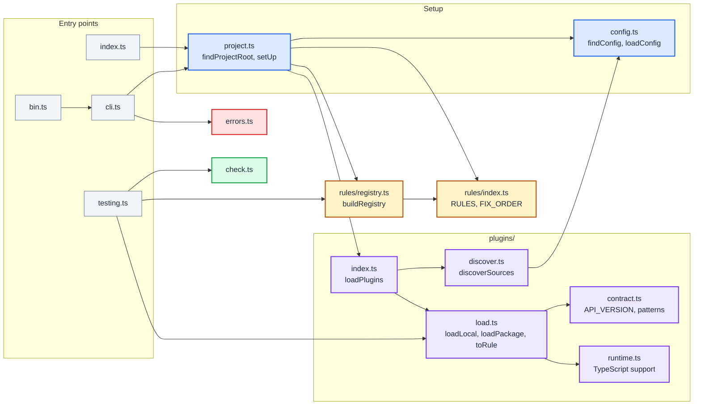

Check, fix, rules and the parse engine, by file (19 nodes)

Each arrow is an import.
The parse engine reads structure from mermaid's own parsers, per [MJL-0001](../adrs/0001-parse-with-mermaids-own-parsers.md).
`stats.ts` uses `@mermaid-js/parser` for the Langium grammars and mermaid core, under `happy-dom`, for the rest.

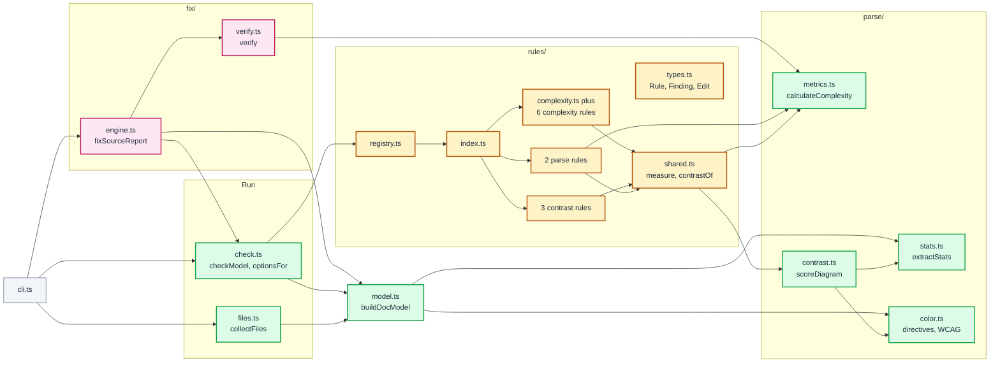

Every rule module imports `types.ts`, so those arrows are left out.

## Run pipeline

A run sets up once, then each file is fixed to a fixpoint when asked, checked by every active rule, and reported.

```mermaid
flowchart LR
    R["Find project<br/>root"] --> C["Load<br/>config"] --> P["Load<br/>plugins"] --> G["Build<br/>registry"]
    G --> F["Collect<br/>files"] --> M["Build document<br/>model"]
    M --> Q{"--fix?"}
    Q -->|yes| X["Fix to fixpoint,<br/>write file"]
    X --> K
    Q -->|no| K["Check with<br/>all rules"]
    K --> O["Report findings,<br/>exit 0 or 1"]

    classDef setup fill:#dbeafe,stroke:#2563eb,color:#1e293b,stroke-width:2px
    classDef doc fill:#dcfce7,stroke:#16a34a,color:#1e293b,stroke-width:2px
    classDef fix fill:#ede9fe,stroke:#7c3aed,color:#1e293b,stroke-width:2px
    classDef report fill:#fef3c7,stroke:#b45309,color:#1e293b,stroke-width:2px
    classDef gate fill:#f1f5f9,stroke:#64748b,color:#1e293b,stroke-width:1px
    class R,C,P,G setup
    class F,M,K doc
    class X fix
    class O report
    class Q gate
```

Run pipeline, every step and exit (23 nodes)

Sources:

- `run` and `main` in `src/cli.ts`.
- `setUp` in `src/project.ts`.
- `fixSourceReport` in `src/fix/engine.ts`.
- `checkModel` in `src/check.ts`.

A usage error exits 2 before any file is read, and any other failure propagates to `bin.ts`, which exits 1.

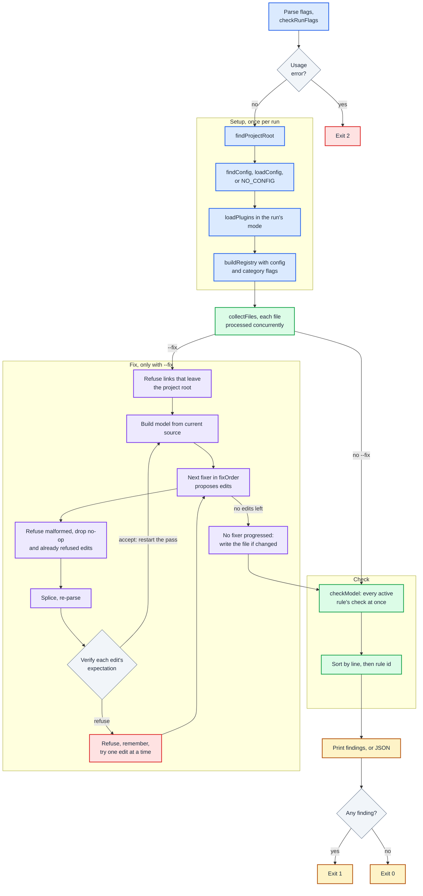

A fix run that never reaches a fixpoint stops after 1,000 passes with `FixNotConvergingError`, and nothing is written.

## A lint run

The command builds the registry once, then checks every file concurrently, with every active rule started at once on each file.

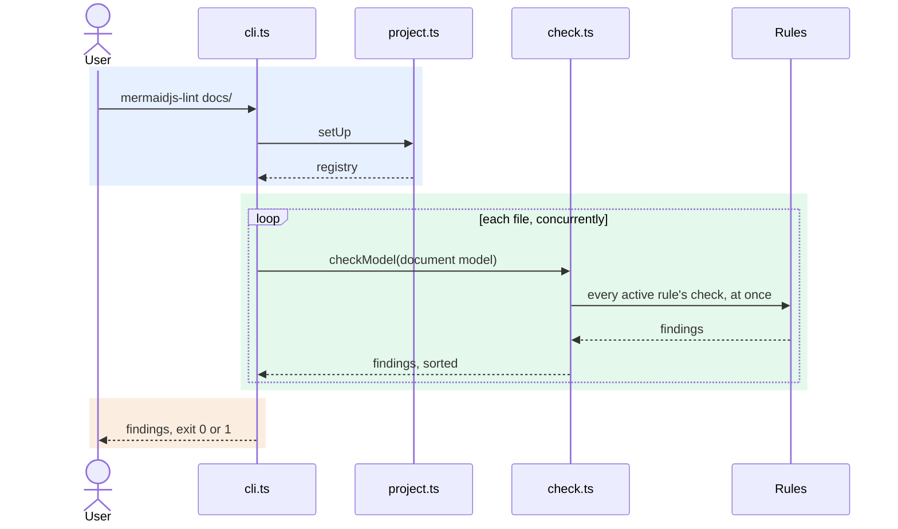

A lint run, every call (11 participants)

Sources:

- `run` in `src/cli.ts`.
- `setUp` in `src/project.ts`.
- `checkModel` and `optionsFor` in `src/check.ts`.
- `buildDocModel` in `src/model.ts`.
- `contrastOf` in `src/rules/shared.ts`, which calls `scoreDiagram` in `src/parse/contrast.ts`.

Each rule receives its options from `optionsFor`, which lays the run flags over the configured options.

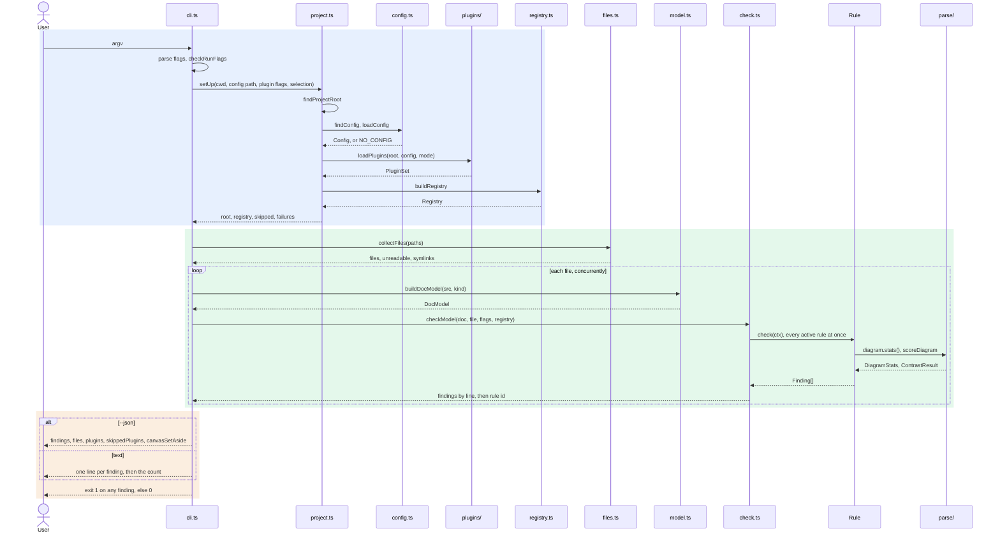

`collectFiles` walks a directory without following links, and the command names every link it skipped.

## A fix run

The fix engine asks each fixer for edits, proves every edit on the re-parsed source, and writes only what survives.

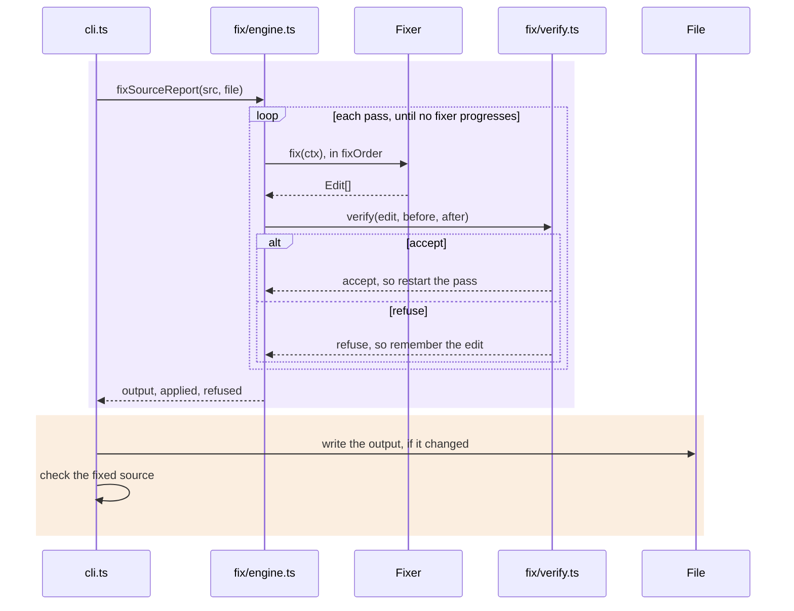

A fix run, with batching, refusal and non-convergence (7 participants)

Source: `run` in `src/cli.ts`, `fixSourceReport` in `src/fix/engine.ts` and `verify` in `src/fix/verify.ts`.
A refused edit leaves the source untouched, so its finding stays in the check that follows, per [MJL-0005](../adrs/0005-a-fixer-refuses-when-unsure.md).

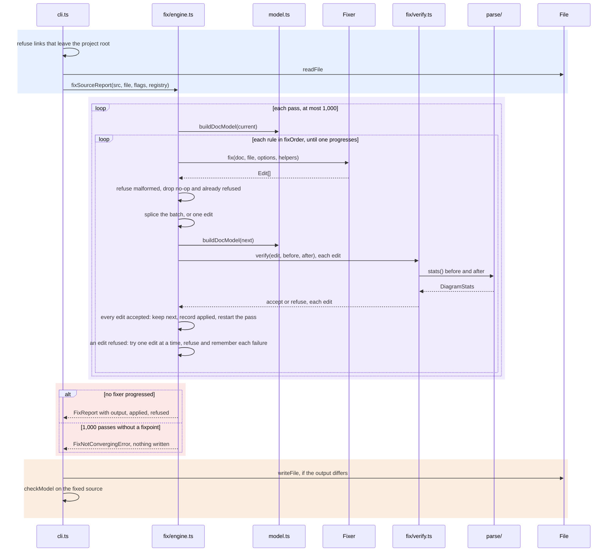

A batch is tried whole only when it holds more than one edit and none overlap.
Every accepted edit restarts the pass, because offsets are valid only for the source they were computed from.

## Fix verification

The verifier accepts an edit only when the re-parsed document keeps what the edit's expectation claims.

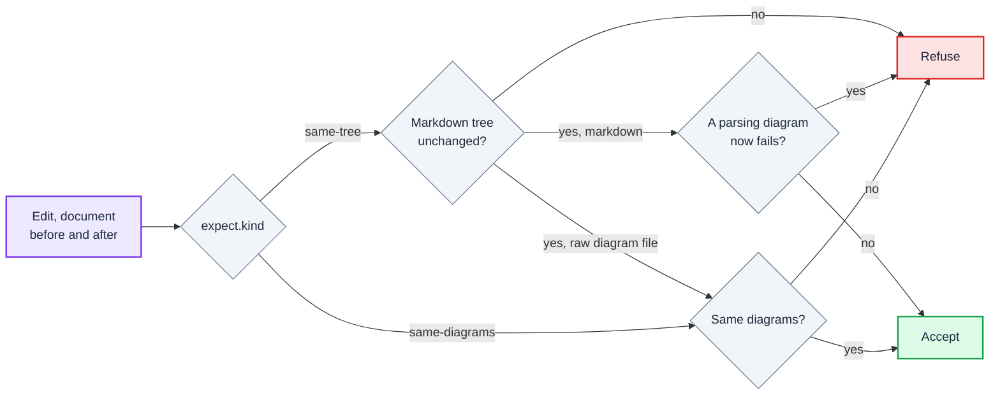

Fix verification, every comparison and what it leaves out (13 nodes)

Source: `verify`, `sameDiagrams`, `breaksAParse` and `normalise` in `src/fix/verify.ts`.
Every fix is verified by re-parse, per [MJL-0006](../adrs/0006-every-fix-is-verified-by-reparse.md).

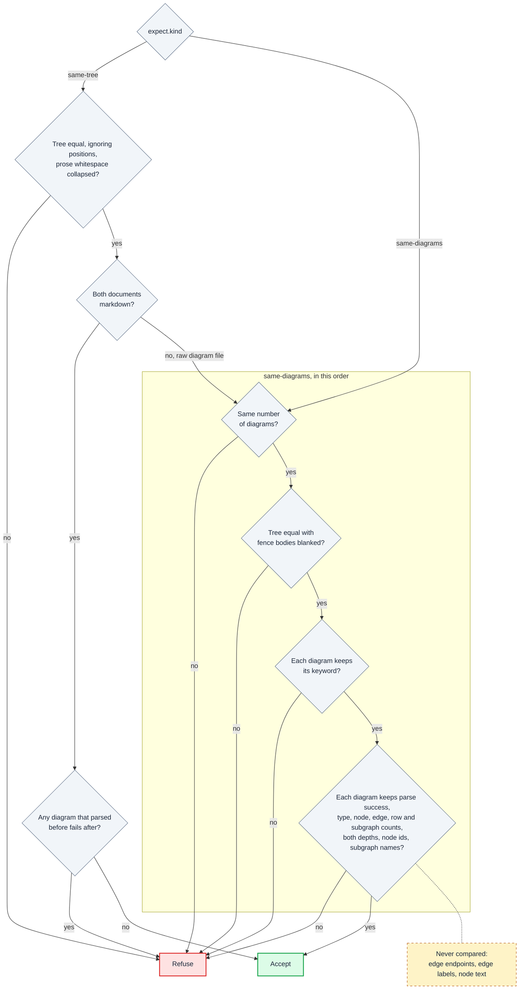

Verification does not compare edge endpoints, edge labels or node text.
An edit that rewires an edge or renames a label while keeping the counts and ids can pass `same-diagrams`.
So a fixer must never rely on the verifier to catch such a change.

## Plugin loading

Plugins are discovered, loaded and checked against the contract, then merged into the registry, and the plugin mode decides what a failure does.

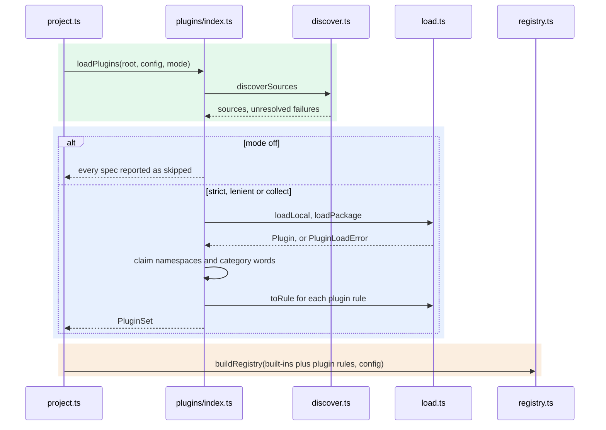

Plugin loading, every source, check and failure path (6 participants)

Sources:

- `setUp` in `src/project.ts`.
- `loadPlugins` in `src/plugins/index.ts`.
- `discoverSources` in `src/plugins/discover.ts`.
- `loadLocal`, `loadPackage`, `parsePlugin` and `toRule` in `src/plugins/load.ts`.

Plugins follow the prose gates contract, per [MJL-0007](../adrs/0007-plugins-follow-the-prose-gates-contract.md).

The mode is picked before loading.
It is off for `--no-plugins` or `plugins: false`, collect for `--validate-plugins`, and lenient for `--lenient-plugins` or `pluginLoading: lenient`.
Otherwise it is strict.

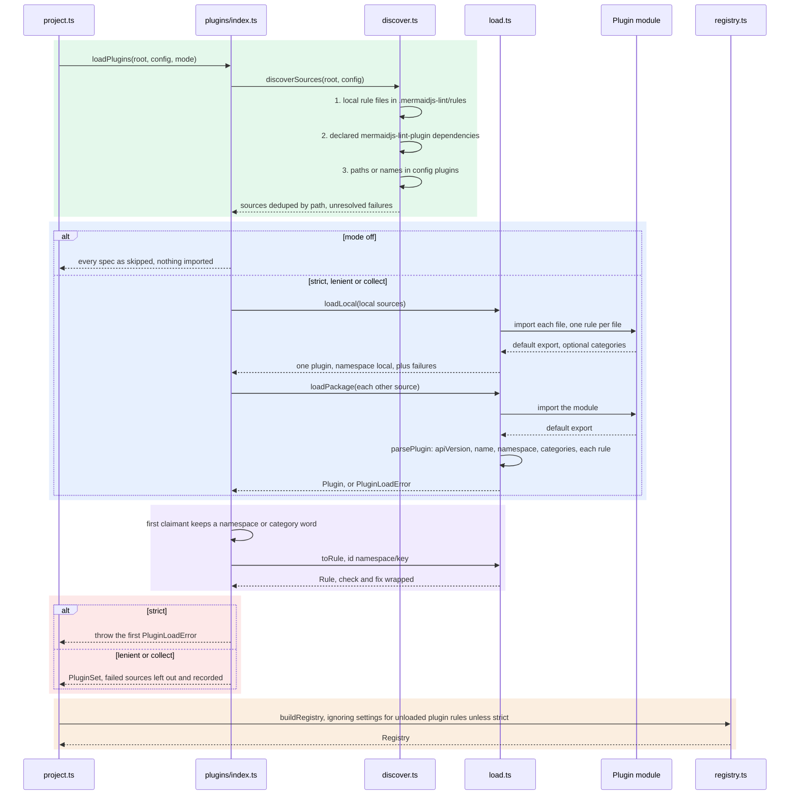

A failure is settled where it happens, so a strict run throws at the first one, during discovery, loading or the conflict check.
A bad plugin stops the run with its reason, unless the run is lenient or collecting.

## Core data shapes

Setup hands each run a registry, rules read the document model, and a run ends in findings and, under `--fix`, a fix report.

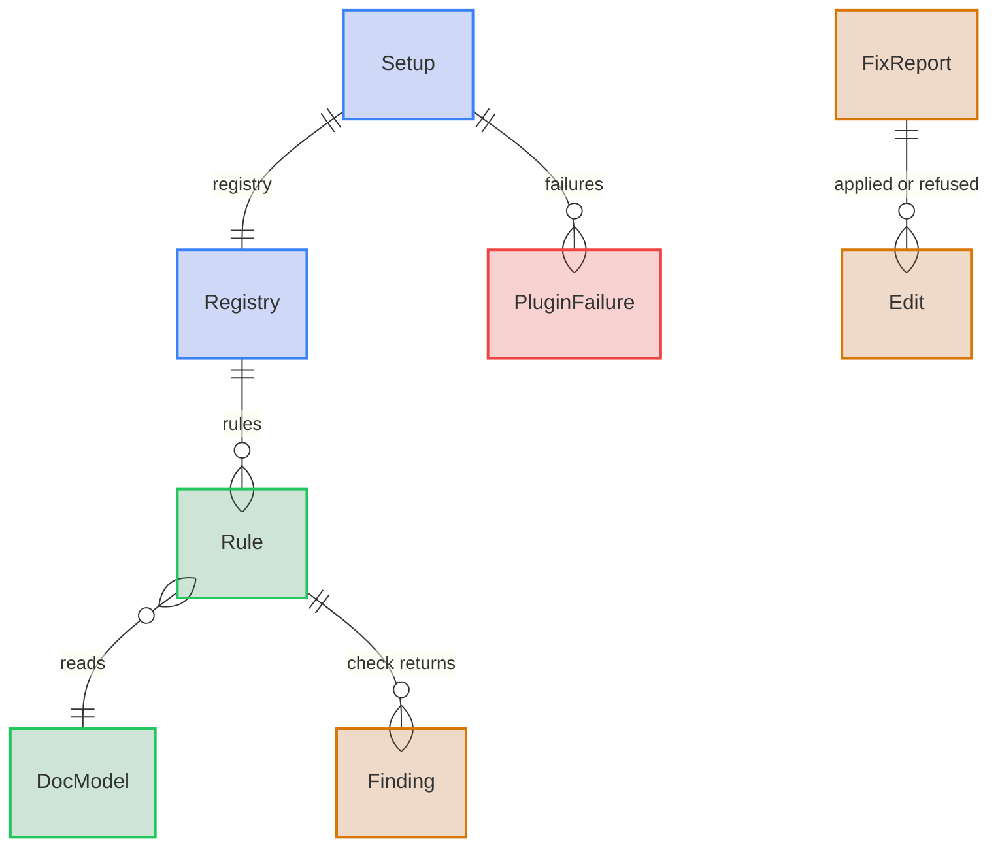

Core data shapes, with the run's inputs and its JSON report (12 entities)

Sources: `src/project.ts`, `src/check.ts`, `src/files.ts`, `src/rules/registry.ts`, `src/rules/types.ts`, `src/fix/engine.ts` and `src/plugins/index.ts`.
`JsonReport` is not an exported type: it is the object `run` in `src/cli.ts` prints under `--json`.
[DATA_MODEL.md](DATA_MODEL.md) has every field of the document, rule, fix and plugin models.

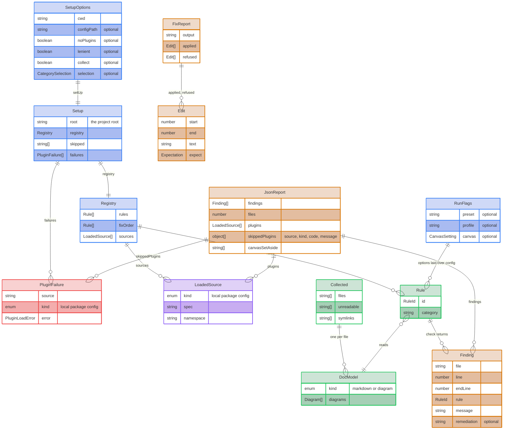

