# Data model

The shapes `jpai-mermaidjs-lint` passes between its stages, read from the types in `src/`.
[ARCHITECTURE.md](ARCHITECTURE.md) shows the modules and the run that moves these shapes.

Each section opens with a simplified diagram and a one-sentence summary.
The full diagram, with every field, sits in a collapsible block beneath it.
Every entity is a type in the cited file, unless the section names it as a value inside a function.
The terms follow [GLOSSARY.md](../GLOSSARY.md).

The docs site draws parts of this model for consumers and plugin authors.
Its [document model](https://jpeakai.github.io/jpai-mermaidjs-lint/reference/document-model/), [plugin model](https://jpeakai.github.io/jpai-mermaidjs-lint/concepts/plugin-model/) and [plugin API](https://jpeakai.github.io/jpai-mermaidjs-lint/reference/plugin-api/) pages carry the same colours, and the site describes the latest release.

## Contents

- [The model at a glance](#the-model-at-a-glance)
- [Parsed document model](#parsed-document-model)
- [What is scored from a diagram](#what-is-scored-from-a-diagram)
- [Rule and finding model](#rule-and-finding-model)
- [Registry and config](#registry-and-config)
- [Fix model](#fix-model)
- [Plugin contract](#plugin-contract)
- [Plugin loading](#plugin-loading)

## The model at a glance

Every rule reads one document model, a check returns findings, a fixer returns edits, and the registry decides which rules run.

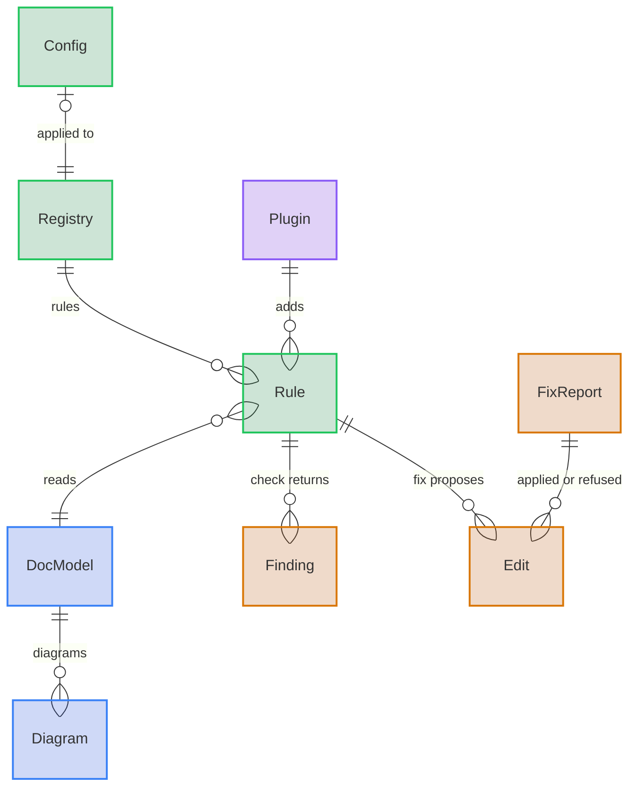

The model at a glance, with the types between each pair (16 entities)

Sources: `src/model.ts`, `src/rules/types.ts`, `src/rules/registry.ts`, `src/config.ts`, `src/plugins/contract.ts` and `src/fix/engine.ts`.

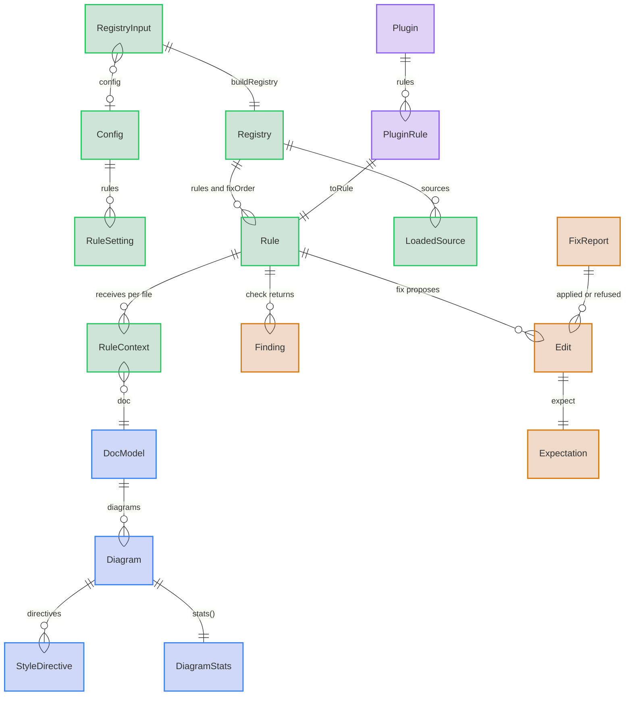

## Parsed document model

A file is parsed once to an mdast tree, and each mermaid fence in it becomes one diagram that every rule reads.

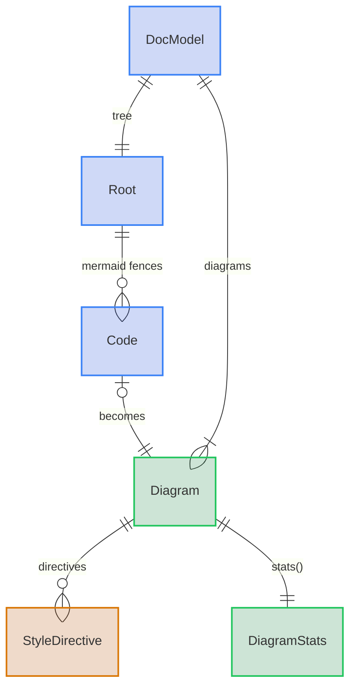

Parsed document model, every field (7 entities)

Sources:

- `src/model.ts` for `DocModel` and `Diagram`.
- `src/parse/color.ts` for `StyleDirective` and `ValueSpan`.
- `src/parse/stats.ts` for `DiagramStats`.

`Root` and `Code` are mdast node types, built by `mdast-util-from-markdown` with the frontmatter and GFM extensions.

A raw diagram file has an empty `Root` and exactly one `Diagram`, so no `Code` node stands behind it.
A markdown file with no mermaid fence has no diagrams, so the diagram list may be empty there.

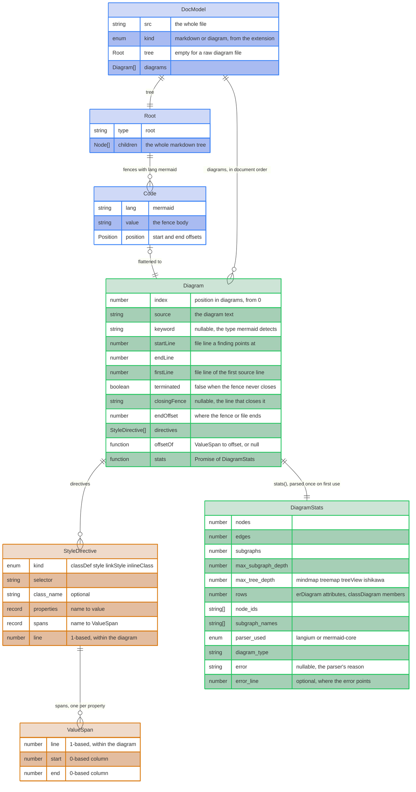

`offsetOf` returns null when a diagram line cannot be mapped back to the file, which makes a fixer refuse.

## What is scored from a diagram

The complexity rules score a diagram's stats against thresholds, and the contrast rules score pairs read from its style directives or theme variables.

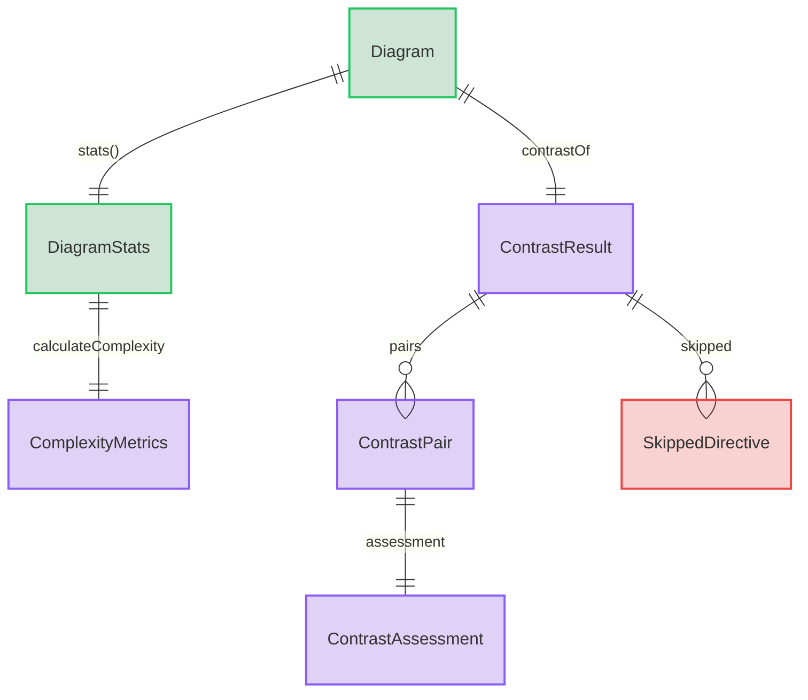

What is scored from a diagram, every field (10 entities)

Sources:

- `src/parse/metrics.ts` for the thresholds and metrics.
- `src/parse/contrast.ts` for pairs, results and the canvas.
- `src/parse/color.ts` for `ContrastAssessment`.
- `src/rules/shared.ts` for `ContrastSettings`.

A pair's `directive` is a `ContrastSource`.
That is a style directive, or, in a `sequenceDiagram`, a theme variable that has no directive and no span to rewrite.

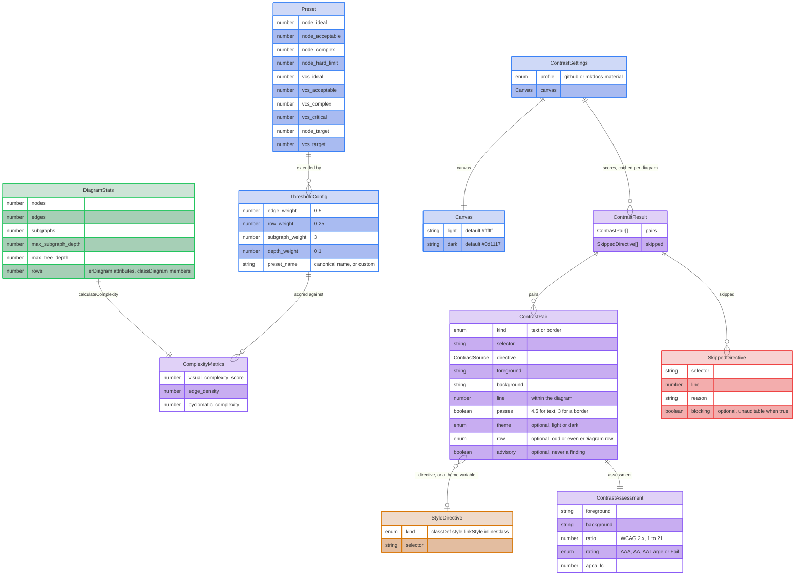

The visual complexity score uses the larger of `max_subgraph_depth` and `max_tree_depth` as its depth.
A blocking skipped directive is what `contrast-directive-unauditable` reports.

## Rule and finding model

A rule reads a context built around the document model, returns findings from its check, and may return edits from an optional fixer.

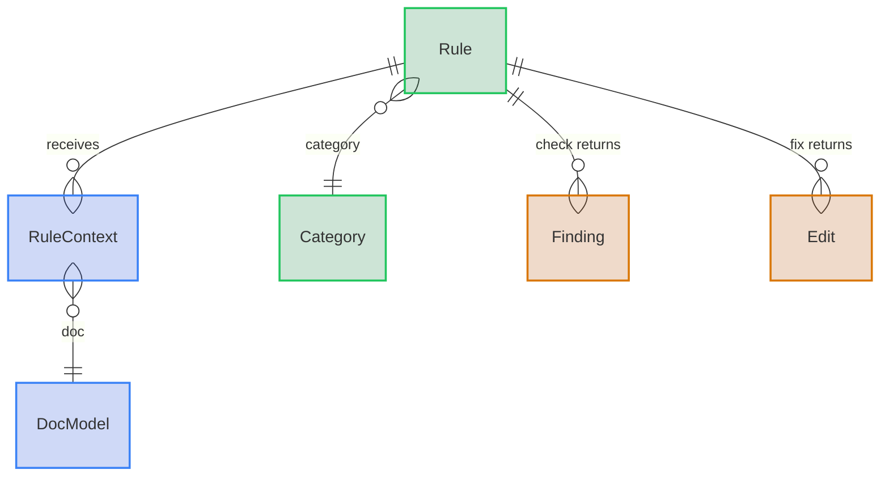

Rule and finding model, every field (9 entities)

Sources: `src/rules/types.ts` for every entity here, and `src/rules/registry.ts` for the built-in category descriptions.
`CheckContext` and `FixContext` are both aliases of `RuleContext`.

A remediation is not an entity of its own.
It is the optional `remediation` field of a finding, shown in `--json` output.

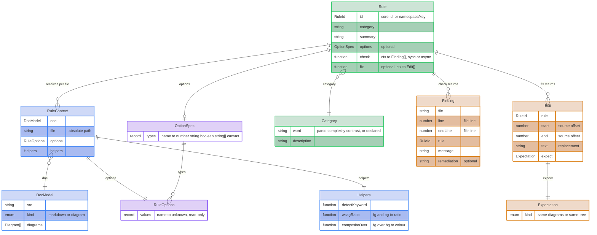

A core rule id has no slash, and a plugin rule id is always `namespace/key`.
Every complexity rule leaves `fix` absent, per [MJL-0004](../adrs/0004-complexity-is-never-autofixed.md).

## Registry and config

The registry is built from the rules a run knows, with the config and the category flags applied, and every check and fix reads it.

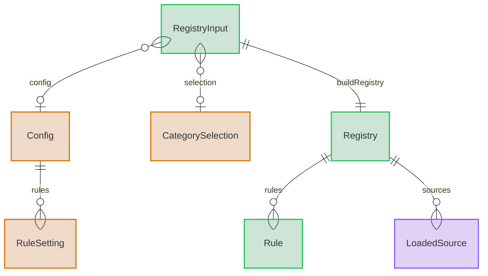

Registry and config, every field (8 entities)

Sources:

- `src/rules/registry.ts` for `RegistryInput`, `Registry`, `CategorySelection` and `LoadedSource`.
- `src/config.ts` for `Config` and `RuleSetting`.

With no config file, the run uses `NO_CONFIG`: no extra plugins, strict loading and no rule settings.

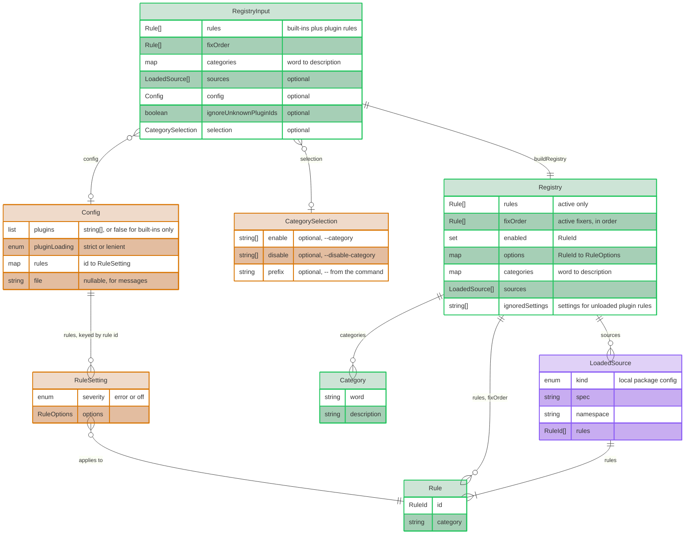

A rule that is off keeps its options, so a category flag that turns it back on runs it as configured.
The category flags have the last word for the run, per [MJL-0020](../adrs/0020-category-flags-have-the-last-word-for-a-run.md).

## Fix model

A fixer proposes edits, the engine proves each edit's expectation on the re-parsed document, and every edit ends up applied or refused.

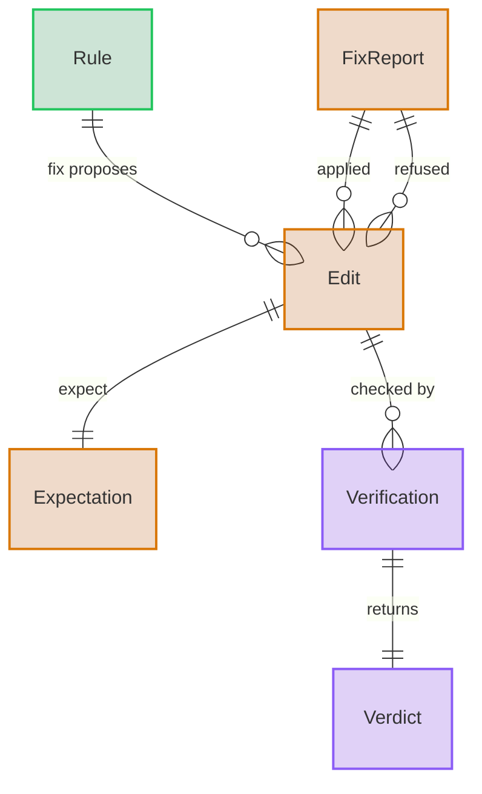

Fix model, every field and what verification compares (8 entities)

Sources:

- `src/rules/types.ts` for `Edit` and `Expectation`.
- `src/fix/engine.ts` for `FixReport` and the refusal memory.
- `src/fix/verify.ts` for `Verdict` and the comparisons.

Three entities here are values inside a function, not exported types.
`Verification` is one call of `verify(edit, before, after)`.
`ComparedShape` is the tuple `sameDiagrams` builds for each diagram.
`RefusalKey` is an entry in the engine's `refusedKeys` set.

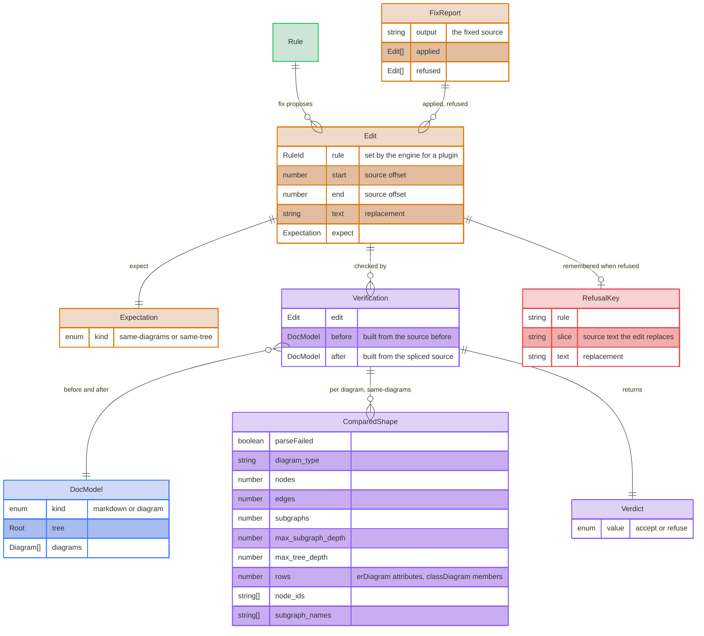

What each expectation compares, and nothing more:

- **same-diagrams** compares the diagram count, the markdown tree with fence bodies blanked, each diagram's keyword, and each diagram's compared shape.
- **same-tree** compares the markdown tree, with whitespace in prose text collapsed and fence bodies kept.
  In markdown it also refuses an edit that makes a parsing diagram fail to parse.
  In a raw diagram file the tree is empty, so it also demands everything same-diagrams does.

Verification does not compare edge endpoints, edge labels or node text.
A fixer must not rely on it to catch a changed edge or label.

A malformed edit is refused before any re-parse, and its refusal key holds the offsets in place of the source slice.
An edit refused once stays refused while its source slice is unchanged.

## Plugin contract

A plugin's default export holds its meta and its rules, and each plugin rule becomes an ordinary rule under its namespace.

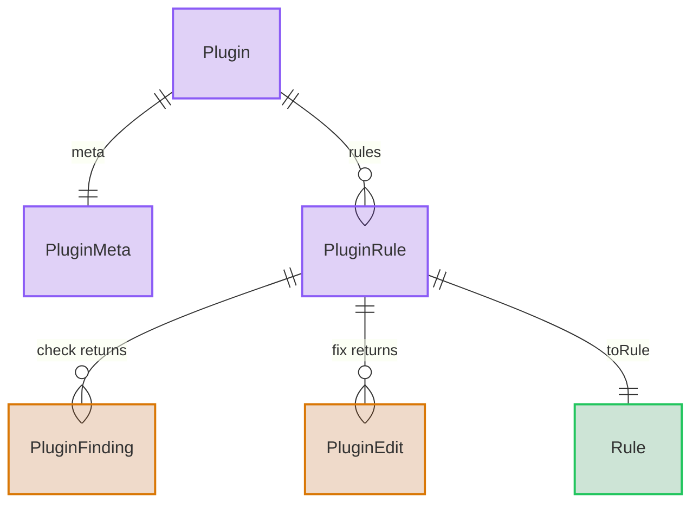

Plugin contract, every field and constraint (8 entities)

Sources: `src/plugins/contract.ts` for the contract types and patterns, and `src/plugins/load.ts` for `toRule` and the checks applied at load.
The contract version is `API_VERSION`, which is 1, and a plugin targeting another version fails to load.

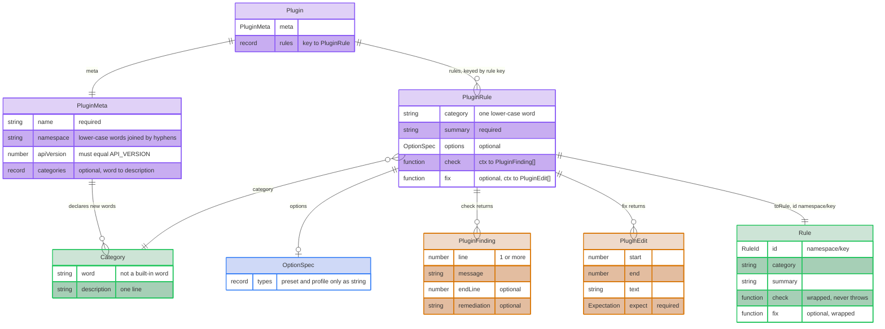

A rule key must start with its category, as in `category-short-name`.
The engine adds the file and the rule id to a plugin finding.
It adds the rule id to a plugin edit, so a plugin cannot report as another rule.
A check that throws or returns a malformed list becomes one finding for that rule.
A fixer that throws, returns a non-list or omits a valid expectation stops the run with `PluginFixerError`.

## Plugin loading

Discovery finds plugin sources, loading turns each into a plugin or a failure, and the merged plugin set feeds the registry.

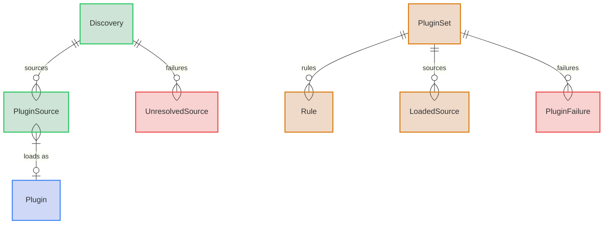

Plugin loading, every field (10 entities)

Sources:

- `src/plugins/discover.ts` for `Discovery`, `PluginSource` and `UnresolvedSource`.
- `src/plugins/load.ts` for `LocalLoad`.
- `src/plugins/index.ts` for `PluginSet` and `PluginFailure`.
- `src/errors.ts` for `PluginLoadError`.

All local rule files load together as one plugin, under the reserved namespace `local`.

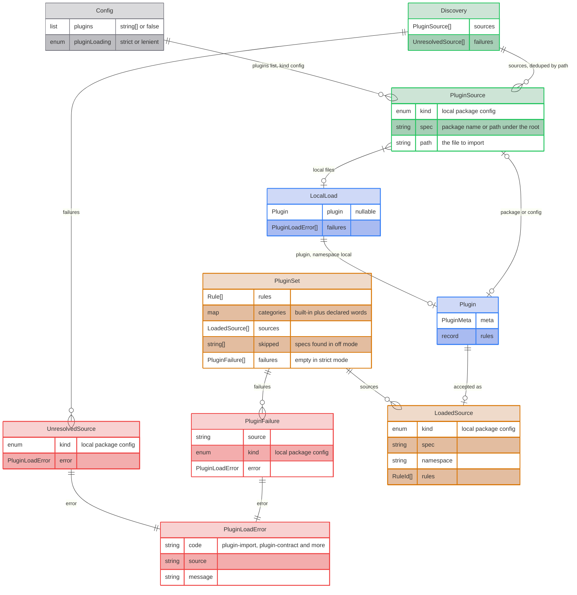

The plugin mode is `off`, `strict`, `lenient` or `collect`, and it decides what a failure does.
Strict throws the first failure, lenient and collect record it and carry on, and off loads nothing.
The first plugin to claim a namespace or a new category word keeps it, and a later claimant fails with `PluginConflictError`.

