# Complexity bands

<!-- llm: Each oversized scenario is split into smaller diagrams that keep every node and edge, with an overview where the parts connect, and the three-deep nesting is merged to two levels. -->

This file is the LLM fix for `bands.md`.
Each section keeps the description of what the linter reports on the original diagram, then shows the fix.
The fix splits a diagram rather than trim it, so every node and edge survives.
Every diagram in this file lints clean:

```bash
bunx @jpeakai/mermaidjs-lint tests/fixtures/complexity/bands.llm.md
```

From a clone of this repo, `bun run src/bin.ts tests/fixtures/complexity/bands.llm.md` does the same, and exits 0.

## What the linter reports on the original

The `high-density` preset sets these thresholds:

| Threshold | Value |
|---|---|
| `nodeAcceptable` | 35 |
| `nodeComplex` | 50 |
| `nodeHardLimit` | 100 |
| `vcsAcceptable` | 60 |
| `vcsComplex` | 100 |

The visual complexity score (VCS) weighs edges, rows, subgraphs and nesting as well as nodes:

```text
score = (nodes + 0.5 × edges + 0.25 × rows + 3 × subgraphs) × (1 + 0.1 × nesting depth)
```

| Section | Original diagram | Nodes | Score | Rules reported |
|---|---|---:|---:|---|
| 3 | 36 loose nodes | 36 | 36.5 | `complexity-node-count-acceptable-exceeded` |
| 4 | 51 nodes, no edges | 51 | 51 | `complexity-node-count-cognitive-limit` |
| 5 | 120 nodes, no edges | 120 | 120 | `complexity-node-count-hard-limit`, `complexity-visual-score-critical` |
| 6 | 10 nodes, 40 edges | 10 | 30 | none |
| 7 | Six linked chains | 60 | 100 | `complexity-node-count-cognitive-limit`, `complexity-visual-score-acceptable-exceeded` |
| 8 | Subgraphs three deep | 2 | 15 | `complexity-subgraph-nesting-too-deep` |
| 9 | A `block` diagram | 6 | 7.5 | none |
| 10 | Four named subgraphs | 52 | 98.5 | `complexity-node-count-cognitive-limit`, `complexity-visual-score-acceptable-exceeded` |

Sections 1, 2 and 11 to 30 report nothing.

Each measure is a ladder of bands, and a diagram lands in one band per measure.
So a diagram gets at most one node count rule and at most one score rule.
Nesting has its own rule, which fires whatever the counts are.

A diagram the parser cannot read is reported as `parse-diagram-unparseable` instead.
The complexity rules skip it, because counts from a failed parse mean nothing.

---

## Diagram kinds in the clean sections

Sections 1, 2 and 11 to 30 each hold a small diagram of one kind.
The linter must report nothing for them.
If one starts to report a finding, either mermaid's parser changed or the adapter that reads its result drifted.

| Section | Diagram kind | Parser | Adapter in `src/parse/stats.ts` |
|-------|--------------|-------------|--------------------|
| 1    | `flowchart`          | mermaid-core | `adaptFlowchart` |
| 2    | `architecture-beta`  | langium      | `extractLangiumStats` |
| 11   | `classDiagram`       | mermaid-core | `adaptClass` |
| 12   | `sequenceDiagram`    | mermaid-core | `adaptSequence` |
| 13   | `stateDiagram-v2`    | mermaid-core | `adaptState` |
| 14   | `erDiagram`          | mermaid-core | `adaptEr` |
| 15   | `journey`            | mermaid-core | `adaptJourney` |
| 16   | `mindmap`            | mermaid-core | `adaptMindmap` |
| 17   | `gantt`              | mermaid-core | `adaptGantt` |
| 18   | `pie`                | langium      | `extractLangiumStats` |
| 19   | `timeline`           | mermaid-core | `adaptTimeline` |
| 20   | `xychart-beta`       | mermaid-core | `adaptXychart` |
| 21   | `sankey-beta`        | mermaid-core | `adaptSankey` |
| 22   | `quadrantChart`      | mermaid-core | `adaptQuadrantChart` |
| 23   | `block-beta`         | mermaid-core | `adaptBlock` |
| 24   | `C4Context`          | mermaid-core | `adaptC4` |
| 25   | `kanban`             | mermaid-core | `adaptKanban` |
| 26   | `gitGraph`           | langium      | `extractLangiumStats` |
| 27   | `packet-beta`        | langium      | `extractLangiumStats` |
| 28   | `radar-beta`         | langium      | `extractLangiumStats` |
| 29   | `treemap-beta`       | langium      | `extractLangiumStats` |
| 30   | `requirementDiagram` | mermaid-core | `adaptRequirement` |

---

## 1. Clean flowchart (no findings)

A small, readable diagram well under every threshold.
The linter reports nothing for it.

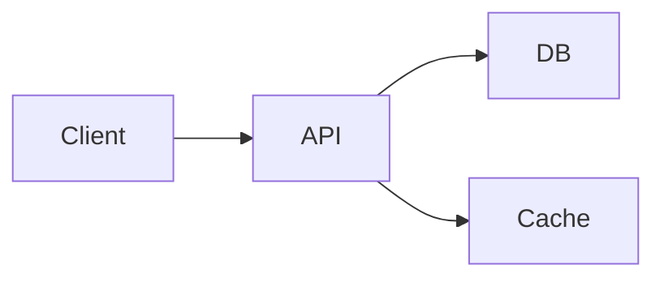

## 2. Clean architecture-beta (no findings)

The Langium grammar parses this one.
It is small, so the linter reports nothing for it.

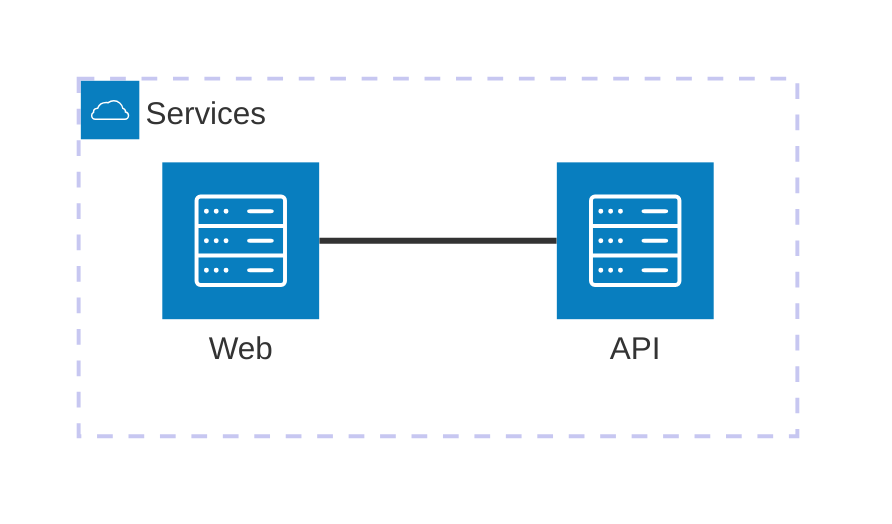

## 3. Just over the acceptable node count

The diagram has 36 nodes and one edge, one node over `nodeAcceptable`.
The linter reports `complexity-node-count-acceptable-exceeded` with the message `36 nodes > 35 acceptable threshold`.
The edges are sparse, so the score of 36.5 stays under `vcsAcceptable` and no score rule fires.

The fix splits the 36 nodes into two diagrams of 18.

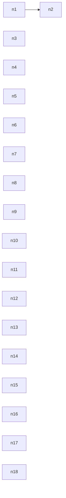

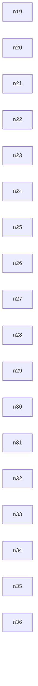

## 4. Just over the cognitive limit

The diagram has 51 nodes and no edges, one node over `nodeComplex`.
That threshold follows Huang 2020, which found that a network diagram gets hard to read at around 50 nodes.
The linter reports `complexity-node-count-cognitive-limit` alone.
It does not also report `complexity-node-count-acceptable-exceeded`, because a node count lands in one band.

The fix splits the 51 nodes into two diagrams of 26 and 25.

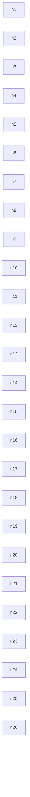

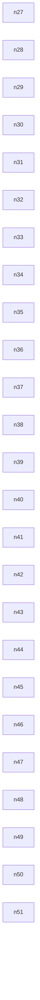

## 5. Over the hard limit

The diagram has 120 nodes, beyond any readable size.
The linter reports `complexity-node-count-hard-limit`, and its remediation starts with "Split immediately".
With no edges the score is also 120, above `vcsComplex`, so `complexity-visual-score-critical` fires too.

The fix gives the 120 nodes an overview of four blocks, then one diagram of 30 nodes per block.

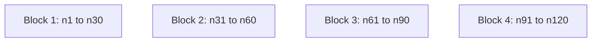

```mermaid
flowchart TD
  N1[n1]
  N2[n2]
  N3[n3]
  N4[n4]
  N5[n5]
  N6[n6]
  N7[n7]
  N8[n8]
  N9[n9]
  N10[n10]
  N11[n11]
  N12[n12]
  N13[n13]
  N14[n14]
  N15[n15]
  N16[n16]
  N17[n17]
  N18[n18]
  N19[n19]
  N20[n20]
  N21[n21]
  N22[n22]
  N23[n23]
  N24[n24]
  N25[n25]
  N26[n26]
  N27[n27]
  N28[n28]
  N29[n29]
  N30[n30]
```

```mermaid
flowchart TD
  N31[n31]
  N32[n32]
  N33[n33]
  N34[n34]
  N35[n35]
  N36[n36]
  N37[n37]
  N38[n38]
  N39[n39]
  N40[n40]
  N41[n41]
  N42[n42]
  N43[n43]
  N44[n44]
  N45[n45]
  N46[n46]
  N47[n47]
  N48[n48]
  N49[n49]
  N50[n50]
  N51[n51]
  N52[n52]
  N53[n53]
  N54[n54]
  N55[n55]
  N56[n56]
  N57[n57]
  N58[n58]
  N59[n59]
  N60[n60]
```

```mermaid
flowchart TD
  N61[n61]
  N62[n62]
  N63[n63]
  N64[n64]
  N65[n65]
  N66[n66]
  N67[n67]
  N68[n68]
  N69[n69]
  N70[n70]
  N71[n71]
  N72[n72]
  N73[n73]
  N74[n74]
  N75[n75]
  N76[n76]
  N77[n77]
  N78[n78]
  N79[n79]
  N80[n80]
  N81[n81]
  N82[n82]
  N83[n83]
  N84[n84]
  N85[n85]
  N86[n86]
  N87[n87]
  N88[n88]
  N89[n89]
  N90[n90]
```

```mermaid
flowchart TD
  N91[n91]
  N92[n92]
  N93[n93]
  N94[n94]
  N95[n95]
  N96[n96]
  N97[n97]
  N98[n98]
  N99[n99]
  N100[n100]
  N101[n101]
  N102[n102]
  N103[n103]
  N104[n104]
  N105[n105]
  N106[n106]
  N107[n107]
  N108[n108]
  N109[n109]
  N110[n110]
  N111[n111]
  N112[n112]
  N113[n113]
  N114[n114]
  N115[n115]
  N116[n116]
  N117[n117]
  N118[n118]
  N119[n119]
  N120[n120]
```

## 6. Many edges on few nodes, still under the score threshold

The diagram has 10 nodes and 40 edges.
Each edge weighs half a node, so the score is 30, well under `vcsAcceptable`.
The linter reports nothing.
The case shows that a small diagram needs far more edges than this to fail on edges alone.

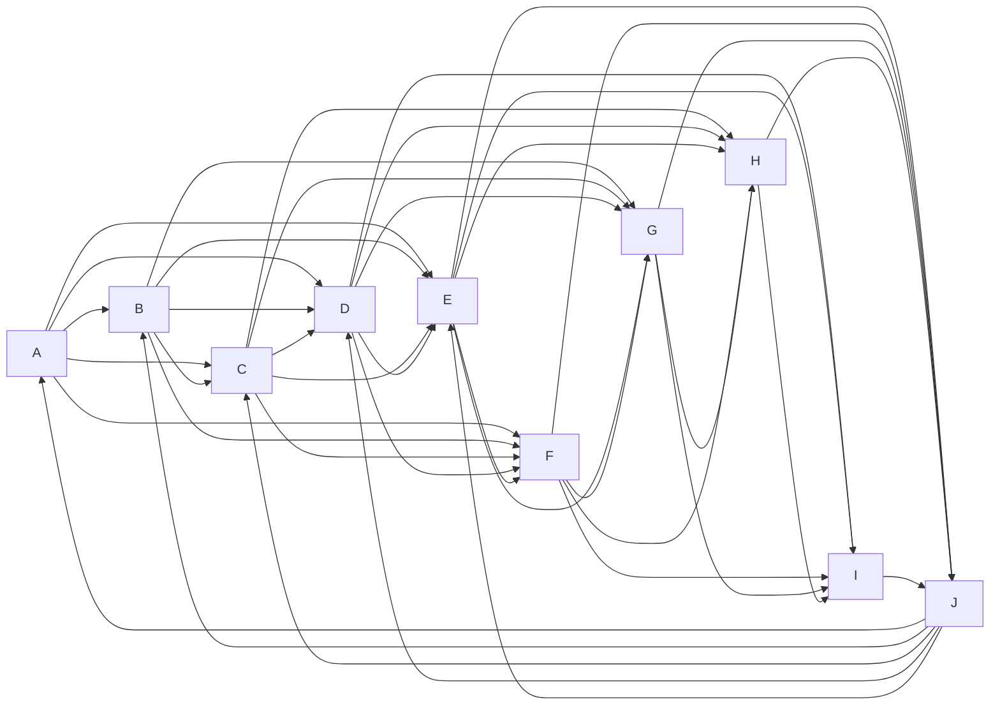

## 7. Six linked chains, a score of exactly 100

The diagram has 60 nodes and 80 edges, for a score of exactly 100.
The critical score rule fires only above `vcsComplex`, so the score lands in the acceptable band.
The linter reports `complexity-node-count-cognitive-limit` and `complexity-visual-score-acceptable-exceeded`.

The fix draws an overview of the six chains, then the spine and each pair of linked chains on its own.
Nodes shared between diagrams are where they join.

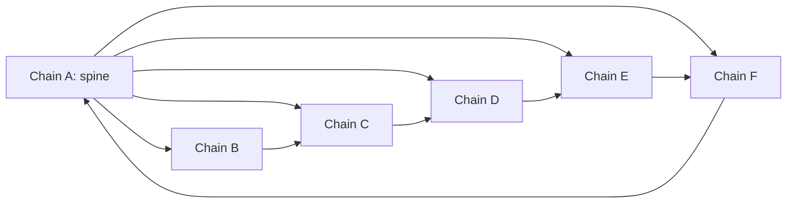

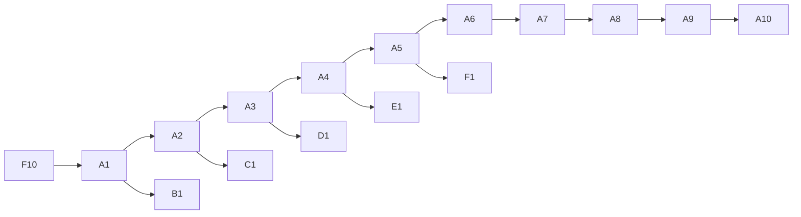

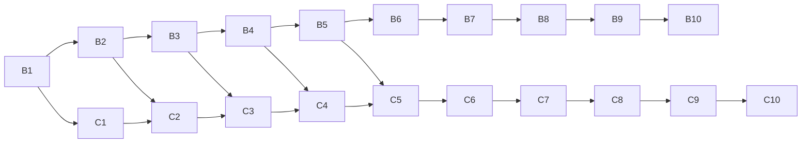

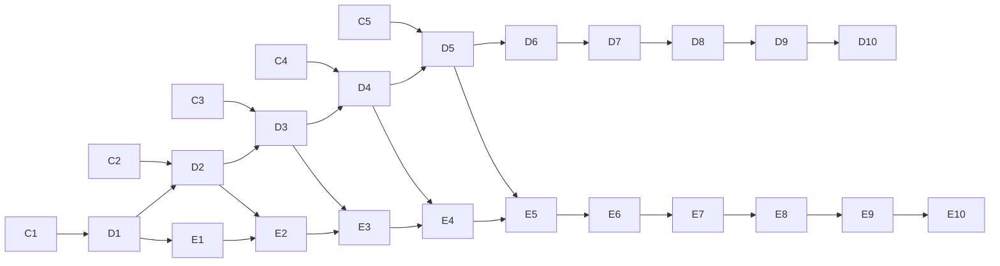

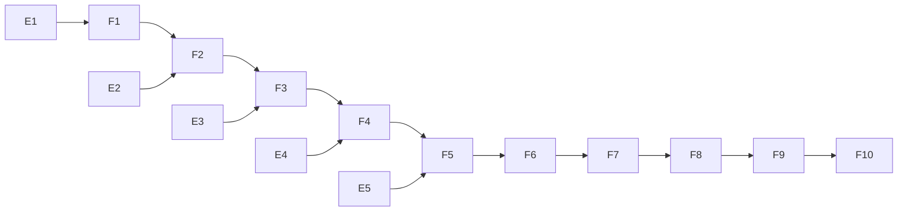

## 8. Subgraphs nested three deep

The diagram has two nodes inside three nested subgraphs.
Its counts are far under every threshold, but nesting has its own rule.
The linter reports `complexity-subgraph-nesting-too-deep` alone.

The fix merges the inner level into the middle one, so the nesting is two levels deep.

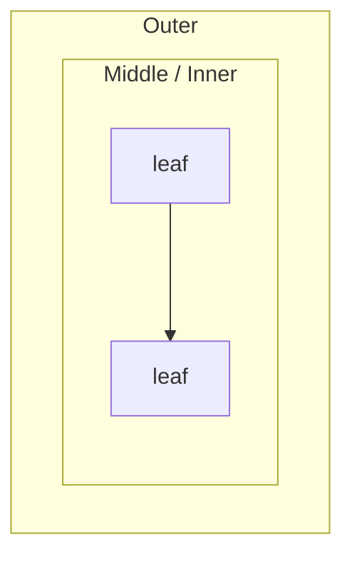

## 9. A `block` diagram that parses

This diagram opens with the `block` keyword rather than `block-beta`.
The mermaid-core parser reads it through a happy-dom shim, so no browser is needed.
It finds six blocks and three edges, and the linter reports nothing.
The case guards that parser path.
If it broke, the diagram would read as zero nodes and be reported as `parse-diagram-unparseable`.

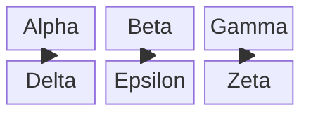

## 10. Four named subgraphs to split along

The diagram has 52 nodes in four subgraphs named Ingress, Web, App and Data.
The linter reports `complexity-node-count-cognitive-limit`, and `complexity-visual-score-acceptable-exceeded` for a score of 98.5.
Both remediations name the subgraphs to split along, then the split plan the linter found, which folds each subgraph into one group:

```text
Split into sub-diagrams along existing subgraph boundaries: Ingress, Web, App, Data. Target at most 25 nodes and 40 VCS per sub-diagram. Split plan: an overview folding 4 groups (Data (13 nodes), Ingress (13 nodes), App (13 nodes), Web (13 nodes)), and one detail diagram per group.
```

A human or an LLM reading the finding can split on those names rather than guess.

The fix uses those four boundaries: an overview of how they hand off, then one diagram per subgraph.

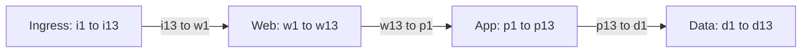

```mermaid
flowchart LR
  subgraph Ingress
    I1[i1] --> I2[i2] --> I3[i3] --> I4[i4]
    I4 --> I5[i5] --> I6[i6] --> I7[i7]
    I7 --> I8[i8] --> I9[i9] --> I10[i10]
    I10 --> I11[i11] --> I12[i12] --> I13[i13]
  end
```

```mermaid
flowchart LR
  subgraph Web
    W1[w1] --> W2[w2] --> W3[w3] --> W4[w4]
    W4 --> W5[w5] --> W6[w6] --> W7[w7]
    W7 --> W8[w8] --> W9[w9] --> W10[w10]
    W10 --> W11[w11] --> W12[w12] --> W13[w13]
  end
```

```mermaid
flowchart LR
  subgraph App
    P1[p1] --> P2[p2] --> P3[p3] --> P4[p4]
    P4 --> P5[p5] --> P6[p6] --> P7[p7]
    P7 --> P8[p8] --> P9[p9] --> P10[p10]
    P10 --> P11[p11] --> P12[p12] --> P13[p13]
  end
```

```mermaid
flowchart LR
  subgraph Data
    D1[d1] --> D2[d2] --> D3[d3] --> D4[d4]
    D4 --> D5[d5] --> D6[d6] --> D7[d7]
    D7 --> D8[d8] --> D9[d9] --> D10[d10]
    D10 --> D11[d11] --> D12[d12] --> D13[d13]
  end
```

---

## 11. Clean classDiagram (no findings)

`adaptClass` reads `db.classes` (a Map) and `db.relations` (an Array).

```mermaid
classDiagram
  class Animal {
    +String name
    +eat()
    +sleep()
  }
  class Dog {
    +String breed
    +bark()
  }
  class Cat {
    +purr()
  }
  Animal <|-- Dog
  Animal <|-- Cat
```

## 12. Clean sequenceDiagram (no findings)

`adaptSequence` reads `db.state.records.actors` (a Map) and `db.state.records.messages` (an Array).

```mermaid
sequenceDiagram
  actor User
  participant Gateway
  participant Service
  participant DB

  User->>Gateway: request
  Gateway->>Service: forward
  Service->>DB: query
  DB-->>Service: rows
  Service-->>Gateway: response
  Gateway-->>User: 200 OK
```

## 13. Clean stateDiagram-v2 (no findings)

`adaptState` reads the state diagram's nodes and edges.

```mermaid
stateDiagram-v2
  [*] --> Idle
  Idle --> Loading : fetch()
  Loading --> Ready : success
  Loading --> Error : failure
  Ready --> Idle : reset()
  Error --> Idle : retry()
  Ready --> [*]
```

## 14. Clean erDiagram (no findings)

`adaptEr` reads `db.entities` (a Map) and `db.relationships` (an Array).
The mermaid-core parser fills both under the happy-dom shim, so no browser is needed.

```mermaid
erDiagram
  CUSTOMER ||--o{ ORDER : places
  ORDER ||--|{ ORDER_LINE : contains
  ORDER_LINE }o--|| PRODUCT : "refers to"
  CUSTOMER ||--o{ ADDRESS : has
  ORDER }o--|| ADDRESS : "ships to"
  PRODUCT }o--|| CATEGORY : "belongs to"
```

## 15. Clean journey diagram (no findings)

```mermaid
journey
  title Morning routine
  section Wake up
    Open eyes: 3: Me
    Stretch:   4: Me
  section Kitchen
    Make coffee: 5: Me
    Check email: 2: Me
```

## 16. Clean mindmap (no findings)

```mermaid
mindmap
  root((System))
    Ingress
      CDN
      Load Balancer
    Compute
      API
      Worker
    Data
      Cache
      Primary DB
```

## 17. Clean gantt (no findings)

```mermaid
gantt
  title Release schedule
  dateFormat YYYY-MM-DD
  section Backend
    Design       :a1, 2026-01-01, 5d
    Implement    :a2, after a1, 10d
  section Frontend
    Wireframes   :b1, 2026-01-01, 4d
    Build        :b2, after b1, 12d
```

## 18. Clean pie (no findings)

The Langium grammar parses this one.

```mermaid
pie title Traffic by source
  "Organic search" : 45
  "Direct" : 25
  "Referral" : 15
  "Social" : 15
```

## 19. Clean timeline (no findings)

```mermaid
timeline
  title Project milestones
  2024 : Kickoff
       : Discovery
  2025 : Alpha release
       : Beta release
  2026 : GA
```

## 20. Clean xychart-beta (no findings)

```mermaid
xychart-beta
  title "Revenue by quarter"
  x-axis [Q1, Q2, Q3, Q4]
  y-axis "Revenue (USD)" 0 --> 1000000
  bar [250000, 420000, 680000, 910000]
```

## 21. Clean sankey-beta (no findings)

```mermaid
sankey-beta

source,target,value
Revenue,Salaries,400
Revenue,Infrastructure,150
Revenue,Marketing,120
Revenue,Reserves,80
```

## 22. Clean quadrantChart (no findings)

```mermaid
quadrantChart
  title Effort vs impact
  x-axis Low effort --> High effort
  y-axis Low impact --> High impact
  quadrant-1 Do now
  quadrant-2 Plan
  quadrant-3 Defer
  quadrant-4 Reconsider
  "Feature A": [0.7, 0.8]
  "Feature B": [0.3, 0.6]
  "Feature C": [0.2, 0.2]
  "Feature D": [0.8, 0.3]
```

## 23. Clean block-beta (no findings)

`adaptBlock` walks the block tree.
It leaves the synthetic `space` and `composite` wrappers out of the node count.

```mermaid
block-beta
  columns 3
  a["Alpha"]
  b["Beta"]
  c["Gamma"]
  d["Delta"]
  e["Epsilon"]
  f["Zeta"]
  a --> d
  b --> e
  c --> f
```

## 24. Clean C4Context (no findings)

`adaptC4` leaves out the synthetic top-level `global` boundary.

```mermaid
C4Context
  title System context — Acme Platform
  Person(customer, "Customer", "Uses the web and mobile apps")
  System(platform, "Acme Platform", "Core offering")
  System_Ext(payments, "Stripe", "Payment processor")
  Rel(customer, platform, "Browses & purchases")
  Rel(platform, payments, "Charges via API", "HTTPS/JSON")
```

## 25. Clean kanban (no findings)

```mermaid
kanban
  Todo
    task1[Task 1]
    task2[Task 2]
  Doing
    task3[Task 3]
  Done
    task4[Task 4]
    task5[Task 5]
```

## 26. Clean gitGraph (no findings)

The Langium grammar parses this one.

```mermaid
gitGraph
  commit id: "initial"
  commit id: "add tests"
  branch feature
  commit id: "draft impl"
  commit id: "polish"
  checkout main
  merge feature
  commit id: "release"
```

## 27. Clean packet-beta (no findings)

The Langium grammar parses this one.

```mermaid
packet-beta
  title TCP segment header (simplified)
  0-15: "Source port"
  16-31: "Destination port"
  32-63: "Sequence number"
  64-95: "Acknowledgement number"
```

## 28. Clean radar-beta (no findings)

The Langium grammar parses this one.

```mermaid
radar-beta
  axis Speed, Reliability, Cost, Security, UX
  curve baseline["v1 baseline"]{3, 4, 2, 3, 3}
  curve target["v2 target"]{4, 5, 3, 4, 4}
```

## 29. Clean treemap-beta (no findings)

The Langium grammar parses this one.

```mermaid
treemap-beta
  title Budget allocation
  "Engineering": 40
  "Product": 20
  "Design": 15
  "Operations": 15
  "Marketing": 10
```

## 30. Clean requirementDiagram (no findings)

`adaptRequirement` reads `db.requirements` and `db.elements` (both Maps) and `db.relations` (an Array).

```mermaid
requirementDiagram

requirement auth_req {
id: REQ_001
text: Users must authenticate before accessing protected resources
risk: high
verifymethod: test
}

element login_service {
type: service
}

login_service - satisfies -> auth_req
```
