# Complexity failures and recommended fixes

<!-- expect: complexity-node-count-acceptable-exceeded complexity-node-count-cognitive-limit complexity-node-count-hard-limit complexity-subgraph-nesting-too-deep complexity-visual-score-acceptable-exceeded complexity-visual-score-critical contrast-directive-unauditable parse-diagram-unparseable -->

This is the companion to `bands.md`.
Each section pairs a failing diagram with what the linter reports, a recommended remedy, and a passing diagram.
The examples use realistic system content, so each failure looks like one from a real project.
Check the file with the default `high-density` preset:

```bash
bunx @jpeakai/mermaidjs-lint tests/fixtures/complexity/recommendations.md
```

From a clone of this repo, `bun run src/bin.ts tests/fixtures/complexity/recommendations.md` does the same.

Every failing diagram reports findings, and every finding fails the run.
The passing diagrams report nothing, with one deliberate exception.
The overview in section 8 reports `contrast-directive-unauditable`, because its `compound` class sets `fill:` with no `color:`.
If any other passing diagram starts to report a finding, the recipe has drifted and this file needs updating.

## Recipe card

| Rule | First fix to try |
|---------|----------------|
| `complexity-node-count-acceptable-exceeded` | Group related nodes into a `subgraph`, or collapse a cluster of leaves into one node. |
| `complexity-node-count-cognitive-limit` | Split into an overview of about 12 nodes plus one detail diagram per subsystem. |
| `complexity-node-count-hard-limit` | Stop drawing. This is a dump, not a diagram. Pick a lens and a level of abstraction, then start again. |
| `complexity-visual-score-acceptable-exceeded` | Delete redundant edges. Introduce a mediating node, such as an API gateway, event bus or service mesh. |
| `complexity-visual-score-critical` | Split by lens (architecture, data flow, sequence), not just by component. Keep the nodes, and draw a different edge set per diagram. |
| `complexity-subgraph-nesting-too-deep` | Flatten to two levels. Move the innermost subgraph to its own diagram, or fold its name into the parent's label. |
| `parse-diagram-unparseable` | Fix the syntax error. `bands.md` holds a working diagram of each kind to compare against. |

The finding's own remediation also names the existing subgraphs to split along, when the diagram has any.

> **Another fix** for the two higher node count rules suits a system with several loosely coupled subsystems.
> Draw an overview whose nodes each point to one sub-diagram.
> See [section 8](#8-hierarchical-decomposition-with-sub-diagram-pointers) below.

## Pick the right diagram kind first

Many complexity findings come from using a `flowchart` for content that is not a flow.
Before drawing, ask what the diagram is for:

| Intent | Right diagram kind |
|--------|-------------------|
| Static component structure, service boundaries, module layout | `flowchart` or `architecture-beta` |
| Interaction over time between a few actors | `sequenceDiagram` |
| Data model entities and their relationships | `erDiagram` |
| Finite states and transitions | `stateDiagram-v2` |
| Concepts branching out from a root | `mindmap` |

The linter parses every kind above, and `bands.md` holds a clean example of each.
Picking the wrong kind still parses, so it shows up as a complexity finding instead.
A data model drawn as a `flowchart`, with an edge for every foreign key, inflates the score quickly.

---

## 1. Acceptable node count exceeded: a flat microservices catalogue

### Failing example

Every microservice is drawn beside the store it owns.
That is 18 services and 18 stores, so 36 nodes.
The services are real, but the flat layout hides which are platform pieces, domain services or third party integrations.

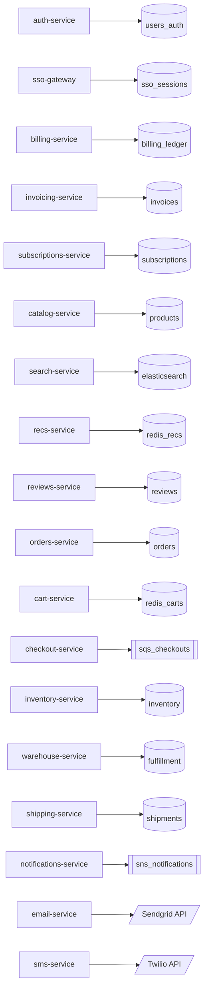

### What the linter reports

```text
complexity-node-count-acceptable-exceeded 36 nodes > 35 acceptable threshold
```

The 18 edges bring the score to 45, under `vcsAcceptable`, so no score rule fires.

### Recommendation

A list of 18 services and their stores is a catalogue, not an architecture diagram.
A reader cannot see structure at this density.
Two fixes work well:

1. **Group by business domain**.
   Most services fall into three to five domains, such as Identity, Commerce, Content, Fulfillment and Communications.
   Wrap each domain in a `subgraph`.
2. **Drop the store when it is implied**.
   Each service owning its own database is the microservices norm, so 18 copies of it say nothing.
   Draw a store only when services share it, or when its type is itself a design point.

### Passing example

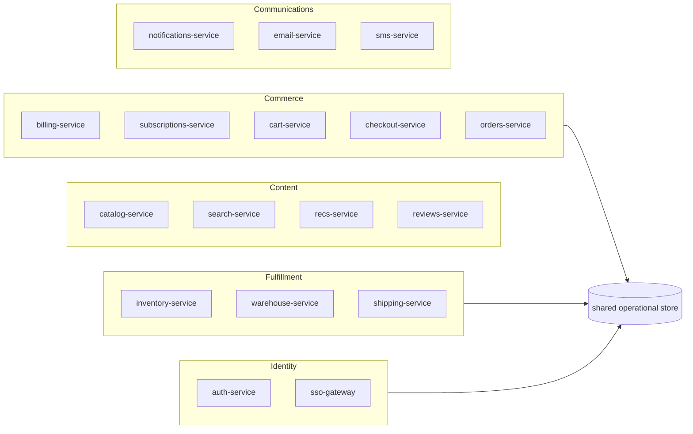

---

## 2. Cognitive limit exceeded: per-source pipeline stages

### Failing example

An ELT pipeline that forgot to abstract gives every SaaS source its own landing table, normaliser, enricher and publish target.
Ten sources in five stages plus one orchestrator make 51 nodes.

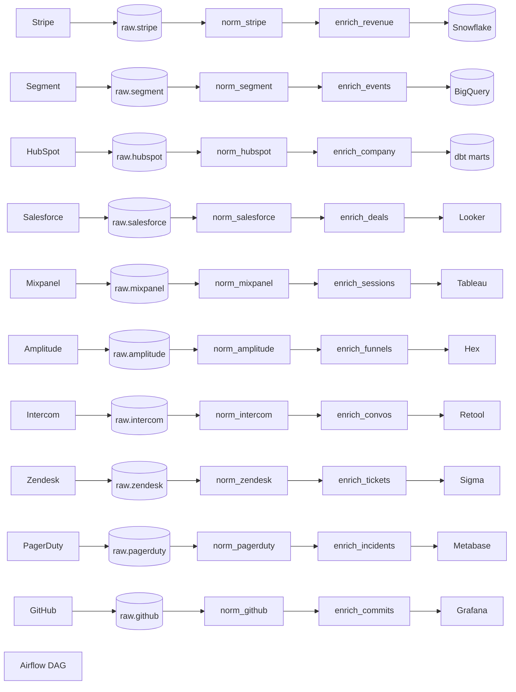

### What the linter reports

```text
complexity-node-count-cognitive-limit 51 nodes > 50 (Huang 2020 cognitive limit)
complexity-visual-score-acceptable-exceeded VCS 71.0 > 60 acceptable threshold
```

Two rules fire because node count and score are separate measures, each with its own ladder.
The 51 nodes and 40 edges cross the node limit and the score threshold at once.

### Recommendation

Huang and colleagues (2020) found that a node-link diagram gets hard to read at around 50 nodes.
Past that point, readers stop tracing paths and start matching patterns.
For pipeline diagrams the fix is nearly always the same: collapse the fan-out.
If a stage does the same thing to every source, draw that stage as one box.

Use two levels of detail:

1. Keep the 51-node pipeline in a detail section, inside a collapsed `<details>` block for engineers who need it.
2. Write a new overview of about 12 nodes that collapses each per-source stage into one stage.
   Place it above the `<details>` block.

### Passing example

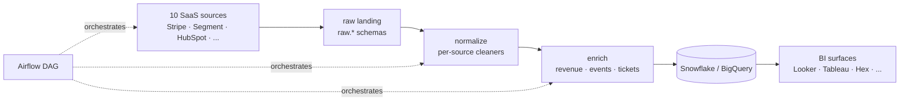

---

## 3. Hard limit exceeded: a full AWS footprint dump

### Failing example

An inventory of a mid-sized team's production AWS account, across tiers and availability zones, makes 101 nodes.
Mermaid renders it, but the image cannot be read at any screen size.


### What the linter reports

```text
complexity-node-count-hard-limit 101 nodes > 100 hard limit
complexity-visual-score-critical VCS 105.5 > 100 critical threshold
```

### Recommendation

Past the hard limit, no fix keeps the diagram.
The scope is wrong: it shows a whole account's resources at one level of abstraction.
That is an inventory, not architecture.

1. **Pick a lens**.
   Is it about request flow, deployment topology, cost or blast radius?
   The lens narrows what to draw.
2. **Pick a level**.
   Draw either an overview of about 12 actors, tiers or systems, or the detail of one subsystem in at most 35 nodes.
   Do not mix the two.
3. **Start again from an empty canvas** at the chosen lens and level.
   Trimming a 101-node inventory to 35 tends to keep the wrong things.

For the inventory itself, use a table or a resource tagging report, not a diagram.

### Passing example

The deployment lens at overview level shows what flows through the stack, and leaves out single instances:

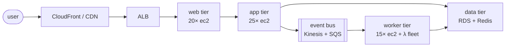

---

## 4. Acceptable score exceeded: a microservice mesh with no gateway

### Failing example

Fifteen microservices each call every other one directly, which is the classic mesh without a service mesh.
That is 105 edges.
The 15 nodes stay under every node threshold, but the edges make the diagram unreadable.

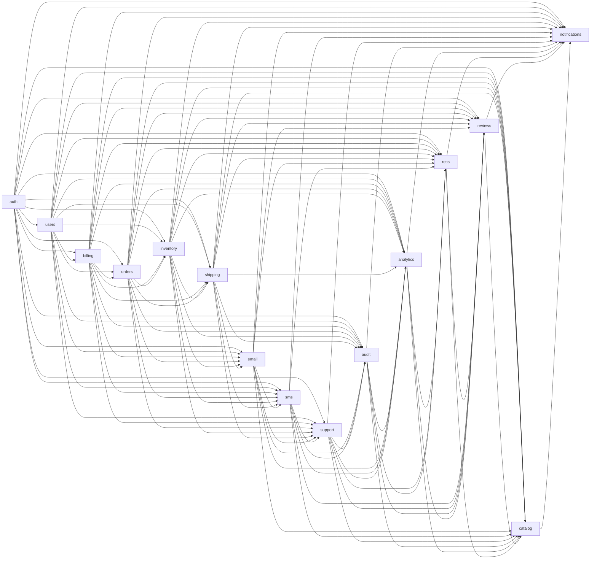

### What the linter reports

```text
complexity-visual-score-acceptable-exceeded VCS 67.5 > 60 acceptable threshold
```

### Recommendation

When every service touches every other one, the diagram is an adjacency matrix drawn with arrows.
The diagram fix mirrors the architecture fix:

1. **Introduce a mediating node**.
   Services should not call each other directly either.
   An API gateway or a service mesh such as Istio, Linkerd or Consul turns the full mesh into two fans.
2. **Bundle parallel edges**.
   If direct peer calls really are the topology, the ELK layout's `mergeEdges` option draws parallel edges as one stroke.
3. **Use an event bus**.
   If the calls are asynchronous, show services publishing to and subscribing from a stream instead.

### Passing example

The same 15 services behind a gateway and a mesh make 18 nodes and 17 edges:

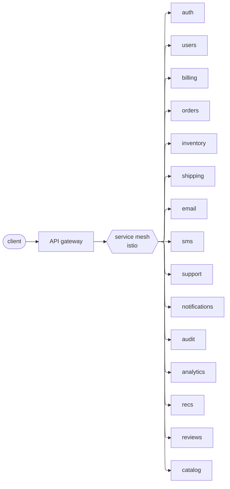

---

## 5. Critical score exceeded: a full-mesh monolith in progress

### Failing example

Twenty services are all coupled to each other.
This is a monolith being broken apart, where every extracted service still depends on every other one.
The 190 edges push the score past the critical threshold, though the 20 nodes are fine.

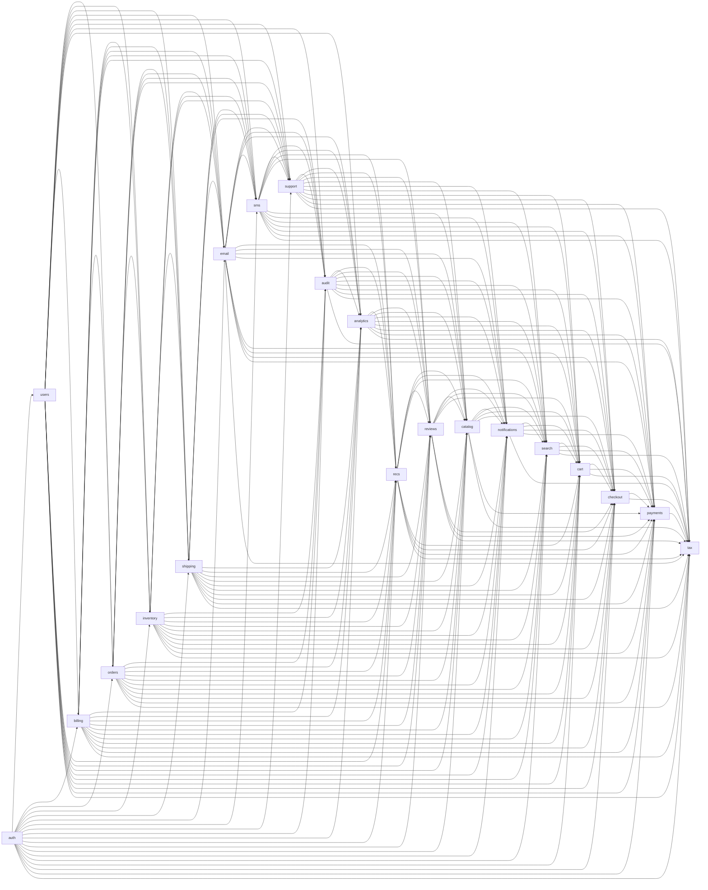

### What the linter reports

```text
complexity-visual-score-critical VCS 115.0 > 100 critical threshold
```

### Recommendation

A critical score means a reader would give up before finishing.
Split by lens, not by component count.
The same 20 services support three lenses:

- **Architecture:** what the components are, grouped, with parent and child edges only.
- **Sequence:** how one interaction, such as checkout, passes through some of them over time.
- **Data flow:** how one entity, such as an order, moves between stores.

Readers pick the lens that answers their question, and no single diagram tries to show all three.

### Passing example: architecture lens

Six domains hold the 20 services and tell the structural story:

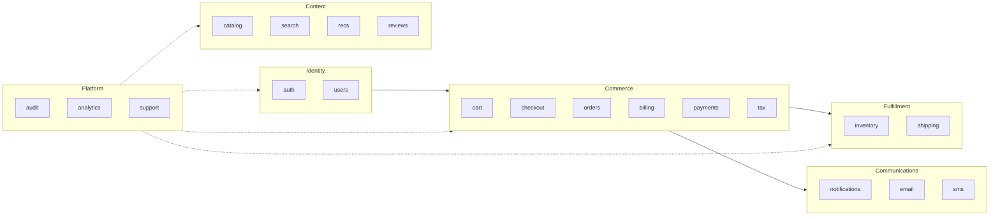

### Passing example: sequence lens

For the same system, the checkout interaction as a sequence diagram.
One workflow, read from top to bottom, is far clearer than every interaction on one flowchart:

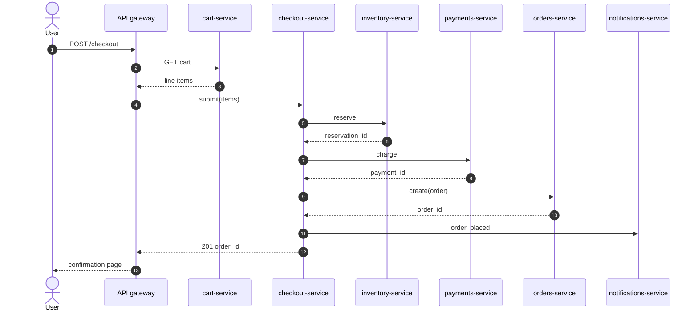

---

## 6. Subgraphs nested too deep: AWS organisation, account and region

### Failing example

A multi-account cloud topology nests three levels: organisation, then account, then region.
Past two levels, inner boundaries gain padding until the diagram is mostly white space.
Readers lose track of which container they are in.

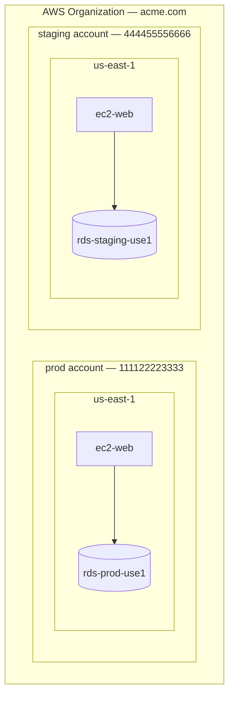

### What the linter reports

```text
complexity-subgraph-nesting-too-deep subgraph nesting depth 3 (at least 3) hinders readability
```

### Recommendation

Two fixes work well:

1. **Fold the inner level into the middle label**.
   A label such as `prod / us-east-1` replaces a nested region subgraph.
   The hierarchy still reads, without the extra box.
2. **Give each leaf its own diagram**.
   When regions differ in architecture, draw each region separately.
   Link them from a parent overview that shows only the organisation and its accounts.

### Passing example: compound labels, two levels deep

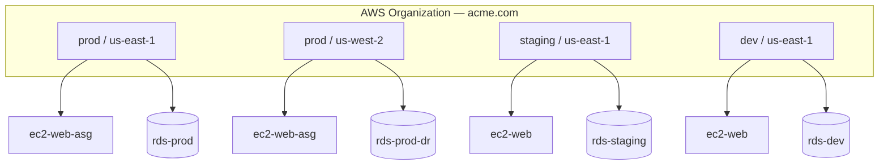

---

## 7. Unparseable diagram: an unknown keyword

### Failing example

Mermaid does not recognise the diagram keyword, so the parser reads zero nodes.

```mermaid
not_a_known_diagram_type
  alpha
  beta
```

### What the linter reports

```text
parse-diagram-unparseable not_a_known_diagram_type yielded 0 nodes from multi-line source (parser: mermaid-core): No diagram type detected matching given configuration for text: not_a_known_diagram_type
```

The complexity rules skip a diagram that fails to parse.
Counts from a failed parse mean nothing, so any threshold check against them would mislead.

### Recommendation

Every diagram kind in `bands.md` parses cleanly, from `flowchart` to `requirementDiagram`.
If your diagram of one of those kinds fails and the fixture does not, the cause is in your syntax, not in the tool.

Common causes:

| Cause | Fix |
|-------|-----|
| A typo in the diagram keyword, such as `flochart` | Spell it correctly |
| A `subgraph` with no matching `end` | Match them up |
| A grammar error, such as a hyphen in a `requirementDiagram` id like `REQ-001` | Follow the grammar, using the matching example in `bands.md` |
| Syntax newer than the mermaid version this tool bundles | Update the tool, or revise the diagram |

### Passing example: a valid flowchart

The same intent as the unknown keyword, written as a valid flowchart:

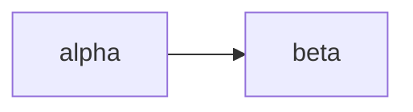

---

## 8. Hierarchical decomposition with sub-diagram pointers

This is an alternative to the two-level pattern in section 2.
When a system has several loosely coupled subsystems, each worth its own diagram, use an overview of compound nodes.
Each compound node has a dotted border and points to its own sub-diagram section below.
It works like a UML package diagram, drawn in mermaid.

### Failing example

A whole e-commerce platform is drawn as one diagram with every subsystem expanded.
It has 51 nodes and 25 edges, more than a reader can hold in mind.

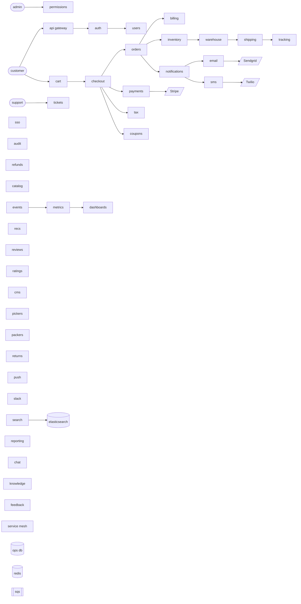

### What the linter reports

```text
complexity-node-count-cognitive-limit 51 nodes > 50 (Huang 2020 cognitive limit)
complexity-visual-score-acceptable-exceeded VCS 63.5 > 60 acceptable threshold
```

### Recommendation

When a system splits into four or more subsystems that each make sense alone, do not hide them together in one `<details>` block.
Give each its own diagram, and have the overview point at them.

Three mermaid features make this work:

| Feature | Purpose | Snippet |
|---------|---------|---------|
| `classDef` with `stroke-dasharray` | A dotted border that marks a node as detailed elsewhere | `classDef compound stroke-dasharray:5 5,stroke-width:2px,fill:#f5f5f5` |
| Markdown string labels | An italic "See Sub-Diagram X" line inside the label | `commerce["\`**Commerce**<br/>*See Sub-Diagram 2*\`"]` |
| `click` directive | Where the renderer allows it, makes the node a link to the sub-diagram's heading | `click commerce "#sub-diagram-2--commerce" "Commerce detail"` |

Each sub-diagram sits in its own section and has its own budget of at most 35 nodes and a score of at most 60.
Readers work top down: they see the overview, follow the node they care about, and land on a self-contained diagram.

### Passing overview: compound node pointers

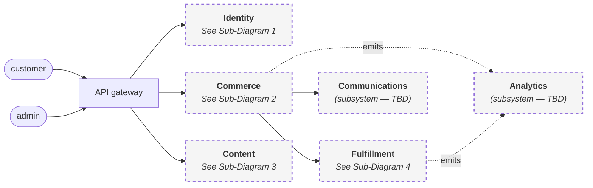

The overview has nine nodes, well under every threshold.
Dotted borders set the subsystem nodes apart from concrete nodes such as the gateway and the actors.
The `click` directives turn the rendered diagram into a table of contents.

This overview reports `contrast-directive-unauditable`.
The `compound` class sets `fill:` but no `color:`, so the label colour depends on the renderer's theme.
Under the `github` profile the linter cannot score it, and says so rather than pass it unchecked.
Adding a `color:` that reads on the fill clears the finding.

### Sub-Diagram 1 / Identity

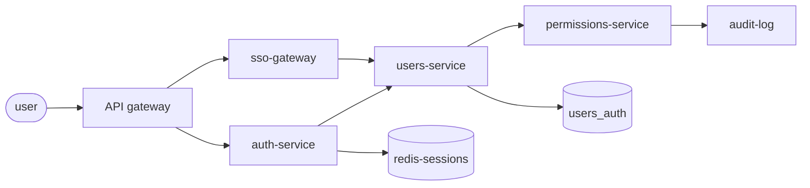

### Sub-Diagram 2 / Commerce

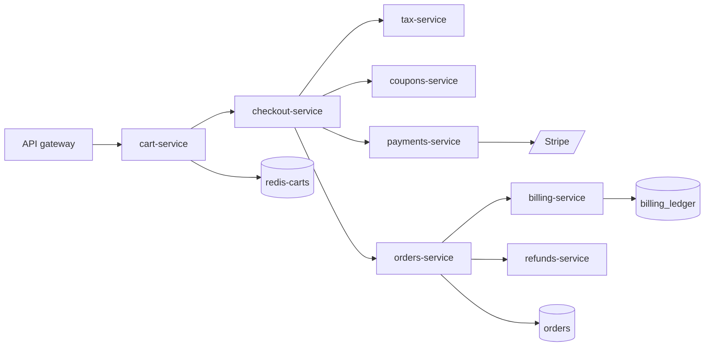

### Sub-Diagram 3 / Content

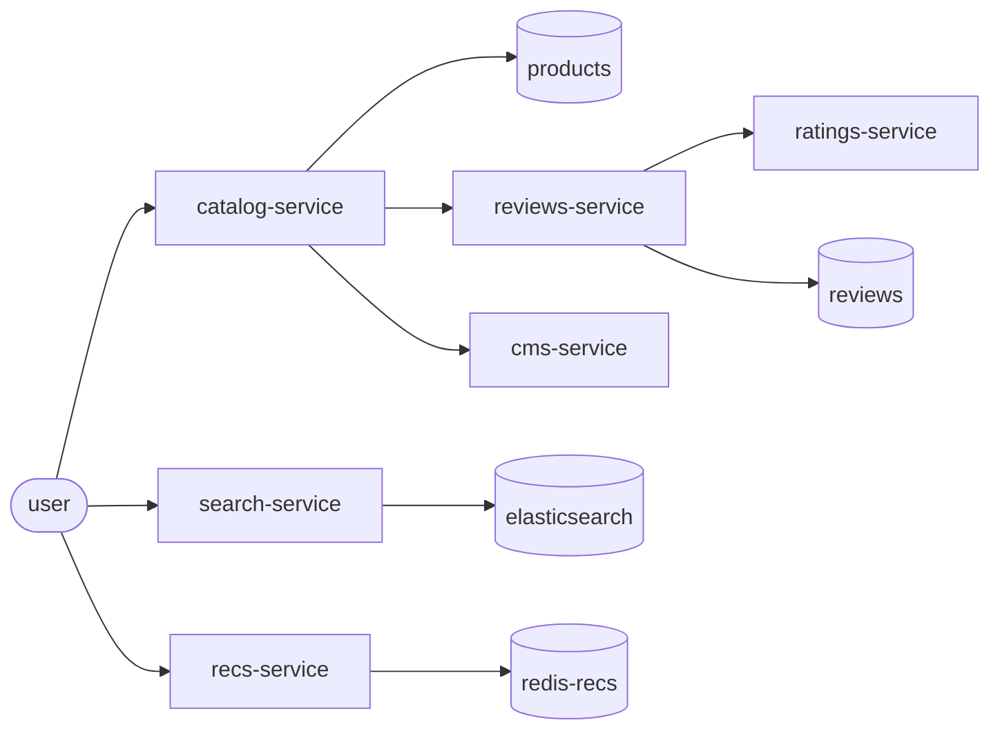

### Sub-Diagram 4 / Fulfillment

```mermaid
flowchart LR
  orders[orders-service] --> inventory[inventory-service]
  inventory --> warehouse[warehouse-service]
  warehouse --> pickers[pickers-team]
  pickers --> packers[packers-team]
  packers --> shipping[shipping-service]
  shipping --> tracking[tracking-service]
  tracking --> returns[returns-service]
  inventory --> inventory_db[(inventory)]
  shipping --> shipping_db[(shipments)]
```

### Trade-offs against two levels of detail

| Criterion | Two levels (section 2 fix) | Hierarchical decomposition (section 8 fix) |
|-----------|----------------------|--------------------------------------|
| When to pick | One diagram with one natural overview and detail split | Several loosely coupled subsystems, each worth its own diagram |
| Upkeep | Low: two diagrams in one section | Higher: one section per subsystem, each with its own budget, and anchors to keep in sync |
| Reading | The reader sees all the detail on expanding it | The reader follows links and never sees all the detail at once |
| Fit for a README | Excellent, since the collapsed detail keeps the page short | Better in a dedicated architecture page than on a README landing page |
| How the linter scores it | Each diagram on its own, both within budget | Each sub-diagram on its own, with a deliberately tiny overview |
| Breaks when | The detail passes 35 nodes even after collapsing | A new subsystem is added without its own sub-diagram section |

Use two levels of detail by default.
Reach for hierarchical decomposition when the detail diagram passes 35 nodes, or covers four or more clearly separate subsystems.
Either signal means the diagram has outgrown a single section.
