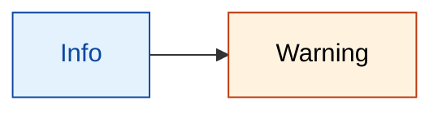
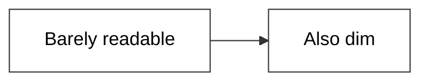
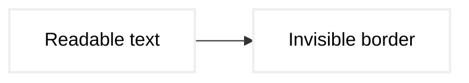
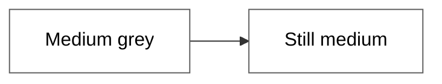
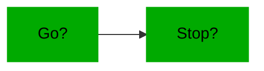
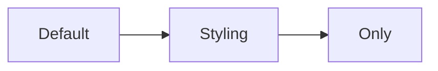
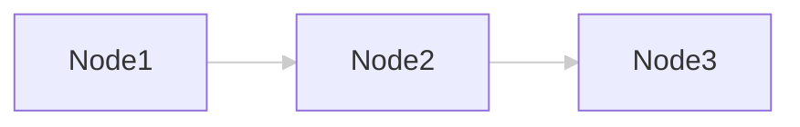
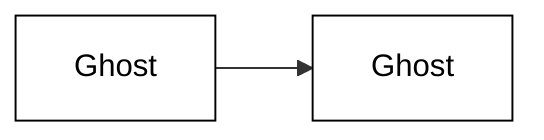
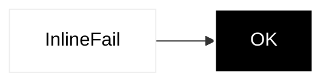

# Contrast scenarios

<!-- expect: contrast-border-below-ui-minimum contrast-text-below-aa parse-diagram-unparseable -->

Each mermaid fence below is a named scenario for the contrast rules.
They score every `classDef` and `style` directive against WCAG AA:

- **Label text** (`color:` on `fill:`) must reach 4.5:1, or `contrast-text-below-aa` fires.
- **Borders** (`stroke:` on `fill:`) must reach 3:1, or `contrast-border-below-ui-minimum` fires.

No `mkdocs.yml` sits above this folder, so the default `auto` profile reads it as `github`.
Under that profile, the declared `color:` is the label colour a reader sees.
Check the file with:

```bash
bunx @jpeakai/mermaidjs-lint tests/fixtures/contrast/scenarios.md
```

From a clone of this repo, `bun run src/bin.ts tests/fixtures/contrast/scenarios.md` does the same.
Every finding fails the run, so the command exits 1, and it exits 0 only when nothing is reported.

## What the linter reports

| Section | Scenario | Text | Border |
|---|---|---|---|
| 1 | White on navy | passes | passes |
| 2 | Dark text on pastel, beside orange on cream | `accent` fails, 3.46:1 | passes |
| 3 | Light grey on white | fails, 2.85:1 | passes |
| 4 | Pale stroke on white | passes | fails, 1.16:1 |
| 5 | Mid grey on white | fails, 3.95:1 | passes |
| 6 | Red on green | fails, 1.28:1 | fails, 1.00:1 |
| 7 | Four classes, two failing | `badText` fails, 1.07:1 | `badBorder` fails, 1.09:1 |
| 8 | No style directives | nothing to score | nothing to score |
| 9 | `linkStyle` with no `color:` | not scored | not scored |
| 10 | Translucent white fill | passes | passes |
| 11 | Per-node `style` | node A fails, 1.36:1 | node A fails, 1.16:1 |
| 12 | Named colours, red on green | fails, 1.29:1 | fails, 1.00:1 |
| 13 | `oklch()` colours | not scored | not scored |

Section 13 reports `parse-diagram-unparseable` instead, because mermaid's parser rejects the diagram.

`--fix` rewrites a failing `color:` to black or white when that choice reaches 4.5:1.
It fixes every text finding here.
It leaves the border findings and the parse finding, because those need a person to choose.

---

## 1. Well above AA: white text on navy

Both the text and the border clear every threshold by a wide margin.
The linter reports nothing.


## 2. One class passes, one fails: pastel blue and cream orange

The `soft` class sets dark blue text on a pale blue fill, and passes both checks.
The `accent` class sets orange text on a cream fill, at 3.46:1.
The linter reports `contrast-text-below-aa` for `accent` alone.



## 3. Text fails AA: light grey on white

Light grey text (`#999999`) on a white fill reaches only 2.85:1, under the 4.5:1 bar.
The linter reports `contrast-text-below-aa`.



## 4. Border fails: a pale stroke

The stroke (`#EEEEEE`) on a white fill reaches only 1.16:1, under the 3:1 minimum for a border.
The text is black on white and passes.
The linter reports `contrast-border-below-ui-minimum` alone.



## 5. Large text only: between 3:1 and 4.5:1

The text reaches 3.95:1.
That passes WCAG AA for large text, but labels are not large text.
The linter holds every label to 4.5:1, so it reports `contrast-text-below-aa`.



## 6. Red on green: a colour blindness trap with poor contrast

Red text on a green fill is hard to tell apart for people with red-green colour blindness.
Its contrast is also poor, at 1.28:1.
The stroke is the same green as the fill, so the border reaches 1:1.
The linter reports both `contrast-text-below-aa` and `contrast-border-below-ui-minimum`.



## 7. Mixed classes: some pass, some fail

Four classes share one diagram, and two of them fail.
The linter reports `contrast-text-below-aa` for `badText` and `contrast-border-below-ui-minimum` for `badBorder`.
The passing classes stay silent, which shows that the rules score each class on its own.


## 8. No style directives: nothing to score

The diagram uses mermaid's default styling, with no `classDef` or `style`.
The contrast rules have nothing to score, and the linter reports nothing.



## 9. A `linkStyle` with no label colour is not scored

`linkStyle` colours edges, not nodes.
The contrast rules score a `linkStyle` only when it declares `color:`, the edge label text.
This one sets only the stroke, so it reports nothing, even though its edges are a pale grey.



## 10. Translucent fill: an alpha channel

`#FFFFFF80` is white at 50% opacity, so a reader sees it blended with the page.
Under the `github` profile, the linter blends the fill over GitHub's light and dark page backgrounds, then scores each result.
Black text and a black border pass on both, so the linter reports nothing.



## 11. A `style` directive on one node

`style` styles a single node rather than a reusable class.
The rules score it the same way as a `classDef`.
Node A fails both checks, at 1.36:1 for text and 1.16:1 for the border.
Node B passes both, so only node A is reported.



## 12. Named CSS colours, not just hex

`color:red` is valid CSS, and the rules resolve it like a hex value.
Named `green` is `#008000`, darker than the `#00AA00` in section 6.
So the ratios differ slightly: 1.29:1 for the text, and 1:1 for the border.
The linter reports `contrast-text-below-aa` and `contrast-border-below-ui-minimum`.


## 13. `oklch()` colours: the parser rejects them

OKLCH is a good colour space for building accessible palettes.
But mermaid's flowchart parser rejects the parentheses of `oklch()` inside a `classDef`.
The diagram reads as zero nodes, so the linter reports `parse-diagram-unparseable`.
No contrast finding is reported for it.
To use these colours, write them as hex.

```mermaid
flowchart LR
  classDef modern fill:oklch(0.25 0.05 250),color:oklch(0.98 0 0),stroke:oklch(0.98 0 0),stroke-width:2px
  A[Modern] --> B[Palette]
  A:::modern
  B:::modern
```
