# Diagram type gallery

<!-- expect: none -->

One example of each diagram type the linter can measure.
Most examples are adapted from mermaid's own demo pages and syntax docs.
Every diagram here must lint clean:

```bash
bunx @jpeakai/mermaidjs-lint tests/fixtures/gallery/diagram-types.md
```

From a clone of this repo, `bun run src/bin.ts tests/fixtures/gallery/diagram-types.md` does the same, and exits 0.

**Purpose**

- It guards the parse engine: if mermaid stops parsing a type, its diagram here reports `parse-diagram-unparseable`.
- It records which types parse through the Langium grammars in `@mermaid-js/parser`, and which through the older JISON grammars in mermaid core.
- It gives readers a one-page index of what mermaid can draw.

---

## Langium-parsed diagrams

These grammars return a typed syntax tree and need no DOM.

### architecture-beta

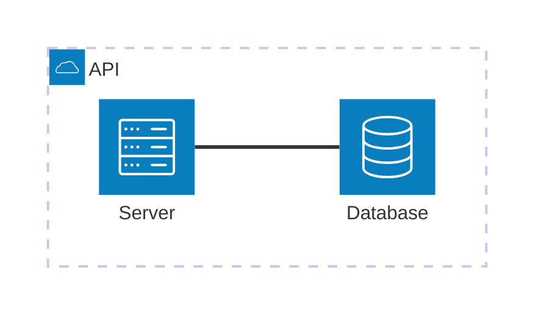

### gitGraph

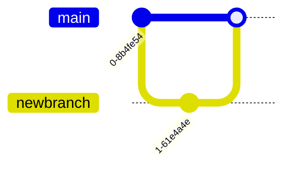

### info

`info` draws no nodes.
The parse rule flags a diagram the parser reports an error for, or a mermaid-core diagram read as zero nodes from several lines.
This one-line diagram is neither, so it passes.

```mermaid
info
```

### packet-beta

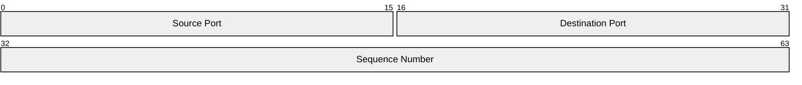

### pie

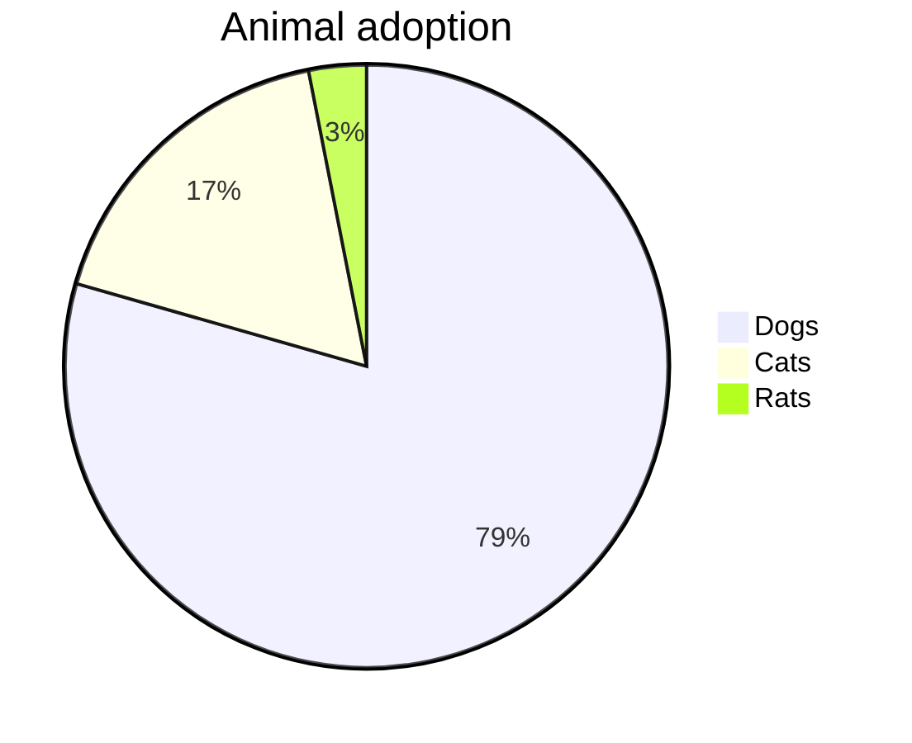

### radar-beta

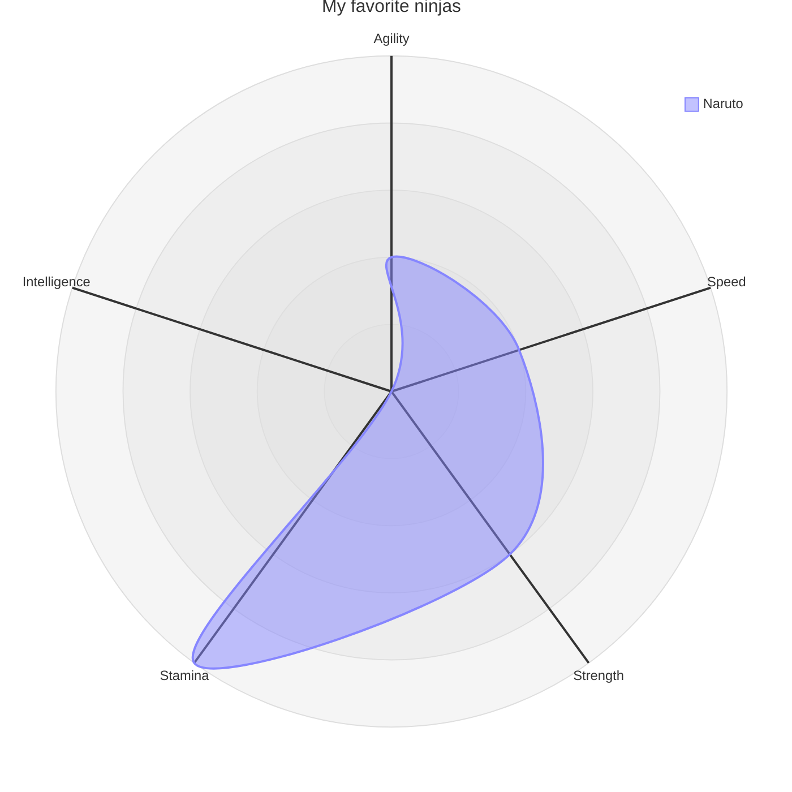

### treemap

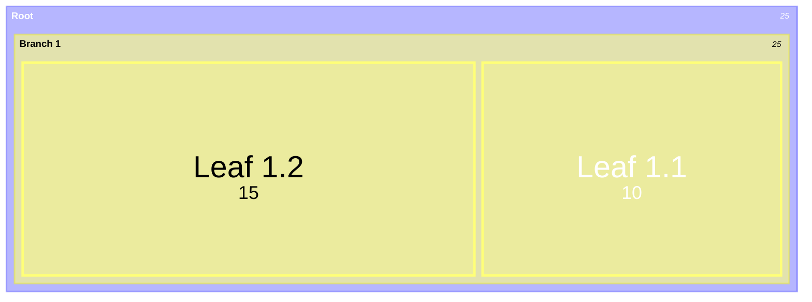

### treeView-beta

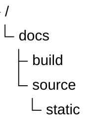

### wardley-beta

```mermaid
wardley-beta
  title Tea Shop
  anchor Business [0.95, 0.63]
  component Cup of Tea [0.85, 0.62] label [0, 0]
  component Tea Leaves [0.43, 0.12] label [0, 0]
  Business -> Cup of Tea
  Cup of Tea -> Tea Leaves
```

---

## JISON-parsed diagrams

The older grammars in mermaid core expect a browser.
The linter runs them under a happy-dom shim, then reads each type's parsed result.

### block

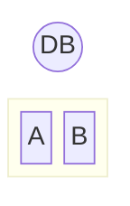

### C4Context

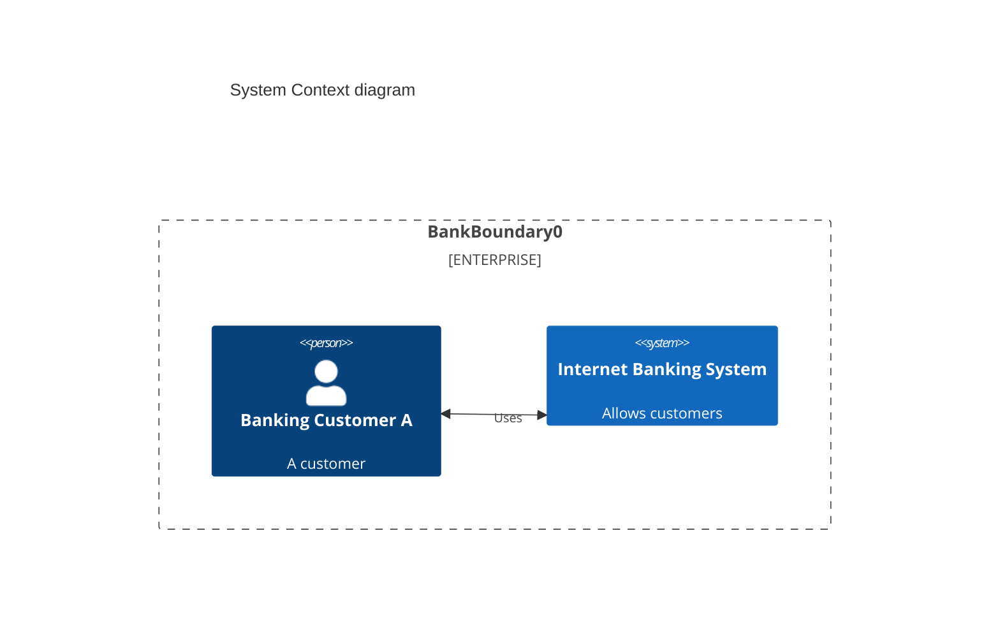

### classDiagram

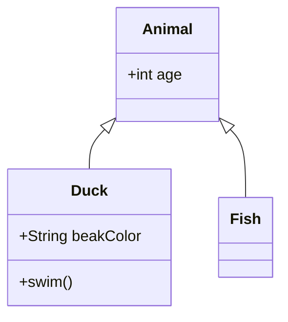

### erDiagram

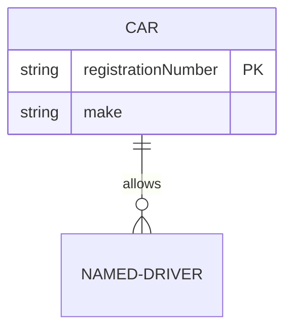

### flowchart

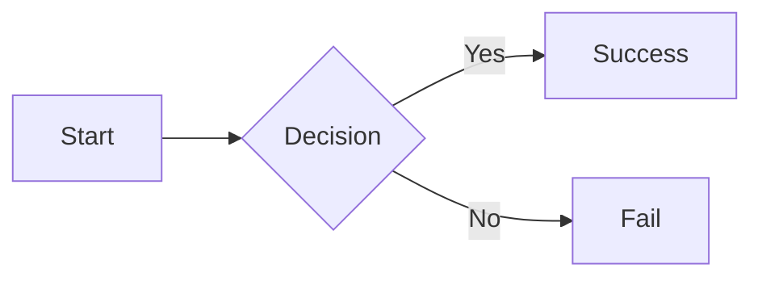

### gantt

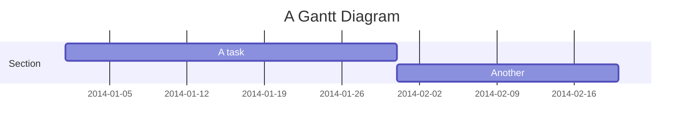

### ishikawa-beta

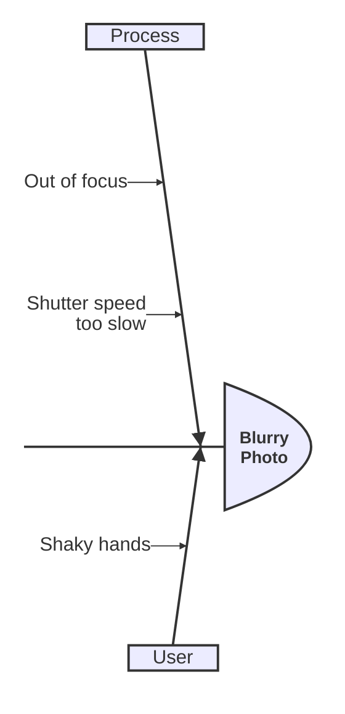

### kanban

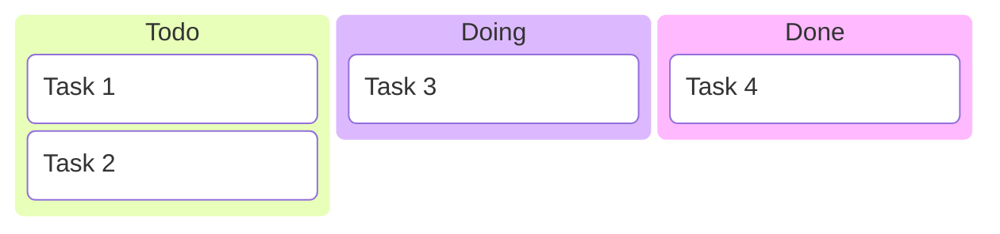

### mindmap

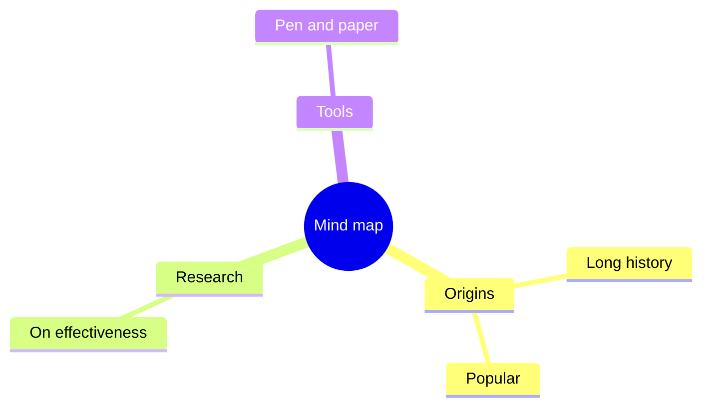

### quadrantChart

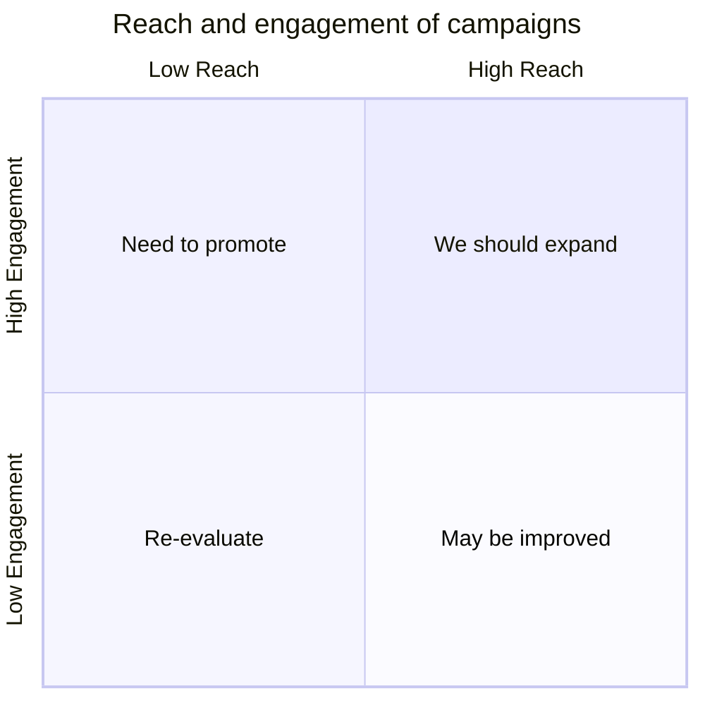

### requirementDiagram

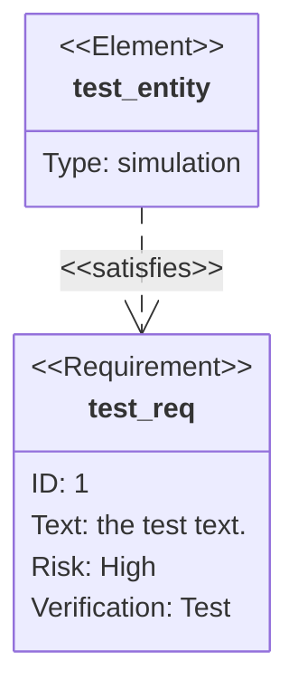

### sankey-beta

```mermaid
sankey-beta
iPhone,Products,205
Mac,Products,40
Products,Revenue,315
Services,Revenue,60
```

### sequenceDiagram

```mermaid
sequenceDiagram
  participant Alice
  participant Bob
  Alice ->> Bob: Hello Bob, how are you?
  Bob -->> Alice: Great, thanks!
```

### stateDiagram

```mermaid
stateDiagram-v2
  [*] --> Still
  Still --> Moving
  Moving --> Still
  Moving --> Crash
  Crash --> [*]
```

### timeline

```mermaid
timeline
  title History of Social Media
  section 2002-2006
    2002 : LinkedIn
    2004 : Facebook
  section 2007-2009
    2007 : iPhone
```

### journey

```mermaid
journey
  title My working day
  section Go to work
    Make tea: 5: Me
    Go upstairs: 3: Me
    Do work: 1: Me, Cat
  section Go home
    Go downstairs: 5: Me
    Sit down: 5: Me
```

### venn-beta

```mermaid
venn-beta
  title Very Basic Venn Diagram
  set A
  set B
  union A,B["AB"]
```

### xychart-beta

```mermaid
xychart-beta
  title Sales Revenue
  x-axis [jan, feb, mar]
  y-axis Revenue 4000 --> 11000
  bar [5000, 6000, 7500]
  line [5000, 6000, 7500]
```
