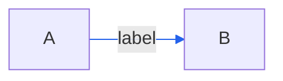

# White edge label text

<!-- llm: An edge label sits on a light box in one theme and a grey box in the other, and no one colour reads on both, so the linkStyle keeps its stroke and leaves the label text to the theme. -->

