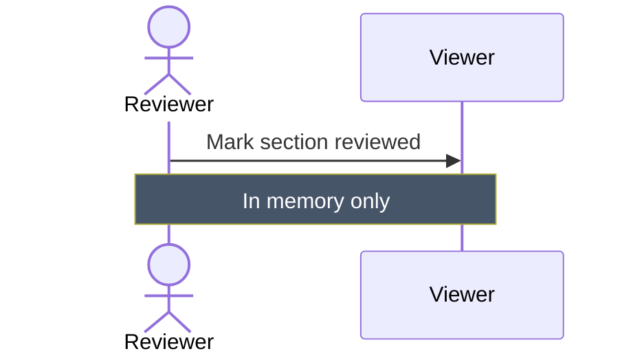

# Sequence message text tuned for a light page

<!-- llm: Message text, arrows and the human actor's label sit on the page, so they keep the theme's own colours, which flip with the reader. The note keeps its own box, where white on slate reads in both themes. -->

