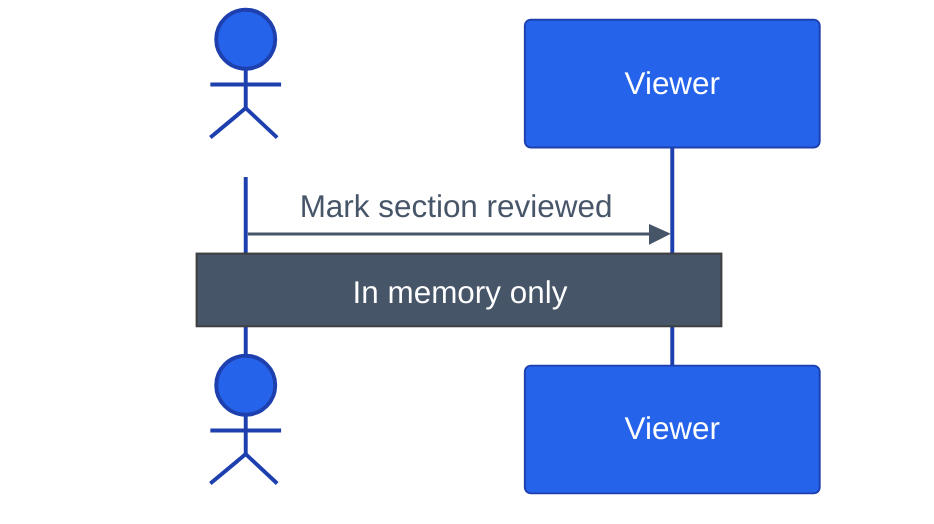

# Sequence message text tuned for a light page

<!-- expect: contrast-text-below-aa contrast-border-below-ui-minimum -->

A sequence diagram pins the `base` theme and sets slate message text and arrows.
They read on a white page but fade on a dark one, because the SVG is transparent and messages sit on the page.
The human actor's white label sits on the page too, so it vanishes in light.

