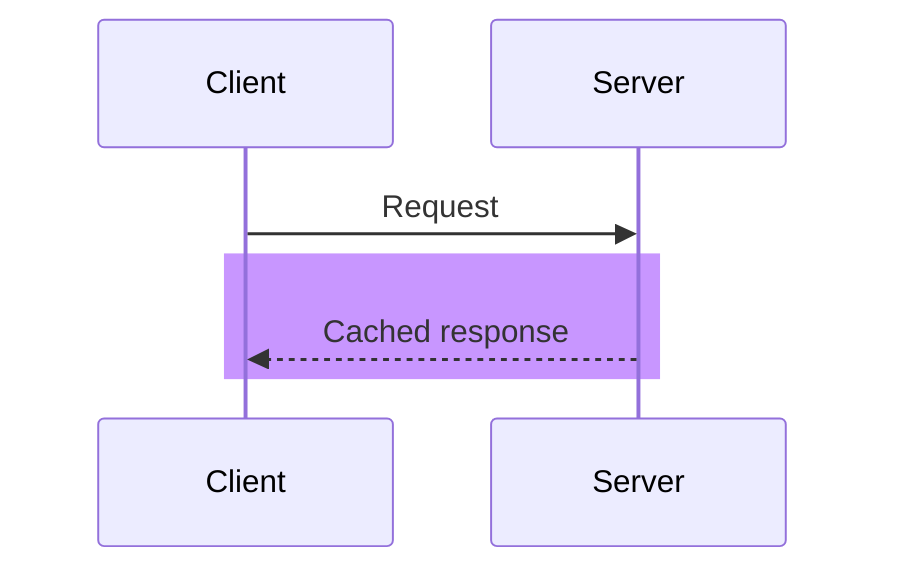

# Sequence rect in a light colour

<!-- expect: contrast-text-below-aa contrast-border-below-ui-minimum -->

A `rect` paints a light lilac behind its messages.
In dark the theme draws message text and arrows in light grey, which vanish on it.

