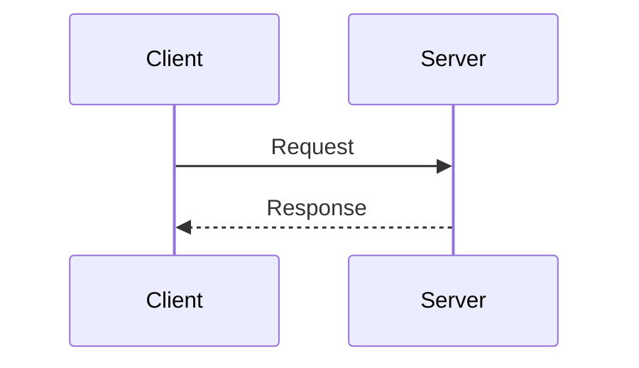

# Sequence colours set by themeCSS

<!-- llm: Message text sits on the page, and one fixed colour fades in one theme, so the CSS goes and the theme's own message colour, which flips with the reader, stays. -->

