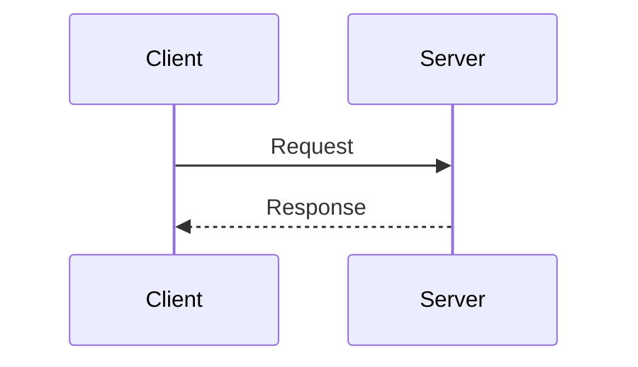

# Sequence colours set by themeCSS

<!-- expect: contrast-directive-unauditable -->

A sequence diagram restyles its message text with `themeCSS`.
The audit reads theme variables, not CSS, so it cannot score the result.

