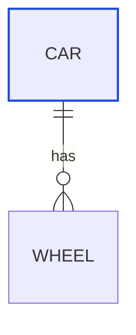

# White label on white fill

<!-- llm: An entity draws rows on light and dark backgrounds, and no one label colour reads on all of them, so the class marks the entity with a border and leaves the rows to the theme. -->

