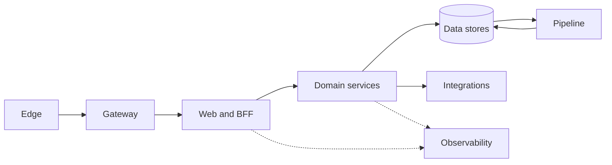
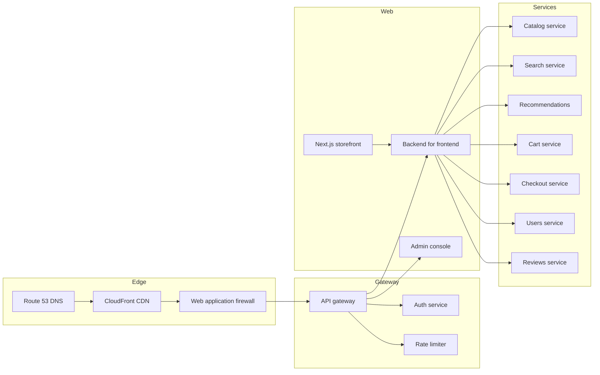
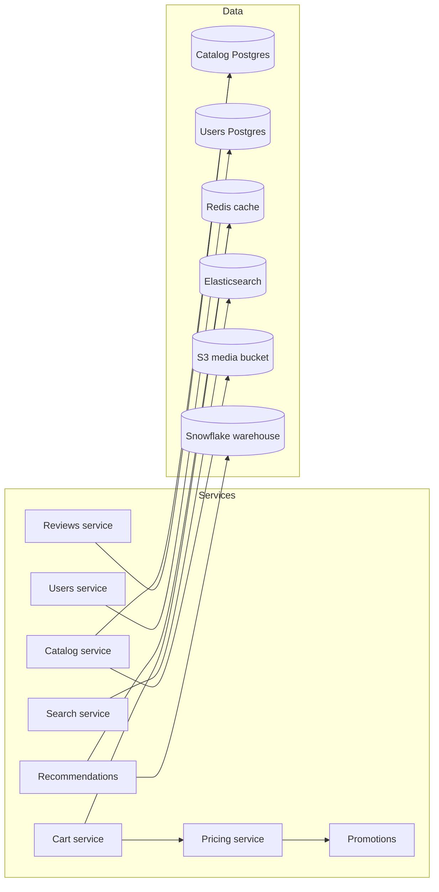
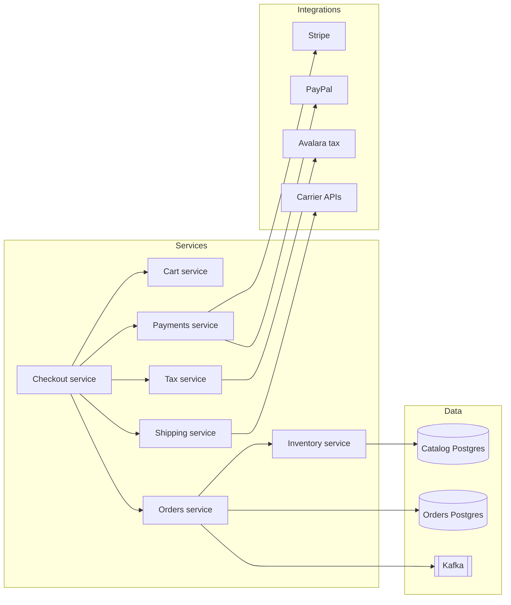
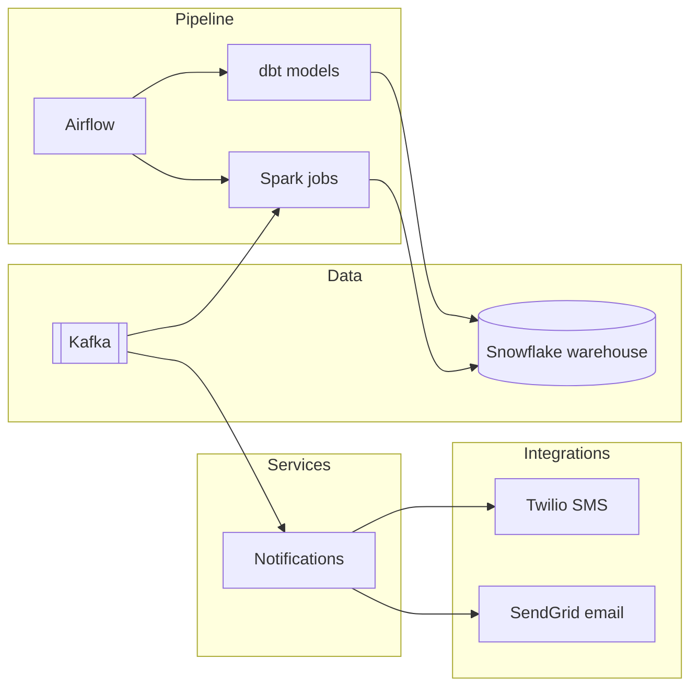
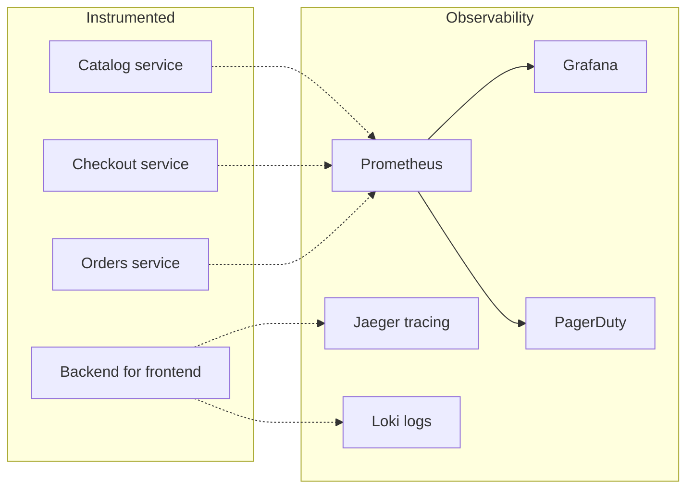

# Storefront platform architecture

<!-- llm: One 46-node diagram was too dense to read, so it became an overview of the eight layers plus five smaller diagrams, one per path through the system, which together keep every node and every connection. -->

This document describes the production topology of the storefront platform.
It covers the edge, the API layer, the domain services, the data stores and the third-party integrations.
It also covers the asynchronous pipeline and the observability stack.
The original diagram was exported from the infrastructure inventory and had grown with every service added.
The linter reported two findings on it: `complexity-node-count-acceptable-exceeded` for 46 nodes, and `complexity-visual-score-critical` for a score of 106.2.
The fix splits it into an overview of the layers and one diagram per path, so each reads on its own and lints clean.

## Overview

## Request path

## Browse and cart

## Checkout and orders

## Asynchronous pipeline

## Observability

The diagrams are used in onboarding, in architecture reviews, and in incident retrospectives.
Each audience needs a different amount of them.
